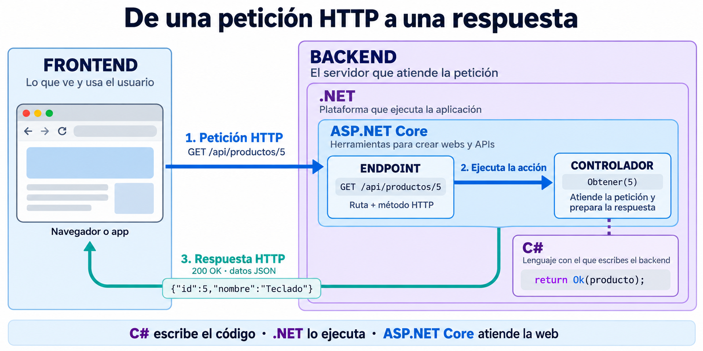

# 📘 Guía de Iniciación a .NET (Backend)

> **Resumen:** Notas técnicas sobre el ecosistema .NET, sintaxis moderna de C\# y patrones para desarrollo backend.
> **Versión:** Referencia actualizada para .NET 10 LTS (Long Term Support) y C\# 14 (octubre de 2026).

## 1. .NET Framework vs .NET moderno: diferencias e historia

### Vista rápida

- **.NET Framework (2002):** plataforma original para Windows. Sigue existiendo para aplicaciones heredadas; versión 4.8.1.
- **.NET Core (2016–2019):** rediseño abierto y multiplataforma. Versiones 1.0–3.1.
- **.NET (desde 2020):** continuación unificada de .NET Core. Para proyectos nuevos, es la opción habitual.

| Versión | Dónde funciona | Qué la caracteriza | Soporte a octubre de 2026 / uso recomendado |
|---|---|---|---|
| **.NET Framework 4.8.1** | Windows | Plataforma original; usada por aplicaciones Windows, ASP.NET clásico y Web Forms. | Se mantiene según la versión de Windows. Elegirla para mantener sistemas existentes o dependencias que la requieran. |
| **.NET 6** | Windows, Linux, macOS | Consolidó la plataforma multiplataforma e introdujo mejoras como Minimal APIs y Hot Reload. | Soporte terminado en noviembre de 2024. Migrar a una versión con soporte. |
| **.NET 8** | Windows, Linux, macOS | Mejoras de rendimiento y publicación; incorporó C# 12. | LTS hasta el 10-11-2026. Muy presente en proyectos actuales; planificar actualización. |
| **.NET 10** | Windows, Linux, macOS | Versión moderna más reciente de esta tabla; continúa las mejoras de rendimiento y herramientas; usa C# 14. | LTS hasta el 14-11-2028. Recomendado para proyectos nuevos. |

**LTS** significa soporte largo: 3 años de actualizaciones. **STS** significa soporte estándar: 2 años. Las versiones 6, 8 y 10 son LTS; el estado y las fechas cambian según la versión. Consulta la [política oficial de soporte de .NET](https://dotnet.microsoft.com/es-es/platform/support/policy/dotnet-core), las novedades de [.NET 6](https://learn.microsoft.com/es-es/dotnet/core/whats-new/dotnet-6), [.NET 8](https://learn.microsoft.com/es-es/dotnet/core/whats-new/dotnet-8/) y [.NET 10](https://learn.microsoft.com/es-es/dotnet/core/whats-new/dotnet-10), y el [ciclo de vida de .NET Framework](https://learn.microsoft.com/lifecycle/products/microsoft-net-framework).

> **Respuesta de entrevista:** .NET Framework 4.8.1 es la línea antigua para Windows. .NET 6, 8 y 10 pertenecen a la línea moderna, que funciona en varios sistemas operativos y recibe mejoras por versión. La diferencia principal entre 6, 8 y 10 es su fecha, las funciones incorporadas y el plazo de soporte; hoy elegiría .NET 10 para un proyecto nuevo y actualizaría .NET 6 u 8 porque su soporte ya terminó o está por terminar.

### ASP.NET y ASP.NET Core: la parte web de .NET

**ASP.NET** es el conjunto de herramientas de .NET para crear páginas web y APIs. Una **API web** permite que una aplicación pida o envíe datos a un servidor; por ejemplo, consultar productos desde una app móvil.

- **C#** es el lenguaje con el que escribes el código.
- **.NET** es la plataforma que permite ejecutarlo.
- **ASP.NET** aporta lo necesario para recibir peticiones web y responderlas.

| Familia | Se ejecuta sobre | Sistemas | Uso |
|---|---|---|---|
| **ASP.NET clásico (4.x)** | .NET Framework | Windows | Aplicaciones existentes con Web Forms, MVC o Web API |
| **ASP.NET Core 1–3.1** | Principalmente .NET Core | Windows, Linux, macOS | Primeras versiones de la línea moderna |
| **ASP.NET Core 5, 6, 8, 10…** | .NET moderno de la misma versión | Windows, Linux, macOS | Nuevas aplicaciones web y APIs |

**ASP.NET Core conserva «Core» en su nombre**, aunque .NET dejó de llamarse «.NET Core» desde la versión 5. Ejemplo: .NET 10 + ASP.NET Core 10.

Los nombres siguientes son formas de construir aplicaciones, no versiones consecutivas:

- **Web Forms:** páginas con controles y eventos; pertenece a ASP.NET clásico.
- **MVC (Modelo–Vista–Controlador):** separa los datos, la página que ve el usuario y el código que atiende la petición. Existe en ambas familias.
- **ASP.NET Web API:** herramienta del ASP.NET clásico para devolver datos, normalmente JSON.
- **APIs en ASP.NET Core:** pueden usar controladores o **Minimal APIs**, que definen las rutas directamente con menos código.
- **Razor Pages:** organiza una web por páginas y su código asociado; pertenece a ASP.NET Core.
- **Blazor:** permite crear interfaces web interactivas con C# y componentes.

Referencias: [ASP.NET clásico](https://learn.microsoft.com/aspnet/overview) y [ASP.NET Core](https://learn.microsoft.com/aspnet/core/overview?view=aspnetcore-10.0).

## 2\. 🛠️ Configuración y Entorno

Para empezar a trabajar con el ecosistema moderno de Microsoft.

  * **SDK:** herramientas para crear y compilar proyectos .NET. Descarga una versión LTS (Long Term Support): [.NET Download](https://dotnet.microsoft.com/es-es/download/dotnet).
  * **IDE Recomendado:** Visual Studio 2022 o 2026 (Community) o VS Code con la extensión **C\# Dev Kit**. [Visual Studio Download](https://visualstudio.microsoft.com/es/downloads/)

### Comandos Esenciales (CLI)

La terminal es tu amiga en .NET Core/.NET 5+.

```bash
dotnet --version            # Verificar instalación
dotnet new list             # Ver plantillas disponibles
dotnet new webapi -n MyApi  # Crear una API Web
dotnet new console -n App   # Crear aplicación de consola
dotnet run                  # Ejecutar proyecto
dotnet build                # Compilar proyecto
```

## 3\. ⌨️ Sintaxis y Sistema de Tipos

C\# es un lenguaje **tipado**: cada variable tiene un tipo que determina qué valores admite. Es **compilado**: el código se traduce antes de ejecutarse.

**¿Qué ocurre al ejecutar?** El compilador convierte C# a **IL** (*lenguaje intermedio*). El **runtime .NET** —el entorno que ejecuta la aplicación— carga ese código. Normalmente, el **JIT** (*compilador justo a tiempo*) traduce cada parte a instrucciones del procesador (código máquina) cuando hacen falta. Por eso, compilar C# no siempre produce un único ejecutable nativo.

### Fundamentos de Sintaxis y Control

La estructura básica de un programa es: `using` (importar bibliotecas), `namespace` (agrupador lógico), `class` (plantilla de objeto) y el punto de entrada, que en las aplicaciones modernas de Consola o Web API es implícito (**Top-Level Statements**).

  * **Datos Primitivos:** Cubiertos en el *Cheatsheet* (ej: `int`, `bool`, `char`).
  * **Funciones/Métodos:** Bloques de código reutilizables.
  * **Estructuras de Control:** `if/else`, `switch`, y bucles (`for`, `foreach`, `while`).

#### Cheatsheet de Tipos Básicos

```csharp
/*
   ┌─────────────────────────────────────────────────────────────┐
   │               C# TYPE SYSTEM CHEATSHEET 🧪                  │
   └─────────────────────────────────────────────────────────────┘
*/

// 1. NÚMEROS (NUMBERS)
int     entero      = 42;             // Estándar para contar (-2B a +2B)
long    gigante     = 9_000_000L;     // Entero de 64-bits (Nota el guion bajo y 'L')
double  cientifico  = 3.14159;        // Punto flotante estándar (Impreciso para $)
float   graficos    = 3.14f;          // Menor peso, usado en Unity/Juegos ('f')
decimal dinero      = 100.50m;        // ¡CRÍTICO! Alta precisión para finanzas ('m')

// 2. TEXTO (STRINGS)
char    letra       = 'A';            // Comillas simples, solo 1 carácter
string  texto       = "Hola Mundo";   // Comillas dobles estándar
string  json        = """             
                      {
                        "prop": "val" 
                      }
                      """;            // Raw String Literal (C# 11+): Ideal para JSON/XML multilínea

// 3. LÓGICA (BOOLEAN)
bool    esValido    = true;           // Ocupa 1 byte (teóricamente 1 byte)

// 4. FECHAS (DATES - MODERN .NET)
DateTime fechaHora  = DateTime.Now;             // 2025-10-05 14:30:00 (Pesado)
DateOnly soloFecha  = new DateOnly(2025,10,5);  // 2025-10-05 (Ligero - Recomendado si no usas hora)
TimeOnly soloHora   = new TimeOnly(14,30);      // 14:30 (Ligero)

// 5. IDENTIFICADORES & BYTES
Guid    idUnico     = Guid.NewGuid(); // a1b2c3d4-e5f6... (Ideal para Primary Keys)
byte    unByte      = 255;            // De 0 a 255 (Para manipulación de archivos/imágenes)
```

#### Declaración de Variables: `var` vs `dynamic` vs `const`

Esta es una pregunta clásica de entrevista.

  * **`var`**: Inferencia estática en **tiempo de compilación**. El tipo queda fijado y no cambia; no equivale a `dynamic`.
  * **`const`**: Valor inmutable. Debe asignarse al declararse.
  * **`dynamic`**: El tipo se comprueba mientras el programa se ejecuta. El compilador no puede detectar algunos errores antes; úsalo cuando sea necesario.

<!-- end list -->

```csharp
// ✅ Recomendado: El compilador sabe que es int
var edad = 25; 

// 🔒 Constante: Nunca cambiará
const double PI = 3.1416; 

// ⚠️ Peligroso: Si te equivocas, falla cuando el programa corre, no al compilar
dynamic datos = "Hola"; 
datos = 10; // Esto es válido en dynamic, pero daría error en var
```

#### `var` en C# vs JavaScript

| C# `var` | JavaScript `var` |
|---|---|
| El compilador infiere un tipo estático una vez | Puede contener valores de tipos distintos |
| Solo variable local con inicializador | Puede declararse sin inicializar; tiene alcance de función |
| `var x = 1; x = "a";` no compila | `var x = 1; x = "a";` es válido |

En JavaScript moderno suele preferirse `let` o `const`, cuyo alcance es de bloque.

#### Strings: Interpolación y Verbatim

  * **Interpolación (`$`)**: Insertar variables directamente.
  * **Verbatim (`@`)**: conserva barras y saltos tal como se escriben; una comilla se duplica (`""`). Útil para rutas de archivos

<!-- end list -->

```csharp
string nombre = "Ana";
// Combinando ambos (muy útil en rutas o JSON a mano)
string ruta = $@"C:\Usuarios\{nombre}\Documentos"; 
string texto = @"Primera línea
Segunda línea; ruta: C:\temp";
string json = @"{""activo"":true}"; // Comillas dobles duplicadas
```

`@"{}"` es una cadena literal de dos llaves; no interpola ni procesa escapes. Para interpolar, usa `$"{nombre}"`. En una cadena interpolada, las llaves literales se escriben `{{` y `}}`.

#### Nulabilidad: `?`, `?.` y `??`

- `string?`: referencia que puede ser `null` (con *nullable reference types* habilitados).
- `int?`: abreviatura de `Nullable<int>`; un tipo de valor que admite `null`.
- `?.`: acceso condicional; devuelve `null` si el receptor es `null`.
- `??`: valor alternativo si la expresión de la izquierda es `null`.

```csharp
string? nombre = null;
int? longitud = nombre?.Length;
int segura = longitud ?? 0;
```

`?` no añade una comprobación automática en ejecución para referencias: el compilador analiza nulabilidad y emite advertencias.

## 💾 Tipos de Valor vs Tipos de Referencia 

Esta es una de las cosas que más confunden cuando empiezas con C#. La idea clave es esta:

> **Cuando copias una variable… ¿se copia el contenido completo o solo el “acceso” a ese contenido?**

Vamos a verlo con una analogía muy simple.


### 1️⃣ Tipos de Valor → *Como una fotocopia en papel* 🧾

Un **tipo de valor guarda directamente el dato**.
Cuando asignas una variable a otra, se hace una **copia independiente**.

| Concepto | Explicación Simple | Analogía |
| :--- | :--- | :--- |
| **¿Qué guardan?** | Guardan **el dato directamente** (por ejemplo el número `10` o el valor `true`). | Una **fotografía en papel**. |
| **¿Dónde viven?** | Depende del contexto: pueden estar dentro de otro objeto o en la pila de llamadas (memoria temporal de los métodos activos). | Como una hoja guardada dentro de una carpeta o sobre el escritorio: depende de dónde esté el contenedor. |
| **Al copiar...** | Se crea una **copia nueva e independiente** del dato. | Haces **otra foto igual**, pero es una hoja distinta. |
| **Ejemplos** | Tipos simples como `int`, `bool`, `decimal` y estructuras (`struct`). | |

#### 🧠 Analogía

Es como hacer una **fotocopia de un documento**:

* Tienes el original
* Haces una copia
* Si escribes en la copia, **el original no cambia**

Son dos hojas completamente separadas.

#### ✅ Ejemplo simple en C#

```csharp
int vidasJugador1 = 3;
int vidasJugador2 = vidasJugador1; // Se copia el VALOR

vidasJugador2 = 1;

Console.WriteLine(vidasJugador1); // 3 ✅ No cambia
Console.WriteLine(vidasJugador2); // 1
```

Aunque partían del mismo número, ahora cada variable tiene su propio valor.


### 2️⃣ Tipos de Referencia → *Como un documento compartido en Google Drive* 🔗

Un **tipo de referencia no guarda el objeto en sí**, guarda una **referencia (dirección)** hacia ese objeto.

| Concepto | Explicación Simple | Analogía |
| :--- | :--- | :--- |
| **¿Qué guardan?** | Guardan una **referencia (dirección)** que apunta a un objeto. | Un **enlace a un archivo compartido**. |
| **¿Dónde viven?** | Normalmente, los objetos creados con `new` se guardan en el **heap** (zona donde .NET guarda y administra objetos). | Como un documento en un archivador; la variable conserva el acceso para encontrarlo. |
| **Al copiar...** | Se copia **la referencia**, no el objeto. Ambas variables apuntan al mismo. | Dos personas abren **el mismo archivo**. |
| **Ejemplos** | Clases (`class`), arrays, listas (`List<T>`), diccionarios, etc. | |

Cuando copias una variable:

* **No se crea una copia del objeto**
* Ambas variables apuntan **al mismo objeto**
* Si una lo modifica, **la otra ve el cambio**

#### 🧠 Analogía

Es como un **documento compartido online**:

* Dos personas abren el mismo archivo
* Si una escribe algo…
* La otra **ve el cambio al instante**

No hay dos documentos: hay **uno solo compartido**.

#### ✅ Ejemplo simple en C#

```csharp
public class Cuenta
{
    public int Saldo;
}

var cuenta1 = new Cuenta { Saldo = 100 };
var cuenta2 = cuenta1; // Se copia la REFERENCIA

cuenta2.Saldo = 500;

Console.WriteLine(cuenta1.Saldo); // 500 ✅ ¡Cambia también!
Console.WriteLine(cuenta2.Saldo); // 500
```

Aquí **no hay dos cuentas**, hay **una sola compartida por dos variables**.


### 📝 La diferencia en una frase

* ✅ **Tipos de Valor:** cada variable tiene su propio dato
* ⚠️ **Tipos de Referencia:** varias variables comparten el mismo objeto


### 📊 Resumen 

| Tipo           | ¿Qué se copia? | ¿Afecta al original? | Ejemplos                           |
| -------------- | -------------- | -------------------- | ---------------------------------- |
| **Valor**      | El dato        | ❌ No                 | `int`, `bool`, `decimal`, `struct` |
| **Referencia** | La dirección   | ✅ Sí                 | `class`, `array`, `List<T>`        |


## 4\. 🧬 Programación Orientada a Objetos (POO)

### ✍️ Convenciones de Nomenclatura (Estándar C\#)

Seguir estas convenciones de estilo es crucial para el *Clean Code* y la consistencia en proyectos .NET:

| Elemento | Convención | Estilo | Ejemplo | Acceso Sugerido |
| :--- | :--- | :--- | :--- | :--- |
| **Clases, Métodos, Propiedades, Namespaces** | **PascalCase** | `Public Name` | `public string NombreUsuario { get; set; }` | `public` |
| **Parámetros de Métodos, Variables Locales** | **camelCase** | `private name` | `void Proceso(int idUsuario)` | `var` / local |
| **Campos Privados (Fields)** | **\_camelCase** | `private _name` | `private int _stockMinimo;` | `private` |
| **Interfaces** | **PascalCase Prefijo I** | `Interface Name` | `public interface IRepositorio;` | `public` |

### Anatomía de una Clase Típica y Colecciones

Una **clase** es la plantilla para crear objetos.

  * **Creación de Objeto:** A diferencia de JavaScript, donde a veces puedes omitir `new`, en C\# la instancia de una clase siempre requiere **`new`** (excepto en DI). `var object = new Class();`

<!-- end list -->

```csharp
public class Producto
{
    // 1. Campo (Field) Variable interna de la clase, típicamente privada con convención _camelCase
    private int _stockMinimo = 5;

    // 2. Propiedad (Property): Encapsula el acceso al campo, controlando su lectura/escritura (pública con PascalCase)
    //    Usando 'auto-implemented property' (lo más común):
    public string Nombre { get; set; }

    // 3. Constructor: Método especial que se ejecuta al crear el objeto (con 'new').
    public Producto(string nombreInicial)
    {
        Nombre = nombreInicial;
    }

    // 4. Método (Method): Define la acción o comportamiento del objeto.
    public void AñadirStock(int cantidad)
    {
        // Lógica de negocio
        if (cantidad < 0) return;
        
        Console.WriteLine($"Añadiendo {cantidad} unidades a {Nombre}.");
    }
}

// Uso:
var lapiz = new Producto("Lápiz HB"); 
lapiz.AñadirStock(10);
}
```

#### Colecciones Básicas

Las colecciones te permiten agrupar datos:

  * **`array`:** Colección de tamaño fijo y del mismo tipo. `int[] numeros = new int[5];`
  * **`List<T>`:** Colección dinámica (genérica) del mismo tipo.
  * **`Dictionary<TKey, TValue>`:** Colección de pares clave-valor (genérica).
  * **`HashSet<T>`:** Colección sin orden y que garantiza que **no hay duplicados**.
  * **`Tuple`:** Tipo de valor que permite agrupar varios elementos relacionados de diferentes tipos. `(int id, string name) user = (1, "Anna");`

### Modificadores de Acceso y Sobrecarga

| Modificador | Acceso | Descripción |
| :--- | :--- | :--- |
| **`public`** | Ilimitado | Accesible desde cualquier parte del código. |
| **`private`** | Limitado | Solo accesible **dentro de la misma clase**. (Recomendado para campos internos). |
| **`protected`** | Limitado | Accesible dentro de la misma clase y por las **clases hijas (heredadas)**. |

#### Ejemplos de Modificadores de Acceso

```csharp
public class CuentaBancaria
{
    // 1. private: Solo accesible dentro de esta clase (Encapsulación).
    private decimal _saldo = 1000m; 

    // 2. protected: Accesible aquí y en clases que hereden de CuentaBancaria.
    protected decimal Interes = 0.05m; 

    // 3. public: Accesible desde cualquier lugar.
    public string NumeroCuenta { get; set; }

    // Método público que interactúa con el campo privado
    public decimal ObtenerSaldo() 
    {
        return _saldo;
    }
}

public class CuentaAhorro : CuentaBancaria
{
    public void CalcularInteres()
    {
        // ✅ Acceso permitido a 'protected' (Interes), porque es una clase hija.
        decimal nuevoInteres = this.ObtenerSaldo() * this.Interes;
        
        // ❌ Error de compilación si intentamos acceder a '_saldo' directamente,
        // porque '_saldo' es 'private' en la clase base.
    }
}

// Uso desde fuera de las clases:
var cuenta = new CuentaBancaria();
cuenta.NumeroCuenta = "12345";       // ✅ OK: Es public
// cuenta._saldo = 500m;             // ❌ Error: Es private
// decimal interes = cuenta.Interes; // ❌ Error: Es protected
```

### Sobrecarga de Métodos (Overloading)

La sobrecarga permite definir **múltiples métodos con el mismo nombre** dentro de una clase, siempre y cuando tengan **diferentes firmas**. La firma se define por el **número** o el **tipo** de sus parámetros.

> **Importante:** El tipo de retorno del método **no** es suficiente para diferenciar una sobrecarga.

#### Ejemplo de Sobrecarga

```csharp
public class Calculadora
{
    // Sobrecarga 1: Suma de dos enteros
    public int Sumar(int a, int b) 
    {
        return a + b;
    }

    // Sobrecarga 2: Suma de tres enteros (diferente número de parámetros)
    public int Sumar(int a, int b, int c) 
    {
        return a + b + c;
    }

    // Sobrecarga 3: Suma de dos decimales (diferente tipo de parámetros)
    public decimal Sumar(decimal a, decimal b) 
    {
        return a + b;
    }
}

// Uso: El compilador elige automáticamente qué método usar
var calc = new Calculadora();
var resultadoInt = calc.Sumar(5, 10);        // Llama a Sobrecarga 1
var resultadoDecimal = calc.Sumar(5.5m, 10m);  // Llama a Sobrecarga 3
```

### Clases y Herencia: `virtual` vs `override`

La **Herencia** permite que una clase hija adquiera las propiedades y métodos de una clase padre. Los conceptos `virtual` y `override` son la base del **Polimorfismo**.

| Palabra Clave | Uso | Propósito |
| :--- | :--- | :--- |
| **`virtual`** | Se define en el **método de la clase padre**. | Permite que este comportamiento **pueda ser modificado** (sobrescrito) por las clases que hereden de ella. |
| **`override`** | Se define en el **método de la clase hija**. | **Reemplaza** el comportamiento definido en la clase padre. |

**`base`** permite acceder desde la clase hija a la implementación de la clase padre. Se usa para reutilizar o ampliar su comportamiento; también puede llamar al constructor base con `: base(...)`.

#### Ejemplo de Código:

```csharp
public class Empleado
{
    // Este método es virtual, la clase hija PUEDE cambiarlo.
    public virtual string CalcularSalario() 
    {
        return "Salario base según contrato.";
    }
}

public class Manager : Empleado 
{
    // Usamos override para cambiar el comportamiento del padre.
    public override string CalcularSalario() 
    {
        return base.CalcularSalario() + " Más bonificación por objetivos.";
        // 'base' llama a la implementación original del padre.
    }
}

// Uso:
Empleado e = new Empleado();
Manager m = new Manager();

Console.WriteLine(e.CalcularSalario()); // Salario base según contrato.
Console.WriteLine(m.CalcularSalario()); // Salario base según contrato. Más bonificación...
```

### Interfaces

Definen un **contrato**. Una interfaz solo contiene las firmas de los métodos, propiedades, o eventos, pero **no su implementación**. La clase que implementa la interfaz *debe* proporcionar el código para esos miembros.

> **Importancia en Backend:** Las interfaces son vitales para la **Inyección de Dependencias (DI)**, ya que permiten trabajar con el *contrato* (`IProducto`) en lugar de la *implementación concreta* (`ProductoServicio`), facilitando los *mocks* en pruebas unitarias.

```csharp
public interface IGuardable
{
    // Define el contrato: debe haber un método Guardar sin implementación.
    void Guardar(string datos);
}

// La clase concreta implementa el contrato
public class RepositorioSql : IGuardable
{
    public void Guardar(string datos)
    {
        Console.WriteLine($"Guardando '{datos}' en la base de datos SQL.");
    }
}
```
## 5\. 🔗 Datos, Serialización y Funcional

### Serialización y Deserialización

Es el proceso de **convertir un objeto C\#** (como una instancia de una clase) **en un formato de transmisión** (como JSON o XML) y viceversa. Esto es fundamental para las API Web.

  * **Serialización:** `Objeto C#` $\rightarrow$ `JSON/XML` (Para enviar datos a un cliente).
  * **Deserialización:** `JSON/XML` $\rightarrow$ `Objeto C#` (Para recibir datos del cliente).

La biblioteca estándar para esto en .NET es **`System.Text.Json`**.

```csharp
// Serialización a JSON
var producto = new Producto("Teclado");
string json = System.Text.Json.JsonSerializer.Serialize(producto);
// Output: {"Nombre":"Teclado"}
```

### Controladores, endpoints y métodos HTTP



- **HTTP:** reglas que usan el navegador o una app para comunicarse con un servidor. Envías una petición y recibes una respuesta.
- **Controlador:** clase que agrupa las operaciones de una parte de la API. Por ejemplo, `ProductosController` atiende consultas y altas de productos. Es como una recepción: recibe la petición, pide el trabajo a los servicios necesarios y entrega la respuesta.
- **Acción:** método del controlador que atiende una petición. Por ejemplo, `Obtener`.
- **Endpoint:** punto de entrada a una operación de la API. Se identifica por el método HTTP y la ruta: `GET /api/productos/5`.

```text
La app pide: GET /api/productos/5
    → ASP.NET Core encuentra la ruta y el método HTTP
    → llama a Obtener(5) en ProductosController
    → el controlador devuelve una respuesta a la app
```

El **método HTTP** indica qué operación solicita el cliente. La **ruta** indica sobre qué datos:

| Método HTTP | Atributo en C# | Uso habitual | Ejemplo |
|---|---|---|---|
| `GET` | `[HttpGet]` | Consultar productos | `GET /api/productos` |
| `POST` | `[HttpPost]` | Enviar un producto para crearlo | `POST /api/productos` |
| `PUT` | `[HttpPut]` | Sustituir los datos de un producto | `PUT /api/productos/5` |
| `PATCH` | `[HttpPatch]` | Cambiar solo algunos datos | `PATCH /api/productos/5` |
| `DELETE` | `[HttpDelete]` | Eliminar un producto | `DELETE /api/productos/5` |

`GET /api/productos` y `POST /api/productos` son endpoints diferentes, aunque compartan la ruta. Estos atributos seleccionan el método que se ejecuta; el código de ese método realiza la operación.

**Ejemplo de controlador:** devuelve datos de muestra y recibe un producto, sin guardarlo en una base de datos.

```csharp
using Microsoft.AspNetCore.Mvc;

[ApiController]
[Route("api/productos")]
public class ProductosController : ControllerBase
{
    [HttpGet("{id}")] // GET /api/productos/5
    public IActionResult Obtener(int id)
    {
        return Ok(new { Id = id, Nombre = "Teclado" });
    }

    [HttpPost] // POST /api/productos
    public IActionResult Recibir([FromBody] ProductoEntrada producto)
    {
        return Ok(new { Recibido = producto.Nombre });
    }
}

public class ProductoEntrada
{
    public string Nombre { get; set; } = "";
}
```

- `[Route("api/productos")]`: parte común de las direcciones del controlador.
- `[HttpGet("{id}")]`: añade el identificador a esa ruta; el `5` de la URL llega al parámetro `id`.
- `[FromBody]`: convierte el JSON enviado en el cuerpo de la petición en un objeto C#. Aquí puedes enviar `{"nombre":"Ratón"}`.
- `ControllerBase`: clase de ASP.NET Core que aporta herramientas para responder, como `Ok(...)`.
- `IActionResult`: representa la respuesta HTTP. `Ok(...)` devuelve el código **200** (correcto) y los datos indicados, normalmente como JSON.
- `[ApiController]`: activa ayudas para APIs; por ejemplo, responde **400** (petición incorrecta) si los datos no superan la validación.

Para activar los controladores, añade en `Program.cs`:

```csharp
var builder = WebApplication.CreateBuilder(args);
builder.Services.AddControllers();
var app = builder.Build();
app.MapControllers();
app.Run();
```

Referencia: [APIs con controladores en ASP.NET Core](https://learn.microsoft.com/aspnet/core/web-api?view=aspnetcore-10.0).

### Swagger y OpenAPI

- **OpenAPI** es un formato estándar para describir una API: rutas, métodos (`GET`, `POST`), parámetros y respuestas. Suele publicarse como un archivo JSON.
- **Swagger** es el nombre de un conjunto de herramientas que usan esa descripción. **Swagger UI** la muestra como una página web y permite probar los endpoints desde el navegador.
- Flujo: API ASP.NET Core → documento OpenAPI → Swagger UI → explorar y enviar peticiones.
- En .NET 9 y posteriores, ASP.NET Core puede generar el documento OpenAPI integrado; para la página interactiva se añade una herramienta como Swagger UI. En .NET 6 y 8 es común encontrar Swashbuckle en las plantillas o proyectos existentes.
- Habilita la interfaz solo en desarrollo, salvo que el acceso esté protegido: puede revelar rutas y detalles de la API.

> **En una frase:** OpenAPI describe la API; Swagger UI convierte esa descripción en documentación interactiva para verla y probarla. [Documentación ASP.NET Core](https://learn.microsoft.com/es-es/aspnet/core/tutorials/web-api-help-pages-using-swagger?view=aspnetcore-10.0).

### 🚀 Funciones de Primera Clase y Delegados (Callbacks)

> **Concepto Clave:** En C\#, las funciones pueden tratarse como variables. Esto permite pasar lógica como parámetro (Callbacks).

### Principios de programación funcional

- **Funciones puras:** mismo input → mismo output; sin efectos secundarios.
- **Inmutabilidad:** evita modificar datos compartidos; crea valores nuevos.
- **Funciones de primera clase:** asigna funciones a variables, pásalas como argumentos y devuélvelas.
- **Composición:** combina funciones pequeñas para construir una transformación mayor.
- **Declarativo:** describe el resultado (`Where`, `Select`) en lugar de los pasos manuales.

```csharp
var numeros = new[] { -1, 2, 3 };
var resultado = numeros
    .Where(n => n > 0)
    .Select(n => n * 2)
    .ToArray(); // transforma; no modifica la lista original
```

LINQ suele usar **evaluación diferida**: espera hasta que el programa recorre los resultados para ejecutar la consulta. Por ejemplo, `ToArray()` la ejecuta y guarda los resultados en un array.

#### 1\. Action (Void)

Delegado que **NO retorna valor** (void).

  * *Uso:* Cuando quieres ejecutar algo (un log, una notificación) sin esperar respuesta.

<!-- end list -->

```csharp
// Recibe un string, no devuelve nada
void ProcesarDatos(Action<string> fnCallback, string mensaje) 
{
    Console.WriteLine("Inicio del proceso...");
    fnCallback(mensaje); // Ejecutamos la función que nos pasaron
    Console.WriteLine("Fin del proceso.");
}

// Uso:
var miLogger = (string msg) => Console.WriteLine($"LOG: {msg}");
ProcesarDatos(miLogger, "Usuario registrado");
```

#### 2\. Func (Return)

Delegado que **SÍ retorna valor**.

  * `Func<Entrada, Salida>`: El último tipo es siempre lo que devuelve.
  * *Uso:* Transformar datos, cálculos, LINQ.

<!-- end list -->

```csharp
// Recibe string, devuelve string transformado
void Transformar(Func<string, string> fnTransformacion, string texto)
{
    string resultado = fnTransformacion(texto);
    Console.WriteLine($"Resultado: {resultado}");
}

// Uso:
var aMayusculas = (string s) => s.ToUpper();
Transformar(aMayusculas, "hola mundo"); // Imprime: HOLA MUNDO
```

#### 3\. Lambda Functions (`=>`)

Es la sintaxis concisa para crear delegados (`Action` o `Func`) en línea.

```csharp
// Lógica que recibe string y devuelve string (Func)
Func<string, string> aMayusculas = (texto) => texto.ToUpper(); 

// Lógica que recibe string y no devuelve nada (Action)
Action<string> logger = (msg) => Console.WriteLine($"LOG: {msg}");
```

## 6\. 🔍 Generics y Colecciones

Los **Genéricos (`<T>`)** nos permiten escribir código reutilizable y seguro sin especificar el tipo de dato exacto hasta el momento de usarlo.

> **¿Por qué usarlos?** Evitan el "Boxing/Unboxing" (coste de rendimiento) y garantizan que no metas un `int` en una lista de `string` (seguridad de tipos).

```csharp
// Lista genérica: Solo acepta enteros
List<int> numeros = new List<int>(); 

// Método genérico
public T DevolverElemento<T>(T elemento)
{
    return elemento;
}
```

## 7\. 📊 LINQ (Language Integrated Query)

La herramienta más potente de .NET para manipular datos (Arrays, Listas, Bases de Datos).

Existen dos sintaxis:

1.  **Query Syntax (Parecido a SQL):** Más legible para consultas complejas.
2.  **Method Syntax (Lambdas):** Más común, conciso y potente.

<!-- end list -->

```csharp
var numeros = new List<int> { 1, 5, 8, 10, 3 };

// 1. Method Syntax (Más usada en el día a día)
var mayoresDeCinco = numeros.Where(n => n > 5).ToList();

// 2. Query Syntax
var query = from n in numeros
            where n > 5 && n < 10
            order by n
            select n;
```

## 8\. 🌐 Instalación y verificación de IIS (Internet Information Services)

IIS es el servidor web de Microsoft integrado en Windows. Para utilizarlo, primero hay que habilitarlo como una característica del sistema operativo.

### 1. Instalación de IIS

Siga estos pasos para activar IIS en Windows:

1. Abra el **Panel de control**.
2. Acceda a **Programas > Programas y características**.
3. Haga clic en **Activar o desactivar las características de Windows**.
4. Busque **Internet Information Services (IIS)** y marque la casilla principal.
5. Expanda el nodo de IIS y compruebe que están seleccionados los componentes necesarios, como:
   - **Herramientas de administración web** (*Web Management Tools*).
   - **Servicios de World Wide Web** (*World Wide Web Services*).
6. Haga clic en **Aceptar** y espere a que Windows complete la instalación.


### 2. ✅ Verificación de la instalación

Para comprobar que IIS se ha instalado correctamente y que el servidor web está funcionando:

1. Abra su navegador web.
2. Escriba la siguiente dirección en la barra de direcciones:

   ```text
   http://localhost
   ```

3. Pulse **Enter**.

Si todo funciona correctamente, aparecerá la página de bienvenida predeterminada de IIS, lo que indica que el servidor web está activo en el equipo local.


