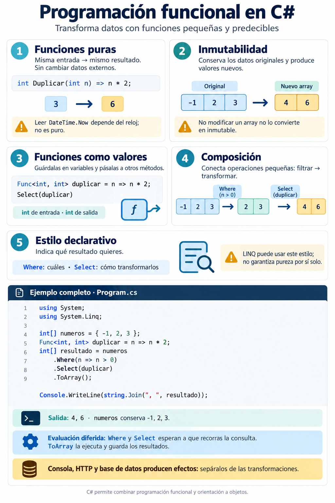
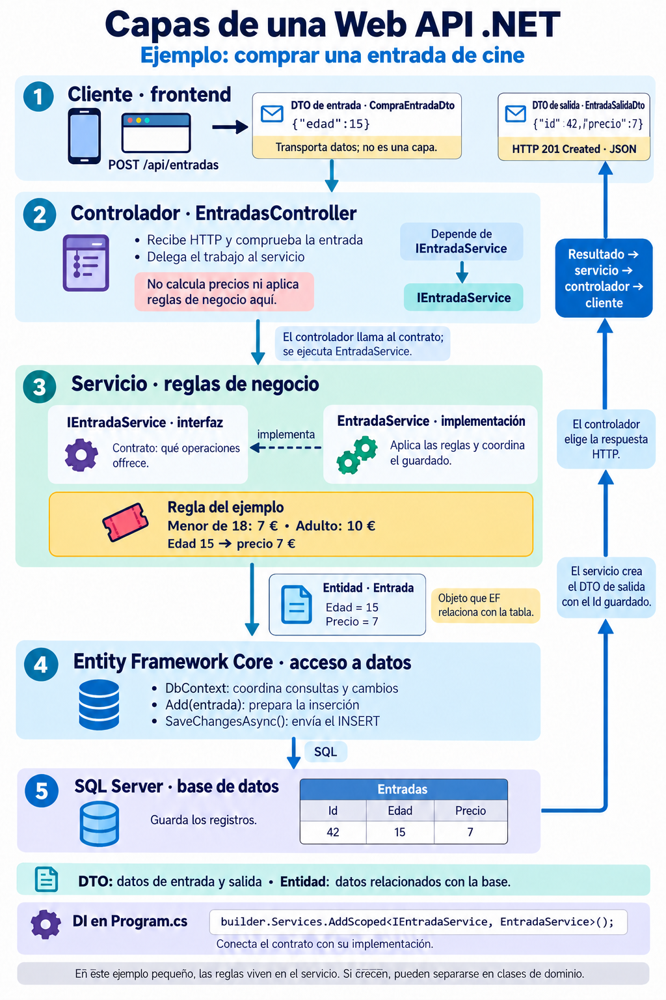
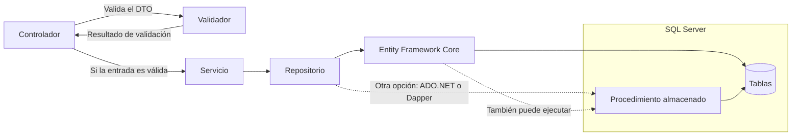
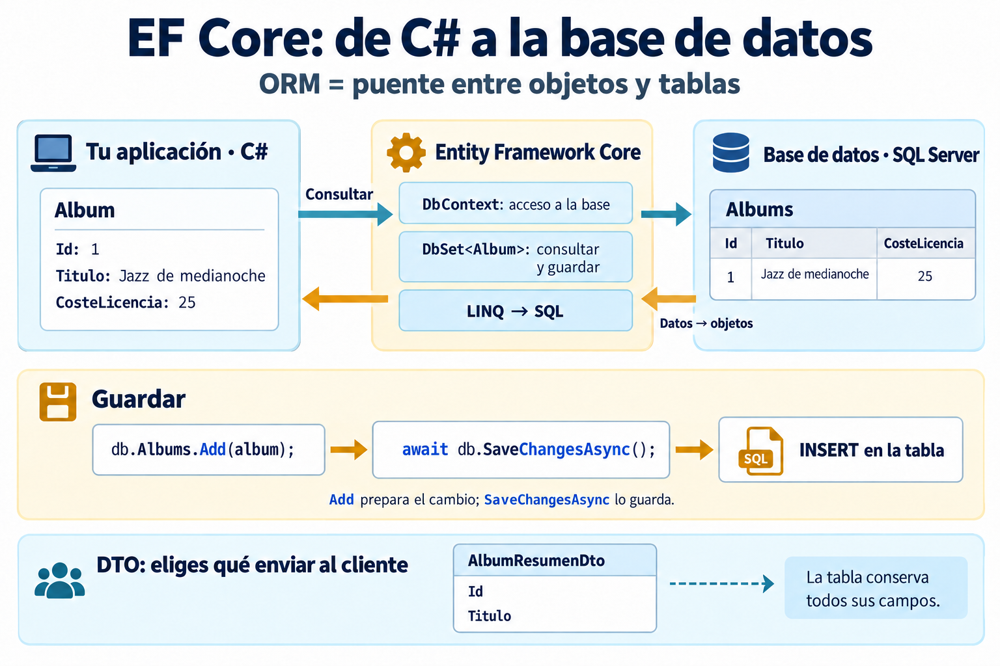
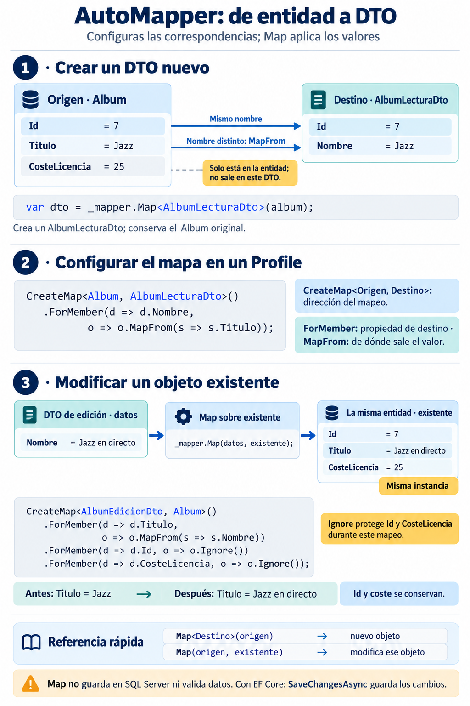
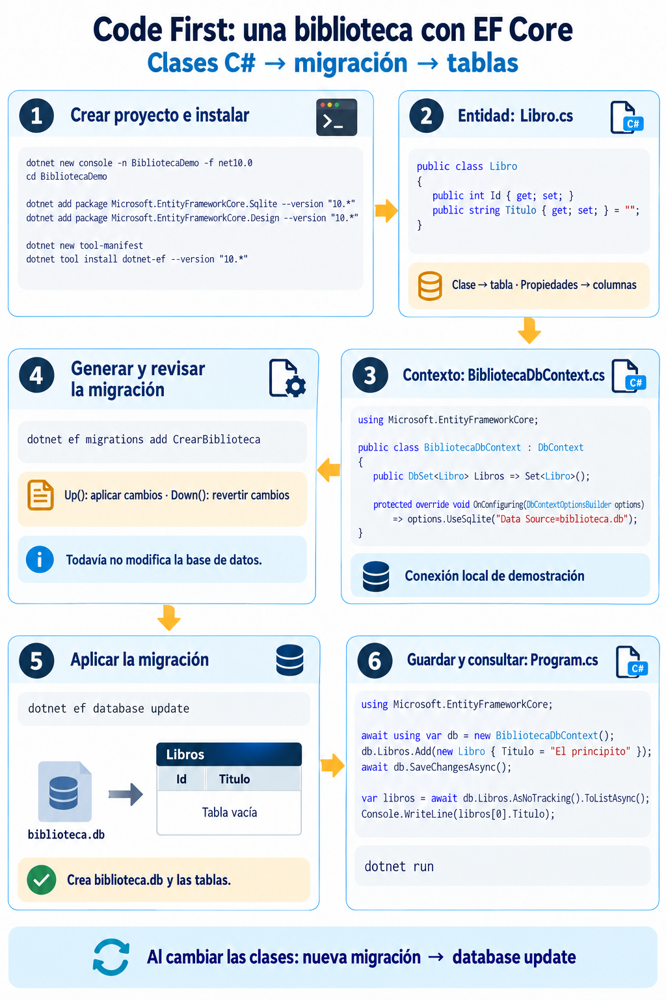
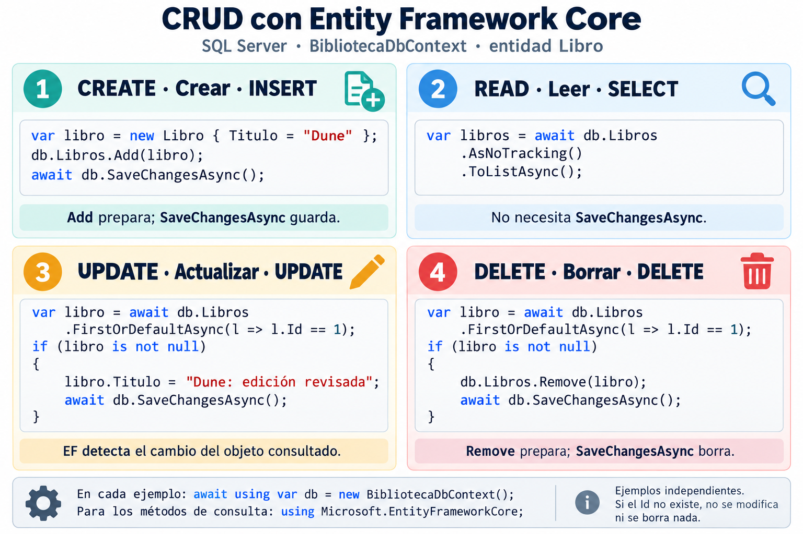
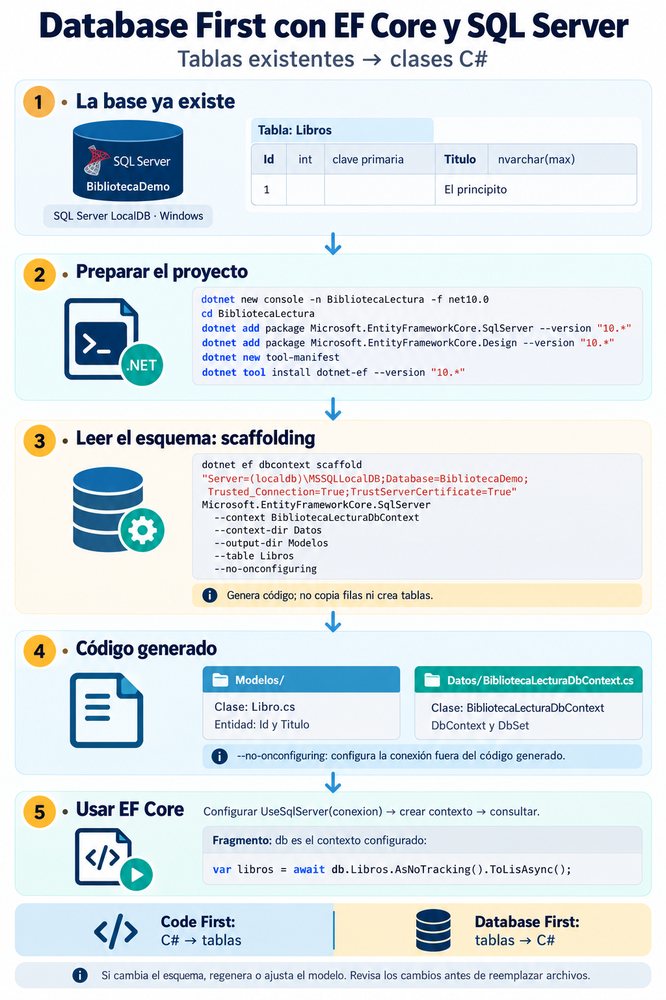
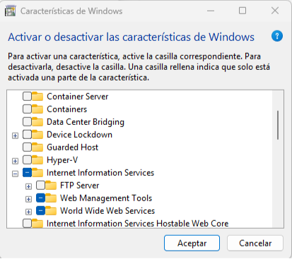
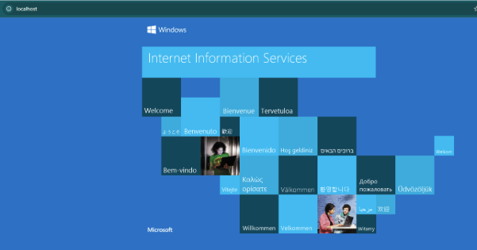

# 📘 Guía de Iniciación a .NET (Backend)

> **Resumen:** Notas técnicas sobre el ecosistema .NET, sintaxis moderna de C\# y patrones para desarrollo backend.
> **Versión:** Referencia para .NET 10 LTS (soporte largo) y C\# 14. Información revisada el 13-10-2026.
> **Ejemplos:** cada bloque es independiente. Las instrucciones de consola se colocan en `Program.cs`; los fragmentos de métodos, dentro de su clase. Los controladores requieren un proyecto ASP.NET Core.

## 1. .NET Framework vs .NET moderno: diferencias e historia

### Vista rápida

- **.NET Framework (2002):** plataforma original para Windows. Sigue existiendo para aplicaciones heredadas; versión 4.8.1.
- **.NET Core (2016-2019):** rediseño abierto y multiplataforma. Versiones 1.0–3.1.
- **.NET (desde 2020):** continuación unificada de .NET Core. Para proyectos nuevos, es la opción habitual.

| Versión | Dónde funciona | Qué la caracteriza | Soporte a octubre de 2026 / uso recomendado |
|---|---|---|---|
| **.NET Framework 4.8.1** | Windows | Plataforma original; usada por aplicaciones Windows, ASP.NET clásico y Web Forms. | Se mantiene según la versión de Windows. Elegirla para mantener sistemas existentes o dependencias que la requieran. |
| **.NET 6** | Windows, Linux, macOS | Consolidó la plataforma multiplataforma e introdujo mejoras como Minimal APIs y Hot Reload. | Soporte terminado en noviembre de 2024. Migrar a una versión con soporte. |
| **.NET 8** | Windows, Linux, macOS | Mejoras de rendimiento y publicación; incorporó C# 12. | LTS hasta el 10-11-2026. Muy presente en proyectos actuales; planificar la actualización de aplicaciones que lo utilicen. |
| **.NET 10** | Windows, Linux, macOS | Versión moderna más reciente de esta tabla; continúa las mejoras de rendimiento y herramientas; usa C# 14. | LTS hasta el 14-11-2028. Recomendado para proyectos nuevos. |

En la política actual, **LTS** significa soporte largo: 3 años de actualizaciones. **STS** significa soporte estándar: 2 años. Las versiones 6, 8 y 10 son LTS; el estado y las fechas cambian según la versión. Consulta la [política oficial de soporte de .NET](https://dotnet.microsoft.com/es-es/platform/support/policy/dotnet-core), las novedades de [.NET 6](https://learn.microsoft.com/es-es/dotnet/core/whats-new/dotnet-6), [.NET 8](https://learn.microsoft.com/es-es/dotnet/core/whats-new/dotnet-8/) y [.NET 10](https://learn.microsoft.com/es-es/dotnet/core/whats-new/dotnet-10), y el [ciclo de vida de .NET Framework](https://learn.microsoft.com/lifecycle/products/microsoft-net-framework).

> **Respuesta de entrevista:** .NET Framework 4.8.1 es la línea antigua para Windows. .NET 6, 8 y 10 pertenecen a la línea moderna, que funciona en varios sistemas operativos y recibe mejoras por versión. La diferencia principal entre 6, 8 y 10 es su fecha, las funciones incorporadas y el plazo de soporte; hoy elegiría .NET 10 para un proyecto nuevo y actualizaría .NET 6 u 8 porque su soporte ya terminó o está por terminar.

### ASP.NET y ASP.NET Core: la parte web de .NET

**ASP.NET** es el conjunto de herramientas de .NET para crear páginas web y APIs. Una **API web** permite que una aplicación pida o envíe datos a un servidor; por ejemplo, consultar productos desde una app móvil.

- **C#** es el lenguaje con el que escribes el código.
- **.NET** es la plataforma que permite ejecutarlo.
- **ASP.NET** aporta lo necesario para recibir peticiones web y responderlas.

| Familia | Se ejecuta sobre | Sistemas | Uso |
|---|---|---|---|
| **ASP.NET clásico (4.x)** | .NET Framework | Windows | Aplicaciones existentes con Web Forms, MVC o Web API |
| **ASP.NET Core 1–3.1** | .NET Core; algunas versiones iniciales también admitían .NET Framework | Windows, Linux, macOS con .NET Core; Windows con .NET Framework | Primeras versiones de la línea moderna |
| **ASP.NET Core 5, 6, 8, 10…** | .NET moderno de la misma versión | Windows, Linux, macOS | Nuevas aplicaciones web y APIs |

**ASP.NET Core conserva «Core» en su nombre**, aunque .NET dejó de llamarse «.NET Core» desde la versión 5. Ejemplo: .NET 10 + ASP.NET Core 10.

Los nombres siguientes son formas de construir aplicaciones, no versiones consecutivas:

- **Web Forms:** páginas con controles y eventos; pertenece a ASP.NET clásico.
- **MVC (Modelo–Vista–Controlador):** separa los datos, la página que ve el usuario y el código que atiende la petición. Existe en ambas familias.
- **ASP.NET Web API:** herramienta del ASP.NET clásico para devolver datos, normalmente JSON.
- **APIs en ASP.NET Core:** pueden usar controladores o **Minimal APIs**, que definen las rutas directamente con menos código.
- **Razor Pages:** organiza una web por páginas y su código asociado; pertenece a ASP.NET Core.
- **Blazor:** permite crear interfaces web interactivas con C# y componentes.

Referencias: [ASP.NET clásico](https://learn.microsoft.com/aspnet/overview) y [ASP.NET Core](https://learn.microsoft.com/aspnet/core/overview?view=aspnetcore-10.0).

## 2\. 🛠️ Configuración y Entorno

Para empezar a trabajar con el ecosistema moderno de Microsoft.

  * **SDK:** herramientas para crear y compilar proyectos .NET. Descarga una versión LTS (Long Term Support): [.NET Download](https://dotnet.microsoft.com/es-es/download/dotnet).
  * **Editor:** para .NET 10, Visual Studio 2026 (18.0 o posterior) o VS Code con **C\# Dev Kit**. Visual Studio 2022 permite trabajar con versiones anteriores, como .NET 8. [Compatibilidad oficial](https://learn.microsoft.com/dotnet/core/porting/versioning-sdk-msbuild-vs).

### Comandos Esenciales (CLI)

La terminal es tu amiga en .NET Core/.NET 5+.

```bash
dotnet --version            # Verificar instalación
dotnet new list             # Ver plantillas disponibles
dotnet new webapi --use-controllers -n MyApi # Crear una API con controladores
dotnet new console -n App   # Crear aplicación de consola
dotnet run                  # Ejecutar proyecto
dotnet build                # Compilar proyecto
```

### Dependencias NuGet: ¿se instalan para todos los proyectos?

**Los paquetes NuGet se referencian por proyecto.** Instalarlos desde Visual Studio no los añade a todos tus proyectos.

Una **solución** agrupa proyectos; cada proyecto tiene su propio archivo `.csproj` con sus dependencias.

| Situación | Qué ocurre |
|---|---|
| Instalas AutoMapper en `MiApi` | Se añade la referencia a `MiApi.csproj` |
| Otro proyecto está en la misma solución | No recibe AutoMapper solo por compartir solución |
| Usas el administrador NuGet de la solución | Puedes seleccionar varios proyectos e instalarlo en cada uno |
| Dos proyectos usan el mismo paquete y versión | Pueden reutilizar los archivos descargados en la caché |
| Un paquete necesita otras bibliotecas | NuGet también restaura esas dependencias: son **transitivas** |
| Quitas el paquete de un proyecto | No lo desinstalas de los demás; sus archivos pueden seguir en caché |

**Ejemplo de referencia en `MiApi.csproj`:**

```xml
<ItemGroup>
  <PackageReference Include="AutoMapper" Version="16.*" />
</ItemGroup>
```

- **Referencia:** declara que el proyecto depende del paquete.
- **Caché:** almacena los archivos descargados; en Windows suele estar en `%USERPROFILE%\.nuget\packages`. Tenerlos allí no añade referencias a otros proyectos.
- **Restaurar:** obtiene los paquetes declarados y sus dependencias. Visual Studio suele hacerlo automáticamente; también puedes ejecutar `dotnet restore`.
- Si `MiApi` referencia otro proyecto, puede recibir sus dependencias transitivamente, salvo que se haya restringido esa propagación.
- Proyectos independientes pueden usar versiones distintas. Al reunir dependencias en una misma aplicación, NuGet resuelve las versiones; las incompatibilidades pueden producir conflictos.

[Referencias por proyecto](https://learn.microsoft.com/nuget/consume-packages/package-references-in-project-files), [Caché de NuGet](https://learn.microsoft.com/nuget/consume-packages/managing-the-global-packages-and-cache-folders), [Instalación desde Visual Studio](https://learn.microsoft.com/nuget/consume-packages/install-use-packages-visual-studio).

#### ¿Se utiliza automáticamente después de instalarlo?

Depende del paquete. Una biblioteca queda disponible para el proyecto, pero su integración puede necesitar configuración. Por ejemplo, AutoMapper requiere declarar mapas y registrar `AddAutoMapper`. Otros paquetes añaden analizadores o tareas de compilación que actúan al compilar.

| Acción | Efecto |
|---|---|
| Instalar un paquete NuGet | Añade una dependencia al proyecto |
| Escribir `using AutoMapper;` | Permite usar nombres cortos de ese espacio de nombres; no instala el paquete |
| Llamar a `AddAutoMapper(...)` | Registra AutoMapper en el contenedor DI de esa aplicación |
| Llamar a `_mapper.Map(...)` | Ejecuta un mapeo |

**Si te refieres a inyección de dependencias:** un registro como `AddScoped<IAlbumService, AlbumService>()` pertenece al contenedor de la aplicación que lo ejecuta. No se comparte automáticamente con otros proyectos o aplicaciones. El registro indica cómo crear el servicio; la instancia se obtiene cuando se solicita al contenedor. [Inyección de dependencias](https://learn.microsoft.com/dotnet/core/extensions/dependency-injection/overview).

### Estructura básica de una Web API .NET

Una aplicación web reúne código, configuración y dependencias. Esta es una organización sencilla; las carpetas opcionales se añaden cuando hacen falta:

| Archivo o carpeta | Para qué sirve |
|---|---|
| `MyApi.csproj` | Define la versión de .NET, los paquetes NuGet y opciones de compilación |
| `Program.cs` | Prepara y arranca la aplicación |
| `appsettings.json` | Configuración común: conexiones, URLs y otras opciones |
| `appsettings.Development.json` | Sustituye valores de configuración durante desarrollo |
| `Properties/launchSettings.json` | Perfiles locales de arranque: URL, puerto y entorno; no configura el despliegue en producción |
| `Controllers/` | Controladores que reciben peticiones HTTP y devuelven respuestas |
| `DTOs/` | Clases con los datos que entran o salen de la API |
| `Mappings/` | Perfiles de AutoMapper: correspondencias entre entidades y DTO |
| `Validators/` | Reglas para comprobar los datos de entrada |
| `Services/` | Operaciones de la aplicación y lógica de negocio |
| `Entities/` | Entidades relacionadas con las tablas de la base de datos |
| `Data/` | Contexto de Entity Framework y configuración de acceso a datos |
| `Repositories/` | Consultas y operaciones de acceso a datos que utilizan los servicios |
| `bin/` y `obj/` | Archivos generados al compilar; no se editan manualmente |

Los nombres de las carpetas son convenciones; ASP.NET Core no exige esta distribución. Por ejemplo, crear `Validators/` organiza archivos, pero no registra ni ejecuta validaciones.

#### ¿Para qué sirve `Program.cs`?

Es el **punto de arranque**. Indica qué necesita la aplicación y cómo atenderá las peticiones.

Ejemplo mínimo de una API con controladores:

```csharp
var builder = WebApplication.CreateBuilder(args);

builder.Services.AddControllers();

var app = builder.Build();

app.UseHttpsRedirection();
app.MapControllers();

app.Run();
```

| Instrucción | Qué hace |
|---|---|
| `CreateBuilder(args)` | Prepara el servidor, la configuración y el contenedor de dependencias |
| `builder.Services...` | Registra lo que la aplicación podrá usar: controladores, servicios, validadores o contexto de datos |
| `Build()` | Construye la aplicación con lo registrado |
| `UseHttpsRedirection()` | Añade un paso que redirige HTTP a HTTPS cuando hay un puerto HTTPS configurado |
| `MapControllers()` | Publica las rutas definidas en los controladores |
| `Run()` | Arranca el servidor y mantiene la aplicación atendiendo peticiones |

Los pasos configurados con métodos `Use...` se llaman **middleware**: procesan las peticiones y respuestas. Su orden puede cambiar el comportamiento. Los registros de servicios se añaden **antes de `Build()`**. [Middleware](https://learn.microsoft.com/aspnet/core/fundamentals/middleware/?view=aspnetcore-10.0).

`Program.cs` prepara el arranque; el método del controlador se ejecuta cuando llega una petición a su endpoint. [Fundamentos de ASP.NET Core](https://learn.microsoft.com/aspnet/core/fundamentals/?view=aspnetcore-10.0).

### Atajos útiles de Visual Studio en Windows

| Atajo | Uso |
|---|---|
| **`Ctrl + .`** | Abre acciones rápidas: correcciones, añadir un `using`, generar código o refactorizar según el contexto |
| `Ctrl + Espacio` | Muestra sugerencias de autocompletado de código |
| `F12` | Va a la definición de un tipo o método |
| `Shift + F12` | Busca dónde se usa un elemento |
| `Ctrl + R`, `Ctrl + R` | Renombra un elemento y actualiza sus referencias |
| `Ctrl + K`, `Ctrl + D` | Da formato al documento |
| `Ctrl + K`, `Ctrl + C` | Comenta la selección |
| `Ctrl + K`, `Ctrl + U` | Quita los comentarios de la selección |
| `Ctrl + Shift + F` | Busca texto en archivos de la solución |
| `Ctrl + Shift + B` | Compila la solución |
| `F5` / `Ctrl + F5` | Ejecuta con depuración / sin depuración |
| `F9` | Añade o quita un punto de interrupción para detener la ejecución al depurar |
| `F10` / `F11` | Avanza una instrucción sin entrar / entrando en los métodos durante la depuración |

En combinaciones separadas por coma, pulsa primero una y después la otra. Los atajos pueden variar según el perfil de teclado; puedes consultarlos o cambiarlos en **Herramientas → Opciones → Entorno → Teclado**. [Atajos oficiales](https://learn.microsoft.com/visualstudio/ide/default-keyboard-shortcuts-in-visual-studio).

## 3\. ⌨️ Sintaxis y Sistema de Tipos

C\# es un lenguaje **tipado**: cada variable tiene un tipo que determina qué valores admite. Es **compilado**: el código se traduce antes de ejecutarse.

**¿Qué ocurre al ejecutar?** El compilador convierte C# a **IL** (*lenguaje intermedio*). El **runtime .NET** —el entorno que ejecuta la aplicación— carga ese código. Normalmente, el **JIT** (*compilador justo a tiempo*) traduce cada parte a instrucciones del procesador (código máquina) cuando hacen falta. Por eso, compilar C# no siempre produce un único ejecutable nativo.

### Fundamentos de Sintaxis y Control

Un programa C# combina instrucciones que realizan tareas y elementos que organizan el código. Para empezar a leerlo, conviene reconocer estos tres:

- **`class` (clase):** define los datos y las operaciones de un tipo de objeto. Por ejemplo, una clase `Producto` puede tener un nombre y un método para actualizar su precio.
- **`namespace` (espacio de nombres):** agrupa clases y otros tipos bajo un nombre común. Por ejemplo, `System` contiene tipos como `Console`.
- **`using`:** permite utilizar esos tipos con su nombre corto. Con `using System;`, puedes escribir `Console` en lugar de `System.Console`.

La aplicación necesita un **punto de entrada**: el lugar donde comienza a ejecutarse. Puede declararse con un método llamado `Main`. En las plantillas modernas de consola y Web API, suele bastar con escribir las instrucciones iniciales en `Program.cs`; el compilador crea ese método por ti. Esta forma se llama **instrucciones de nivel superior**.

Por ejemplo, este programa empieza mostrando un mensaje en la consola:

```csharp
using System;

Console.WriteLine("Programa iniciado");
```

  * **Datos Primitivos:** Cubiertos en el *Cheatsheet* (ej: `int`, `bool`, `char`).
  * **Funciones/Métodos:** Bloques de código reutilizables.
  * **Estructuras de Control:** `if/else`, `switch`, y bucles (`for`, `foreach`, `while`).

#### Cheatsheet de Tipos Básicos

```csharp
/*
   ┌─────────────────────────────────────────────────────────────┐
   │               C# TYPE SYSTEM CHEATSHEET 🧪                  │
   └─────────────────────────────────────────────────────────────┘
*/

// 1. NÚMEROS (NUMBERS)
int     entero      = 42;             // Estándar para contar (-2B a +2B)
long    gigante     = 9_000_000L;     // Entero de 64-bits (Nota el guion bajo y 'L')
double  cientifico  = 3.14159;        // Punto flotante estándar (Impreciso para $)
float   graficos    = 3.14f;          // Menor peso, usado en Unity/Juegos ('f')
decimal dinero      = 100.50m;        // Habitual para importes; representa decimales como 0.1m

// 2. TEXTO (STRINGS)
char    letra       = 'A';            // Una unidad UTF-16; algunos símbolos necesitan dos char
string  texto       = "Hola Mundo";   // Comillas dobles estándar
string  json        = """             
                      {
                        "prop": "val" 
                      }
                      """;            // Raw String Literal (C# 11+): Ideal para JSON/XML multilínea

// 3. LÓGICA (BOOLEAN)
bool    esValido    = true;           // true o false; sizeof(bool) = 1 byte

// 4. FECHAS (DATES - MODERN .NET)
DateTime fechaHora  = DateTime.Now;             // Fecha y hora actual local: 2025-10-05 14:30:00
DateOnly soloFecha  = new DateOnly(2025,10,5);  // Solo fecha, sin hora: 2025-10-05
TimeOnly soloHora   = new TimeOnly(14,30);      // Solo hora, sin fecha: 14:30

// 5. IDENTIFICADORES & BYTES
Guid    idUnico     = Guid.NewGuid(); // Identificador de 128 bits; útil entre varios sistemas. Útil para Primary Keys: a1b2c3d4-e5f6...
byte    unByte      = 255;            // De 0 a 255 (Para manipulación de archivos/imágenes)
```

#### Declaración de Variables: `var` vs `dynamic` vs `const`

Esta es una pregunta clásica de entrevista.

  * **`var`**: Inferencia estática en **tiempo de compilación**. El tipo queda fijado y no cambia; no equivale a `dynamic`.
  * **`const`**: Valor fijo (inmutable) conocido en compilación. Se asigna al declararlo y no puede reasignarse.
  * **`dynamic`**: El tipo se comprueba mientras el programa se ejecuta. El compilador no puede detectar algunos errores antes; úsalo cuando sea necesario.

<!-- end list -->

```csharp
// ✅ Recomendado: El compilador sabe que es int
var edad = 25; 

// 🔒 Constante: Nunca cambiará
const double PI = 3.1416; 

// ⚠️ Peligroso: Si te equivocas, falla cuando el programa corre, no al compilar
dynamic datos = "Hola"; 
datos = 10; // Esto es válido en dynamic, pero daría error en var
```

#### `var` en C# vs JavaScript

| C# `var` | JavaScript `var` |
|---|---|
| El compilador infiere un tipo estático una vez | Puede contener valores de tipos distintos |
| Solo variable local con inicializador | Puede declararse sin inicializar; tiene alcance de función o global |
| `var x = 1; x = "a";` no compila | `var x = 1; x = "a";` es válido |

En JavaScript moderno suele preferirse `let` o `const`, cuyo alcance es de bloque.

#### Strings: Interpolación y Verbatim

  * **Interpolación (`$`)**: Insertar variables directamente.
  * **Verbatim (`@`)**: conserva barras y saltos tal como se escriben; una comilla se duplica (`""`). Útil para rutas de archivos

<!-- end list -->

```csharp
string nombre = "Ana";
// Combinando ambos (muy útil en rutas o JSON a mano)
string ruta = $@"C:\Usuarios\{nombre}\Documentos"; 
string texto = @"Primera línea
Segunda línea; ruta: C:\temp";
string json = @"{""activo"":true}"; // Comillas dobles duplicadas
```

`@"{}"` es una cadena literal de dos llaves; no interpola ni procesa escapes. Para interpolar, usa `$"{nombre}"`. En una cadena interpolada, las llaves literales se escriben `{{` y `}}`.

#### Nulabilidad: `?`, `?.` y `??`

- `string?`: referencia que puede ser `null` (con *nullable reference types* habilitados).
- `int?`: abreviatura de `Nullable<int>`; un tipo de valor que admite `null`.
- `?.`: acceso condicional; devuelve `null` si el receptor es `null`.
- `??`: valor alternativo si la expresión de la izquierda es `null`.

```csharp
string? nombre = null;
int? longitud = nombre?.Length;
int segura = longitud ?? 0;
```

`?` no añade una comprobación automática en ejecución para referencias: el compilador analiza nulabilidad y emite advertencias.

### 💾 Tipos de Valor vs Tipos de Referencia

**Al asignar una variable a otra, se copia el valor o la referencia al objeto.** Esa diferencia determina si las dos variables comparten datos.

#### 1️⃣ Tipos de Valor → *Como una fotocopia en papel* 🧾

Un **tipo de valor guarda directamente el dato**.
Cuando asignas una variable a otra, se hace una **copia independiente**.

##### 🧠 Analogía

Es como hacer una **fotocopia de un documento**:

* Tienes el original
* Haces una copia
* Si escribes en la copia, **el original no cambia**

Son dos hojas completamente separadas.

##### ✅ Ejemplo simple en C#

```csharp
int vidasJugador1 = 3;
int vidasJugador2 = vidasJugador1; // Se copia el VALOR

vidasJugador2 = 1;

Console.WriteLine(vidasJugador1); // 3 ✅ No cambia
Console.WriteLine(vidasJugador2); // 1
```

#### 2️⃣ Tipos de Referencia → *Como un documento compartido en Google Drive* 🔗

Un **tipo de referencia no guarda el objeto en sí**, guarda una **referencia (dirección)** hacia ese objeto.

##### 🧠 Analogía

Es como un **documento compartido online**:

* Dos personas abren el mismo archivo
* Si una escribe algo…
* La otra **ve el cambio al instante**

No hay dos documentos: hay **uno solo compartido**.

##### ✅ Ejemplo simple en C#

```csharp
var cuenta1 = new Cuenta { Saldo = 100 };
var cuenta2 = cuenta1; // Se copia la REFERENCIA

cuenta2.Saldo = 500;

Console.WriteLine(cuenta1.Saldo); // 500 ✅ ¡Cambia también!
Console.WriteLine(cuenta2.Saldo); // 500

public class Cuenta
{
    public int Saldo;
}
```

#### 📊 Comparativa

| Concepto | Tipo de valor | Tipo de referencia |
|---|---|---|
| ¿Qué guarda la variable? | El dato directamente | Una referencia al objeto |
| Al asignar a otra variable | Copia el valor | Copia la referencia; ambas apuntan al mismo objeto |
| Al modificar la copia | Cambiar un valor simple, como `int`, no modifica el original | Modificar el objeto compartido se ve desde ambas variables |
| ¿Dónde viven? | Depende del contexto: dentro de otro objeto o en la pila de llamadas (memoria temporal de los métodos activos) | Normalmente, el objeto está en el heap (zona donde .NET guarda y administra objetos) |
| Analogía de ubicación | Una hoja dentro de una carpeta o sobre el escritorio: depende del contenedor | Un documento en un archivador; la variable conserva cómo encontrarlo |
| Ejemplos | `int`, `bool`, `decimal`, `struct` | `class`, arrays, `List<T>` |

Copiar un `struct` copia sus campos: si alguno contiene una referencia, el objeto apuntado puede seguir compartido. Reasignar una variable de referencia para que apunte a otro objeto tampoco cambia la otra variable.

Referencia: [Tipos de valor y copia de referencias](https://learn.microsoft.com/dotnet/csharp/language-reference/builtin-types/value-types).

## 4\. 🧬 Programación Orientada a Objetos (POO)

### ✍️ Convenciones de Nomenclatura (Estándar C\#)

Seguir estas convenciones de estilo es importante para mantener *Clean Code* y la consistencia en proyectos .NET:

| Elemento | Convención | Ejemplo de nombre |
|---|---|---|
| Clases, métodos, propiedades y namespaces | PascalCase: cada palabra empieza con mayúscula | `EntradaService`, `CalcularPrecio` |
| Parámetros y variables locales | camelCase: primera palabra con minúscula | `edad`, `precioFinal` |
| Campos privados, incluidos los `readonly` | Guion bajo + camelCase | `_entradaService` |
| Interfaces | Prefijo `I` + PascalCase | `IEntradaService` |

El nombre no determina el acceso: `public`, `private` y `protected` se declaran aparte.

### Anatomía de una Clase Típica

Una **clase** es la plantilla para crear objetos.

  * **Creación de objeto:** puedes crearlo con `var object = new Class();` o recibir uno creado por otro componente. Con DI, el contenedor crea o reutiliza las dependencias y te las entrega.

<!-- end list -->

```csharp
// Uso:
var lapiz = new Producto("Lápiz HB");
lapiz.AñadirStock(10);

public class Producto
{
    // 1. Campo (Field) Variable interna de la clase, típicamente privada con convención _camelCase
    private int _stockMinimo = 5;

    // 2. Propiedad (Property): Encapsula el acceso al campo, controlando su lectura/escritura (pública con PascalCase)
    //    Usando 'auto-implemented property' (lo más común):
    public string Nombre { get; set; }

    // 3. Constructor: Método especial que se ejecuta al crear el objeto (con 'new').
    public Producto(string nombreInicial)
    {
        Nombre = nombreInicial;
    }

    // 4. Método (Method): Define la acción o comportamiento del objeto.
    public void AñadirStock(int cantidad)
    {
        // Lógica de negocio
        if (cantidad < 0) return;

        Console.WriteLine($"Añadiendo {cantidad} unidades a {Nombre}.");
    }
}
```

### `static`: un dato común o una función que llamas desde la clase

**Para acceder a un miembro `static`, no necesitas crear una instancia de la clase con `new`.** Una instancia es un objeto creado a partir de una clase. Por ejemplo, puedes leer `Empleado.Empresa` directamente, sin crear antes un empleado.

`static` puede aplicarse a campos, propiedades y métodos. Los campos y propiedades pertenecen a la clase y se comparten; los métodos se llaman usando el nombre de la clase.

- **Datos compartidos:** información común a todos los objetos, como el nombre de la empresa.
- **Funciones de utilidad:** operaciones que reciben datos y devuelven un resultado sin necesitar un objeto concreto, como convertir minutos en segundos.

**Ejemplo: los empleados de un cine.** Cada empleado tiene su nombre, pero todos trabajan para la misma empresa.

```csharp
var lucia = new Empleado { Nombre = "Lucía" };
var marcos = new Empleado { Nombre = "Marcos" };

System.Console.WriteLine(lucia.Nombre);    // Lucía
System.Console.WriteLine(marcos.Nombre);   // Marcos
System.Console.WriteLine(Empleado.Empresa); // Cine Centro

// Cambiamos el dato común una sola vez.
Empleado.Empresa = "Cine Norte";
System.Console.WriteLine($"{lucia.Nombre}: {Empleado.Empresa}");  // Lucía: Cine Norte
System.Console.WriteLine($"{marcos.Nombre}: {Empleado.Empresa}"); // Marcos: Cine Norte

public class Empleado
{
    public string Nombre { get; set; } = "";      // Uno por empleado
    public static string Empresa = "Cine Centro"; // Común a la clase
}
```

| Dato | Cómo se lee | Qué significa |
|---|---|---|
| `Nombre`, sin `static` | `lucia.Nombre` | El nombre de ese empleado |
| `Empresa`, con `static` | `Empleado.Empresa` | El nombre común de la empresa |

**Analogía:** el nombre de cada empleado está en su tarjeta. El nombre de la empresa está en el cartel común del cine.

Una lista con `static` funciona igual: hay una lista compartida, no una lista nueva por cada objeto. Una lista sin `static`, creada dentro de cada objeto, es independiente.

#### Métodos estáticos

Un método `static` se llama usando el nombre de la clase. Es útil para operaciones que no necesitan datos de un objeto concreto:

```csharp
System.Console.WriteLine(Tiempo.ConvertirASegundos(2)); // 120

public static class Tiempo
{
    public static int ConvertirASegundos(int minutos)
    {
        return minutos * 60;
    }
}
```

No necesitamos crear `new Tiempo()`: entregamos los minutos y obtenemos los segundos. Una clase declarada `static` no se instancia y contiene miembros estáticos.

- `static` no significa «no se puede cambiar»: el ejemplo cambia la empresa.
- En una API, los datos estáticos se comparten entre las peticiones de esa aplicación. Evita usarlos para guardar el carrito o los datos personales de cada usuario.
- Una lista estática no es una base de datos: se pierde al reiniciar la aplicación y modificarla desde varias peticiones a la vez requiere coordinación.

### Modificadores de Acceso y Sobrecarga

| Modificador | Acceso | Descripción |
| :--- | :--- | :--- |
| **`public`** | Público | Accesible desde donde pueda utilizarse la clase que contiene el miembro. |
| **`private`** | Limitado | Solo accesible **dentro de la misma clase**. (Recomendado para campos internos). |
| **`protected`** | Limitado | Accesible dentro de la misma clase y por las **clases hijas (heredadas)**. |

#### Ejemplos de Modificadores de Acceso

```csharp
// Uso desde fuera de las clases:
var cuenta = new CuentaBancaria();
cuenta.NumeroCuenta = "12345";       // ✅ OK: Es public
// cuenta._saldo = 500m;             // ❌ Error: Es private
// decimal interes = cuenta.Interes; // ❌ Error: Es protected

public class CuentaBancaria
{
    // 1. private: Solo accesible dentro de esta clase (Encapsulación).
    private decimal _saldo = 1000m;

    // 2. protected: Accesible aquí y en clases que hereden de CuentaBancaria.
    protected decimal Interes = 0.05m;

    // 3. public: Accesible desde cualquier lugar.
    public string NumeroCuenta { get; set; } = "";

    // Método público que interactúa con el campo privado
    public decimal ObtenerSaldo()
    {
        return _saldo;
    }
}

public class CuentaAhorro : CuentaBancaria
{
    public void CalcularInteres()
    {
        // ✅ Acceso permitido a 'protected' (Interes), porque es una clase hija.
        decimal nuevoInteres = this.ObtenerSaldo() * this.Interes;

        // ❌ Error de compilación si intentamos acceder a '_saldo' directamente,
        // porque '_saldo' es 'private' en la clase base.
    }
}
```

### Sobrecarga de Métodos (Overloading)

La sobrecarga permite definir **múltiples métodos con el mismo nombre** dentro de una clase, siempre y cuando tengan **diferentes firmas**. La firma se define por el **número** o el **tipo** de sus parámetros.

> **Importante:** El tipo de retorno del método **no** es suficiente para diferenciar una sobrecarga.

#### Ejemplo de Sobrecarga

```csharp
// Uso: El compilador elige automáticamente qué método usar
var calc = new Calculadora();
var resultadoInt = calc.Sumar(5, 10);        // Llama a Sobrecarga 1
var resultadoDecimal = calc.Sumar(5.5m, 10m);  // Llama a Sobrecarga 3

public class Calculadora
{
    // Sobrecarga 1: Suma de dos enteros
    public int Sumar(int a, int b)
    {
        return a + b;
    }

    // Sobrecarga 2: Suma de tres enteros (diferente número de parámetros)
    public int Sumar(int a, int b, int c)
    {
        return a + b + c;
    }

    // Sobrecarga 3: Suma de dos decimales (diferente tipo de parámetros)
    public decimal Sumar(decimal a, decimal b)
    {
        return a + b;
    }
}
```

### Clases y Herencia: `virtual` vs `override`

La **Herencia** permite que una clase hija adquiera las propiedades y métodos de una clase padre. Los conceptos `virtual` y `override` son la base del **Polimorfismo**.

| Palabra Clave | Uso | Propósito |
| :--- | :--- | :--- |
| **`virtual`** | Se define en el **método de la clase padre**. | Permite que este comportamiento **pueda ser modificado** (sobrescrito) por las clases que hereden de ella. |
| **`override`** | Se define en el **método de la clase hija**. | **Reemplaza** el comportamiento definido en la clase padre. |

**`base`** permite acceder desde la clase hija a la implementación de la clase padre. Se usa para reutilizar o ampliar su comportamiento; también puede llamar al constructor base con `: base(...)`.

#### Ejemplo de Código:

```csharp
// Uso:
Empleado e = new Empleado();
Manager m = new Manager();

Console.WriteLine(e.CalcularSalario()); // Salario base según contrato.
Console.WriteLine(m.CalcularSalario()); // Salario base según contrato. Más bonificación...

public class Empleado
{
    // Este método es virtual, la clase hija PUEDE cambiarlo.
    public virtual string CalcularSalario()
    {
        return "Salario base según contrato.";
    }
}

public class Manager : Empleado
{
    // Usamos override para cambiar el comportamiento del padre.
    public override string CalcularSalario()
    {
        return base.CalcularSalario() + " Más bonificación por objetivos.";
        // 'base' llama a la implementación original del padre.
    }
}
```

### Interfaces

Definen un **contrato**: qué operaciones ofrece un componente. En estos ejemplos, la interfaz declara las operaciones y la clase aporta el código. C# moderno también permite implementaciones predeterminadas en interfaces.

> **Importancia en Backend:** facilitan cambiar implementaciones y probar componentes con objetos que simulan sus dependencias. DI también puede inyectar clases concretas; una interfaz ayuda a depender de su contrato.

```csharp
public interface IGuardable
{
    // Define el contrato: debe haber un método Guardar sin implementación.
    void Guardar(string datos);
}

// La clase concreta implementa el contrato
public class RepositorioSql : IGuardable
{
    public void Guardar(string datos)
    {
        Console.WriteLine($"Guardando '{datos}' en la base de datos SQL.");
    }
}
```
Referencias: [Interfaces](https://learn.microsoft.com/dotnet/csharp/fundamentals/types/interfaces) e [instrucciones de nivel superior](https://learn.microsoft.com/dotnet/csharp/fundamentals/program-structure/top-level-statements).

## 5\. 🔍 Generics y Colecciones

### Genéricos: reutilizar código cambiando el tipo de dato

Un **genérico** es una clase, interfaz o método que recibe uno o más **tipos como parámetros**. Escribes el código una vez y eliges con qué tipos utilizarlo.

**`T` representa un tipo pendiente de concretar**, como `int`, `string` o una clase propia. Es un nombre convencional; también puedes usar nombres como `TRespuesta`.

**Analogía:** una caja con una etiqueta que indica qué admite. `List<string>` es una caja para textos; `List<int>`, para enteros.

#### Ejemplo cotidiano: lista de destinatarios

```csharp
using System;
using System.Collections.Generic;

var destinatarios = new List<string>();
destinatarios.Add("Lucía");
destinatarios.Add("Marcos");

Console.WriteLine(destinatarios[0]); // Lucía
// destinatarios.Add(42); // No compila: esta lista admite string, no int.
```

`List<T>` ya está programada en .NET. Al usar `List<string>`, sus operaciones trabajan con textos: `Add` recibe un `string` y el índice devuelve un `string`.

#### Ejemplo práctico: una respuesta reutilizable

Supón que varias operaciones devuelven **datos y un mensaje**. El dato cambia: a veces es un precio; otras, un nombre. Una clase genérica permite mantener el mismo formato:

```csharp
using System;

var precio = new Respuesta<decimal>(29.90m, "Precio calculado");
var cliente = new Respuesta<string>("Lucía", "Cliente encontrado");

decimal importe = precio.Datos;
string nombre = cliente.Datos;
Console.WriteLine($"{nombre}: {importe}");

public class Respuesta<T>
{
    public T Datos { get; }
    public string Mensaje { get; }

    public Respuesta(T datos, string mensaje)
    {
        Datos = datos;
        Mensaje = mensaje;
    }
}
```

| Uso | `T` representa | Tipo de `Datos` |
|---|---|---|
| `Respuesta<decimal>` | `decimal` | Un importe |
| `Respuesta<string>` | `string` | Un texto |

La clase `Respuesta<T>` se escribe una vez. Evitas crear clases separadas como `RespuestaPrecio` y `RespuestaNombre` solo porque cambia el tipo de `Datos`. Es un formato opcional; una API también puede devolver sus DTO directamente.

#### Qué aporta y qué conviene recordar

- **Reutilización:** una implementación para distintos tipos.
- **Seguridad:** el compilador detecta tipos incompatibles. `T` no cambia libremente como `dynamic`.
- **Menos conversiones:** al leer `precio.Datos`, obtienes un `decimal` directamente.
- **Memoria:** `List<int>` guarda enteros sin convertir cada uno en `object`. Esa conversión se llama **boxing** y puede crear un objeto adicional. Usar genéricos no elimina todo boxing: `List<object>` sí lo hace al guardar un `int`.

Los tipos se comprueban al compilar; .NET conserva la información de los tipos genéricos al ejecutar. Un genérico no conoce automáticamente propiedades de `T`: para exigir operaciones concretas se usan **restricciones** (`where T : ...`). [Genéricos en C#](https://learn.microsoft.com/dotnet/csharp/fundamentals/types/generics).

### Colecciones Básicas

Las colecciones te permiten agrupar datos:

  * **`array`:** Colección de tamaño fijo y del mismo tipo. `int[] numeros = new int[5];`
  * **`List<T>`:** Colección dinámica (genérica) del mismo tipo.
  * **`Dictionary<TKey, TValue>`:** Colección de pares clave-valor (genérica).
  * **`HashSet<T>`:** Colección sin orden garantizado; no admite duplicados según su comparación de igualdad.
  * **Tupla de valor (`ValueTuple`):** Agrupa varios datos: `(int id, string nombre) usuario = (1, "Ana");`. Esta sintaxis crea un tipo de valor; `System.Tuple<...>` es una clase.

Referencias: [Tuplas de valor](https://learn.microsoft.com/dotnet/csharp/language-reference/builtin-types/value-tuples) y [boxing](https://learn.microsoft.com/dotnet/csharp/programming-guide/types/boxing-and-unboxing).

## 6. Métodos, delegados y programación funcional

### Métodos síncronos y asíncronos: esperar sin bloquear

**Un método síncrono termina su trabajo antes de devolver el control. Un método asíncrono puede devolver una tarea mientras espera una operación pendiente.**

Un **hilo** es quien ejecuta las instrucciones del programa. Si lo bloqueamos esperando un archivo o una respuesta de red, no puede hacer otro trabajo durante esa espera.

**Analogía:** preparas un café. Puedes quedarte mirando la cafetera hasta que termine, o preparar las tostadas mientras esperas. El café tarda lo mismo; cambia cómo aprovechas la espera.

| Forma | Qué ocurre al llamar al método | Mientras espera |
|---|---|---|
| **Síncrono** | Obtienes el resultado cuando termina | Si la espera es bloqueante, ocupa el hilo |
| **Asíncrono** | Obtienes un `Task` que representa la operación | Con `await` sobre una operación pendiente, el método se pausa sin bloquear el hilo |

#### Ejemplo síncrono

Simulamos que la cafetera necesita un segundo. `Thread.Sleep` bloquea el hilo durante ese tiempo:

```csharp
using System;
using System.Threading;

string cafe = PrepararCafe();
Console.WriteLine(cafe);
Console.WriteLine("Ahora preparo las tostadas");

string PrepararCafe()
{
    Thread.Sleep(1000);
    return "Café listo";
}
```

Las tostadas se anuncian **después** de que esté listo el café.

#### Ejemplo asíncrono

`Task.Delay` representa una espera sin bloquear el hilo. Lo usamos para simular ese mismo segundo:

```csharp
using System;
using System.Threading.Tasks;

Task<string> tareaCafe = PrepararCafeAsync();
Console.WriteLine("Mientras tanto, preparo las tostadas");

string cafe = await tareaCafe;
Console.WriteLine(cafe);

async Task<string> PrepararCafeAsync()
{
    await Task.Delay(1000);
    return "Café listo";
}
```

El mensaje de las tostadas aparece **antes** del mensaje «Café listo». Se ejecuta entre la llamada al método y `await tareaCafe`. El código situado después de ese `await` necesita el resultado y continúa cuando la tarea termina.

#### Qué significan `Task`, `async` y `await`

| Elemento | Significado | En el ejemplo |
|---|---|---|
| `Task` | Representa una operación y permite conocer cuándo termina; puede completarse correctamente, fallar o cancelarse | `Task.Delay(1000)` no produce un valor |
| `Task<T>` | Una tarea que produce un resultado de tipo `T` | `Task<string>` produce el texto del café |
| `async` | Permite usar `await` dentro del método; el compilador prepara cómo pausarlo y continuarlo | `async Task<string> PrepararCafeAsync()` |
| `await` | Espera la finalización de una tarea sin bloquear el hilo y obtiene su resultado, si lo tiene | `await tareaCafe` entrega un `string` |

Dentro de `PrepararCafeAsync` escribimos `return "Café listo"`. Aunque el método devuelve `Task<string>`, devolvemos el texto: el compilador lo coloca como resultado de la tarea.

#### Cuándo usarlo y qué recordar

- Usa APIs asíncronas para esperas de archivos, red o base de datos, como `ReadAllTextAsync`, `GetStringAsync` o `ToListAsync` de EF Core.
- `async` no crea un hilo nuevo ni hace que un cálculo tarde menos. El método empieza ejecutándose normalmente hasta encontrar un `await` cuya operación todavía no ha terminado.
- Si la tarea ya está completada, `await` obtiene el resultado y continúa sin pausar el método.
- Para esperar tareas, utiliza `await`; `.Result` y `.Wait()` bloquean el hilo y pueden provocar problemas de bloqueo.
- Usa el sufijo `Async` para reconocer métodos asíncronos. Normalmente devuelven `Task` o `Task<T>`; `async void` se reserva para manejadores de eventos.
- En una Web API, la espera asíncrona permite que el servidor aproveche el hilo para atender otras peticiones mientras llega el resultado.

Referencias: [Programación asíncrona](https://learn.microsoft.com/dotnet/csharp/asynchronous-programming/task-asynchronous-programming-model), [Task y tipos de retorno](https://learn.microsoft.com/dotnet/csharp/asynchronous-programming/async-return-types) y [casos de uso](https://learn.microsoft.com/dotnet/csharp/asynchronous-programming/async-scenarios).

### 🚀 Funciones de Primera Clase y Delegados (Callbacks)

> **Concepto Clave:** En C\#, las funciones pueden tratarse como variables. Esto permite pasar lógica como parámetro (Callbacks).

#### 1\. Action (Void)

Delegado que **NO retorna valor** (void).

  * *Uso:* Ejecutar una operación, como escribir un log, que no devuelve un valor. La llamada normal espera a que termine; `Action` no implica asincronía.

<!-- end list -->

```csharp
// Recibe un string, no devuelve nada
void ProcesarDatos(Action<string> fnCallback, string mensaje)
{
    Console.WriteLine("Inicio del proceso...");
    fnCallback(mensaje); // Ejecutamos la función que nos pasaron
    Console.WriteLine("Fin del proceso.");
}

// Uso:
var miLogger = (string msg) => Console.WriteLine($"LOG: {msg}");
ProcesarDatos(miLogger, "Usuario registrado");
```

#### 2\. Func (Return)

Delegado que **SÍ retorna valor**.

  * `Func<Entrada, Salida>`: El último tipo es siempre lo que devuelve.
  * *Uso:* Transformar datos, cálculos, LINQ.

<!-- end list -->

```csharp
// Recibe string, devuelve string transformado
void Transformar(Func<string, string> fnTransformacion, string texto)
{
    string resultado = fnTransformacion(texto);
    Console.WriteLine($"Resultado: {resultado}");
}

// Uso:
var aMayusculas = (string s) => s.ToUpper();
Transformar(aMayusculas, "hola mundo"); // Imprime: HOLA MUNDO
```

#### 3\. Lambda Functions (`=>`)

Es la sintaxis concisa para crear delegados (`Action` o `Func`) en línea.

```csharp
// Lógica que recibe string y devuelve string (Func)
Func<string, string> aMayusculas = (texto) => texto.ToUpper();

// Lógica que recibe string y no devuelve nada (Action)
Action<string> logger = (msg) => Console.WriteLine($"LOG: {msg}");
```

### Principios de programación funcional

Es un estilo que transforma datos mediante funciones. En C# puedes combinarlo con clases y servicios.



- **Funciones puras:** misma entrada → mismo resultado; sin efectos secundarios ni dependencias de datos externos cambiantes.
- **Inmutabilidad:** evita modificar datos compartidos; crea valores nuevos.
- **Funciones de primera clase:** asigna funciones a variables, pásalas como argumentos y devuélvelas.
- **Composición:** combina funciones pequeñas para construir una transformación mayor.
- **Declarativo:** describe el resultado (`Where`, `Select`) en lugar de los pasos manuales.

Un **efecto secundario** es algo que ocurre fuera del resultado de la función: modificar una lista externa, escribir en consola o guardar en una base de datos. Leer `DateTime.Now` depende del reloj, por lo que una función que lo utiliza tampoco es pura.

**Ejemplo: conservar los positivos y duplicarlos.** La transformación deja intacto el array original:

```csharp
using System;
using System.Linq;

int[] numeros = { -1, 2, 3 };
Func<int, int> duplicar = n => n * 2;

int[] resultado = numeros
    .Where(n => n > 0)
    .Select(duplicar)
    .ToArray();

Console.WriteLine(string.Join(", ", resultado)); // 4, 6
// numeros conserva -1, 2, 3.
```

| Paso | Qué hace | Resultado |
|---|---|---|
| `Where(n => n > 0)` | Selecciona los positivos | `2, 3` |
| `Select(duplicar)` | Aplica la función a cada elemento | `4, 6` |
| `ToArray()` | Ejecuta la consulta y guarda sus resultados | Nuevo array |

- `Where` y `Select` usan **evaluación diferida**: trabajan al recorrer la consulta; `ToArray()` provoca ese recorrido.
- `Console.WriteLine` es un efecto separado de la transformación.
- No modificar un array no lo vuelve inmutable: tanto el original como el resultado se podrían modificar después.
- LINQ no garantiza pureza: una lambda puede cambiar datos externos. Crear colecciones nuevas también reserva memoria.

[Estilo funcional en C#](https://learn.microsoft.com/dotnet/standard/linq/functional-vs-imperative-programming), [Evaluación diferida](https://learn.microsoft.com/dotnet/standard/linq/deferred-execution-lazy-evaluation).

## 7\. 📊 LINQ (Language Integrated Query)

LINQ permite consultar y transformar datos de arrays y colecciones. Con un proveedor, como EF Core, algunas consultas pueden traducirse para ejecutarse en una base de datos.

Existen dos sintaxis:

1.  **Query Syntax (Parecido a SQL):** Más legible para consultas complejas.
2.  **Method Syntax (Lambdas):** Más común, conciso y potente.

<!-- end list -->

```csharp
var numeros = new List<int> { 1, 5, 8, 10, 3 };

// 1. Method Syntax (Más usada en el día a día)
var mayoresDeCinco = numeros.Where(n => n > 5).ToList();

// 2. Query Syntax
var query = from n in numeros
            where n > 5
            select n;
```

## 8. Web API: HTTP, controladores y datos

### Controladores, endpoints y métodos HTTP


- **HTTP:** reglas que usan el navegador o una app para comunicarse con un servidor. Envías una petición y recibes una respuesta.
- **Controlador:** clase que agrupa las operaciones de una parte de la API. Por ejemplo, `ProductosController` atiende consultas y altas de productos. Es como una recepción: recibe la petición, pide el trabajo a los servicios necesarios y entrega la respuesta.
- **Acción:** método del controlador que atiende una petición. Por ejemplo, `Obtener`.
- **Endpoint:** punto de entrada a una operación de la API. Se identifica por el método HTTP y la ruta: `GET /api/productos/5`.

```text
La app pide: GET /api/productos/5
    → ASP.NET Core encuentra la ruta y el método HTTP
    → llama a Obtener(5) en ProductosController
    → el controlador devuelve una respuesta a la app
```

El **método HTTP** indica qué operación solicita el cliente. La **ruta** indica sobre qué datos:

| Método HTTP | Atributo en C# | Uso habitual | Ejemplo |
|---|---|---|---|
| `GET` | `[HttpGet]` | Consultar productos | `GET /api/productos` |
| `POST` | `[HttpPost]` | Enviar un producto para crearlo | `POST /api/productos` |
| `PUT` | `[HttpPut]` | Sustituir los datos de un producto | `PUT /api/productos/5` |
| `PATCH` | `[HttpPatch]` | Cambiar solo algunos datos | `PATCH /api/productos/5` |
| `DELETE` | `[HttpDelete]` | Eliminar un producto | `DELETE /api/productos/5` |

`GET /api/productos` y `POST /api/productos` son endpoints diferentes, aunque compartan la ruta. Estos atributos seleccionan el método que se ejecuta; el código de ese método realiza la operación.

**Ejemplo de controlador:** devuelve datos de muestra y recibe un producto, sin guardarlo en una base de datos.

```csharp
using Microsoft.AspNetCore.Mvc;

[ApiController]
[Route("api/productos")]
public class ProductosController : ControllerBase
{
    [HttpGet("{id}")] // GET /api/productos/5
    public IActionResult Obtener(int id)
    {
        return Ok(new { Id = id, Nombre = "Teclado" });
    }

    [HttpPost] // POST /api/productos
    public IActionResult Recibir([FromBody] ProductoEntrada producto)
    {
        return Ok(new { Recibido = producto.Nombre });
    }
}

public class ProductoEntrada
{
    public string Nombre { get; set; } = "";
}
```

- `[Route("api/productos")]`: parte común de las direcciones del controlador.
- `[HttpGet("{id}")]`: añade el identificador a esa ruta; el `5` de la URL llega al parámetro `id`.
- `[FromBody]`: convierte el JSON enviado en el cuerpo de la petición en un objeto C#. Aquí puedes enviar `{"nombre":"Ratón"}`.
- `ControllerBase`: clase de ASP.NET Core que aporta herramientas para responder, como `Ok(...)`.
- `IActionResult`: representa la respuesta HTTP; se detalla en [Respuestas del controlador](#respuestas-del-controlador-iactionresult-y-actionresultt).
- `[ApiController]`: activa ayudas para APIs; por ejemplo, responde **400** (petición incorrecta) si los datos no superan la validación.

Para activar los controladores, usa `AddControllers()` y `MapControllers()`, como en [el ejemplo de `Program.cs`](#para-qué-sirve-programcs).

Referencia: [APIs con controladores en ASP.NET Core](https://learn.microsoft.com/aspnet/core/web-api?view=aspnetcore-10.0).

#### Cómo se construye la URL: rutas y nombres C#

**El nombre del método C# no se añade automáticamente a la URL.** En el ejemplo anterior, `Obtener` atiende `GET /api/productos/5`: la dirección sale de `[Route("api/productos")]` + `[HttpGet("{id}")]`. Puedes renombrarlo y esa ruta seguirá igual.

Los **tokens** `[controller]` y `[action]` se sustituyen al preparar las rutas y ahorran escribir nombres repetidos. `{id}` es distinto: un parámetro cuyo valor llega en cada petición.

| Marcador | Se sustituye por | Ejemplo |
|---|---|---|
| `[controller]` | Nombre del controlador sin el sufijo `Controller` | `ProductosController` → `Productos` |
| `[action]` | Nombre de la acción; normalmente, el nombre del método | `Obtener(int id)` → `Obtener` |
| `{id}` | Valor que llega en la URL de cada petición | `/5` → `id = 5` |

**Ejemplo con ambos tokens:**

```csharp
using Microsoft.AspNetCore.Mvc;

[ApiController]
[Route("api/[controller]/[action]")]
public class ProductosController : ControllerBase
{
    [HttpGet("{id}")]
    public IActionResult Obtener(int id) => Ok(new { Id = id });
}
```

La ruta queda `GET /api/Productos/Obtener/5`. Aquí `Obtener` aparece porque hemos incluido `[action]`.

| Ruta base del controlador | Atributo de `Obtener(int id)` | Endpoint resultante |
|---|---|---|
| `[Route("api/productos")]` | `[HttpGet("{id}")]` | `GET /api/productos/5` |
| `[Route("api/[controller]")]` | `[HttpGet("{id}")]` | `GET /api/Productos/5` |
| `[Route("api/[controller]/[action]")]` | `[HttpGet("{id}")]` | `GET /api/Productos/Obtener/5` |

- **Ventaja:** menos nombres repetidos y un formato común para varios controladores.
- **Consecuencia:** renombrar el controlador o la acción puede cambiar la URL cuando usas su token. Las rutas escritas explícitamente permiten mantener una URL estable aunque cambien los nombres C#.

Referencia: [Enrutamiento y sustitución de tokens](https://learn.microsoft.com/aspnet/core/mvc/controllers/routing?view=aspnetcore-10.0#token-replacement-in-route-templates-controller-action-area).

### Serialización y Deserialización

Es el proceso de **convertir un objeto C\#** (como una instancia de una clase) **en un formato de transmisión** (como JSON o XML) y viceversa. Esto es fundamental para las API Web.

  * **Serialización:** `Objeto C#` $\rightarrow$ `JSON/XML` (Para enviar datos a un cliente).
  * **Deserialización:** `JSON/XML` $\rightarrow$ `Objeto C#` (Para recibir datos del cliente).

Para JSON, .NET incluye **`System.Text.Json`**. XML utiliza otras bibliotecas, como `System.Xml.Serialization`.

```csharp
// Serialización a JSON
var producto = new { Nombre = "Teclado" };
string json = System.Text.Json.JsonSerializer.Serialize(producto);
// Output: {"Nombre":"Teclado"}
```

### Petición POST: headers y body


- **Headers (cabeceras):** información sobre el mensaje. `Content-Type` indica el formato enviado; `Accept`, el formato de respuesta que el cliente acepta.
- **Body (cuerpo):** datos enviados; aquí, el nombre y el precio del producto en JSON.
- El diagrama muestra una API que crea el producto y responde **201 Created**. El ejemplo C# anterior solo recibe los datos y responde **200 OK**.

#### Usar los headers y el body en un controlador

**Una misma acción puede recibir datos del body y de varios headers.** ASP.NET Core los lee y los entrega como parámetros al método:

| Atributo | Qué lee | Ejemplo |
|---|---|---|
| `[FromBody]` | El cuerpo de la petición; convierte el JSON en un objeto C# | `{"a":10,"b":3}` → objeto `Numeros` |
| `[FromHeader]` | La cabecera cuyo nombre coincide con el parámetro | Parámetro `host` → header `Host` |
| `[FromHeader(Name = "Content-Length")]` | Una cabecera con el nombre indicado | Header `Content-Length` → parámetro `longitud` |

```csharp
using Microsoft.AspNetCore.Mvc;

[ApiController]
[Route("api/calculos")]
public class CalculosController : ControllerBase
{
    [HttpPost("sumar")]
    public IActionResult Sumar(
        [FromBody] Numeros numeros,
        [FromHeader] string? host,
        [FromHeader(Name = "Content-Length")] long? longitud)
    {
        return Ok(new
        {
            Resultado = numeros.A + numeros.B,
            Host = host,
            BytesDelBody = longitud
        });
    }
}

public class Numeros
{
    public decimal A { get; set; }
    public decimal B { get; set; }
}
```

**Petición de ejemplo:**

```http
POST /api/calculos/sumar HTTP/1.1
Host: localhost:5000
Content-Type: application/json
Content-Length: 14

{"a":10,"b":3}
```

- `numeros.A` vale `10`; `numeros.B`, `3`; la suma devuelve `13`.
- `host` contiene `localhost:5000`: dirección y puerto del servidor al que se envía la petición.
- `longitud` vale `14`: tamaño del cuerpo en **bytes**, no número de campos JSON. Normalmente lo calcula el cliente HTTP; esta cabecera puede faltar, por eso usamos `long?`.
- `Name` permite leer cabeceras con guiones o usar un nombre de parámetro distinto. Los nombres de cabecera no distinguen mayúsculas y minúsculas.
- Usa un solo parámetro `[FromBody]`; agrupa los datos del cuerpo en una clase. Puedes añadir varios parámetros `[FromHeader]`.
- Con `[ApiController]`, un objeto como `Numeros` normalmente se obtiene del body aunque omitas `[FromBody]`; escribirlo explícitamente deja claro de dónde vienen los datos.

Referencia: [Origen de los parámetros de una acción](https://learn.microsoft.com/aspnet/core/web-api?view=aspnetcore-10.0#binding-source-parameter-inference).

### GET por identificador: buscar y devolver un objeto

Dentro de un controlador con `[Route("api/personas")]`, esta acción atiende `GET /api/personas/5`:

```csharp
[HttpGet("{id}")]
public People Get(int id) => Repository.People.First(p => p.Id == id);
```

Se presupone que `People` es la clase de persona y `Repository.People` contiene la lista de personas. La composición de esta URL se explica en [Cómo se construye la URL](#cómo-se-construye-la-url-rutas-y-nombres-c).

- El primer `=>` abrevia el cuerpo del método: equivale a `{ return ...; }`.
- `First(...)` es una operación de LINQ: busca y devuelve la primera persona que cumple la condición.
- `p => p.Id == id` significa «para cada persona `p`, comprobar si su identificador coincide con el recibido».
- El objeto devuelto se convierte normalmente en JSON; el cliente no necesita conocer la clase C# `People`.

**Si no encuentra la persona, `First` lanza una excepción.** Para responder **404 Not Found** (no encontrado), usa `FirstOrDefault` y comprueba el resultado:

```csharp
[HttpGet("{id}")]
public ActionResult<People> Get(int id)
{
    var persona = Repository.People.FirstOrDefault(p => p.Id == id);
    if (persona is null)
        return NotFound(); // HTTP 404

    return Ok(persona);    // HTTP 200 + datos de la persona
}
```

### Respuestas del controlador: `IActionResult` y `ActionResult<T>`

**`IActionResult` representa una respuesta HTTP. `ActionResult<T>` permite además indicar el tipo de datos esperado**, como una persona. ASP.NET Core envía el estado y convierte los datos normalmente en JSON.

**Analogía:** es el sobre de la respuesta. Puede llevar un estado («correcto», «petición incorrecta»…) y contenido.

| Tipo de retorno | Qué permite devolver | Uso habitual |
|---|---|---|
| `People` | Un objeto de ese tipo | Devolver datos directamente |
| `IActionResult` | Respuestas HTTP como `Ok(...)` o `NotFound()` | Elegir el estado y contenido de la respuesta |
| `ActionResult<People>` | Un objeto `People` o una respuesta HTTP | Declarar los datos esperados y responder con distintos estados |

En `ActionResult<People>`, `People` es el tipo indicado entre `< >`. El GET anterior utiliza esa opción:

```text
GET /api/personas/5
    → FirstOrDefault busca la persona
    → No existe: return NotFound() → HTTP 404
    → Existe:    return Ok(persona) → HTTP 200 + persona en JSON
```

`return` termina la ejecución del método. Si devuelve `NotFound()`, ya no llega a `Ok(persona)`.

| Respuesta C# | Código HTTP | Significado |
|---|---|---|
| `Ok(datos)` | 200 | Petición correcta; devuelve datos |
| `CreatedAtAction(...)` | 201 | Recurso creado; devuelve datos y su URL en `Location` |
| `BadRequest(mensaje)` | 400 | Datos de la petición incorrectos |
| `NotFound()` | 404 | Recurso no encontrado |
| `NoContent()` | 204 | Petición correcta; sin cuerpo de respuesta |

#### Ejemplo con `IActionResult`: disponibilidad de una reserva

Suponemos que quedan cuatro plazas. El método puede responder con un error de entrada o con los datos de disponibilidad:

```csharp
using Microsoft.AspNetCore.Mvc;

[ApiController]
[Route("api/reservas")]
public class ReservasController : ControllerBase
{
    [HttpGet("disponibilidad/{personas:int}")]
    public IActionResult ConsultarDisponibilidad(int personas)
    {
        if (personas < 1)
            return BadRequest("Indica al menos una persona.");

        return Ok(new
        {
            Personas = personas,
            Disponible = personas <= 4
        });
    }
}
```

| Petición | Respuesta |
|---|---|
| `GET /api/reservas/disponibilidad/0` | **400**: cantidad incorrecta |
| `GET /api/reservas/disponibilidad/2` | **200**: `{"personas":2,"disponible":true}` |
| `GET /api/reservas/disponibilidad/6` | **200**: `{"personas":6,"disponible":false}` |

No tener plazas sigue siendo una consulta correcta: devuelve **200** con `disponible: false`.

**Nombres parecidos:** una *acción* es el método del controlador; `ActionResult<T>` representa su resultado; `Action<T>` es un delegado de C# para ejecutar una función que no devuelve valor.

#### `CreatedAtAction()`: devolver el recurso creado y dónde consultarlo

Se usa habitualmente al responder a un **POST que crea un recurso**. Prepara una respuesta con:

- **201 Created:** el recurso se ha creado.
- **Header `Location`:** URL para consultarlo.
- **Body:** los datos que decidas devolver, normalmente un DTO.

**Analogía:** al dar de alta un libro, entregas su ficha y la dirección donde encontrarla.

Ejemplo: usa `Libro` y `BibliotecaDbContext`, definidos en el apartado de acceso a datos con SQL Server. El contexto debe estar registrado con `AddDbContext`; los controladores, con `AddControllers()` y `MapControllers()`.

```csharp
using Microsoft.AspNetCore.Mvc;
using Microsoft.EntityFrameworkCore;

public record CrearLibroDto(string Titulo);
public record LibroRespuestaDto(int Id, string Titulo);

[ApiController]
[Route("api/libros")]
public class LibrosController : ControllerBase
{
    private readonly BibliotecaDbContext _db;

    public LibrosController(BibliotecaDbContext db)
    {
        _db = db;
    }

    [HttpPost]
    public async Task<ActionResult<LibroRespuestaDto>> Crear(CrearLibroDto entrada)
    {
        if (string.IsNullOrWhiteSpace(entrada.Titulo))
            return BadRequest("Indica el título.");

        var libro = new Libro { Titulo = entrada.Titulo };
        _db.Libros.Add(libro);
        await _db.SaveChangesAsync();

        var respuesta = new LibroRespuestaDto(libro.Id, libro.Titulo);
        return CreatedAtAction(nameof(Obtener), new { id = libro.Id }, respuesta);
    }

    [HttpGet("{id:int}")]
    public async Task<ActionResult<LibroRespuestaDto>> Obtener(int id)
    {
        var libro = await _db.Libros.AsNoTracking()
            .FirstOrDefaultAsync(l => l.Id == id);

        if (libro is null)
            return NotFound();

        return Ok(new LibroRespuestaDto(libro.Id, libro.Titulo));
    }
}
```

Los `record` definen aquí DTO breves con propiedades `Titulo` e `Id`. El contexto se usa directamente para centrar el ejemplo en la respuesta HTTP; en la arquitectura por capas, el guardado y la consulta se delegan al servicio.

**La línea clave:** `CreatedAtAction(nameof(Obtener), new { id = libro.Id }, respuesta)`.

| Argumento | Qué hace |
|---|---|
| `nameof(Obtener)` | Indica la acción usada para generar la URL; obtiene su nombre sin escribirlo como texto fijo |
| `new { id = libro.Id }` | Aporta el valor para `{id}` en la ruta del GET |
| `respuesta` | Objeto que se envía en el body; no son parámetros de ruta |

Si se crea el libro `7`, una respuesta ilustrativa sería:

```http
HTTP/1.1 201 Created
Location: https://api.example/api/libros/7
Content-Type: application/json; charset=utf-8

{"id":7,"titulo":"Dune"}
```

El dominio y el puerto de `Location` dependen de dónde esté publicada la API.

- `CreatedAtAction` **no guarda datos**: el guardado ya se hizo con `SaveChangesAsync()`.
- **No ejecuta `Obtener` ni redirige al cliente**: genera la URL. El cliente decide si después hace un GET.
- El nombre `Obtener` identifica la acción internamente; no aparece automáticamente en la URL.
- La acción y los valores deben permitir construir una ruta válida. Si falta un valor requerido o no hay una ruta compatible, la generación de la respuesta falla.

[Referencia de `CreatedAtAction`](https://learn.microsoft.com/dotnet/api/microsoft.aspnetcore.mvc.controllerbase.createdataction?view=aspnetcore-10.0).

### Validaciones con FluentValidation

**Validar** es comprobar que los datos cumplen las reglas antes de trabajar con ellos. Por ejemplo: un envío necesita destinatario y una cantidad de paquetes mayor que cero.

**FluentValidation** es una biblioteca para escribir esas reglas en clases separadas. No forma parte de ASP.NET Core ni guarda datos.

**Flujo:** JSON → DTO → validador → errores **400** o datos válidos para continuar.

#### 1. Instalar el paquete

En la carpeta del proyecto Web API:

```powershell
dotnet add package FluentValidation
```

Este ejemplo registra el validador manualmente con DI; basta con ese paquete. [Instalación](https://docs.fluentvalidation.net/en/latest/installation.html).

#### 2. Definir los datos: `DTOs/CrearEnvioDto.cs`

```csharp
public class CrearEnvioDto
{
    public string? Destinatario { get; set; }
    public int CantidadPaquetes { get; set; }
}
```

Los bloques omiten los `namespace` para centrarse en las reglas. Si tu proyecto los usa, añade los `using` correspondientes.

#### 3. Definir las reglas: `Validators/CrearEnvioValidator.cs`

```csharp
using FluentValidation;

public class CrearEnvioValidator : AbstractValidator<CrearEnvioDto>
{
    public CrearEnvioValidator()
    {
        RuleFor(envio => envio.Destinatario)
            .NotEmpty()
            .WithMessage("{PropertyName} es obligatorio.");

        RuleFor(envio => envio.CantidadPaquetes)
            .GreaterThan(0)
            .WithMessage("La cantidad debe ser mayor que {ComparisonValue}; recibida: {PropertyValue}.");
    }
}
```

| Elemento | Qué significa |
|---|---|
| `Validators/` | Carpeta convencional para organizar validadores; no tiene comportamiento automático |
| `AbstractValidator<CrearEnvioDto>` | Clase base que permite declarar reglas para ese DTO |
| Constructor `CrearEnvioValidator()` | Lugar donde se definen las reglas |
| `RuleFor(envio => envio.Destinatario)` | Selecciona la propiedad que se comprobará |
| `NotEmpty()` | Rechaza `null`, texto vacío o solo espacios; en colecciones exige elementos y en tipos de valor rechaza el valor por defecto, como `0` para `int` |
| `GreaterThan(0)` | Exige un valor **estrictamente mayor que 0**; cero y negativos fallan |
| `WithMessage(...)` | Personaliza el mensaje de la regla inmediatamente anterior |

`NotEmpty()` sobre un número no significa «positivo»: `-1` no es cero. Para cantidades positivas usa `GreaterThan(0)`. [Primer validador](https://docs.fluentvalidation.net/en/latest/start.html), [Reglas incluidas](https://docs.fluentvalidation.net/en/latest/built-in-validators.html).

#### `WithMessage`: qué significan las llaves `{}`

Sin `$`, FluentValidation sustituye sus **marcadores predefinidos** cuando falla la regla:

| Marcador | Valor en el ejemplo |
|---|---|
| `{PropertyName}` | Nombre de la propiedad: `Destinatario` |
| `{PropertyValue}` | Valor recibido: por ejemplo, `0` |
| `{ComparisonValue}` | Límite de una regla de comparación: aquí, `0` |

Los marcadores disponibles dependen de la regla. Escribir `"{miVariable}"` no busca una variable C# con ese nombre.

Para incluir una variable C# propia, usa **interpolación con `$`**. Esta es una alternativa a la regla anterior, dentro del constructor del validador:

```csharp
int minimo = 0;

RuleFor(envio => envio.CantidadPaquetes)
    .GreaterThan(minimo)
    .WithMessage($"La cantidad debe ser mayor que {minimo}.");
```

Aquí C# inserta `minimo` al construir el mensaje. En `"{ComparisonValue}"`, la sustitución la hace FluentValidation al generar el error. [Mensajes personalizados](https://docs.fluentvalidation.net/en/latest/configuring.html).

#### 4. Registrar el validador en `Program.cs`

Junto a `AddControllers()`, **antes de `builder.Build()`**:

```csharp
using FluentValidation;

builder.Services.AddScoped<IValidator<CrearEnvioDto>, CrearEnvioValidator>();
```

Cuando se pida `IValidator<CrearEnvioDto>`, DI entregará un `CrearEnvioValidator`. Registrar no ejecuta sus reglas. [Validadores e inyección de dependencias](https://docs.fluentvalidation.net/en/latest/di.html).

#### 5. Validar desde el controlador

Este endpoint comprueba la entrada y responde **200** si es válida o **400** si hay errores:

```csharp
using FluentValidation;
using Microsoft.AspNetCore.Mvc;
using System.Linq;
using System.Threading;
using System.Threading.Tasks;

[ApiController]
[Route("api/envios")]
public class EnviosController : ControllerBase
{
    private readonly IValidator<CrearEnvioDto> _validator;

    public EnviosController(IValidator<CrearEnvioDto> validator)
    {
        _validator = validator;
    }

    [HttpPost("validar")]
    public async Task<IActionResult> Validar(
        [FromBody] CrearEnvioDto entrada, CancellationToken cancellationToken)
    {
        var resultado = await _validator.ValidateAsync(entrada, cancellationToken);

        if (!resultado.IsValid)
        {
            return BadRequest(new
            {
                errors = resultado.Errors.Select(error => new
                {
                    Campo = error.PropertyName,
                    Mensaje = error.ErrorMessage
                })
            });
        }

        return Ok(new { Mensaje = "Datos válidos" });
    }
}
```

`CancellationToken` permite interrumpir la validación si la petición se cancela. `ValidateAsync` también sirve para validadores con reglas asíncronas.

#### `resultado.Errors` y `errors` en la respuesta

| Elemento | Significado |
|---|---|
| `resultado.IsValid` | `true` si no hay errores |
| `resultado.Errors` | Lista de reglas fallidas; **`Errors` lleva mayúscula en C#** |
| `error.PropertyName` | Campo que falló |
| `error.ErrorMessage` | Mensaje generado, incluido el personalizado con `WithMessage` |
| `errors` | Nombre elegido aquí para la lista enviada en el JSON |

Si envías a `POST /api/envios/validar`:

```json
{"destinatario":"","cantidadPaquetes":0}
```

Obtienes **400 Bad Request** con:

```json
{
  "errors": [
    { "campo": "Destinatario", "mensaje": "Destinatario es obligatorio." },
    { "campo": "CantidadPaquetes", "mensaje": "La cantidad debe ser mayor que 0; recibida: 0." }
  ]
}
```

Un DTO válido no tendrá errores; a partir de ahí puedes delegar el trabajo al servicio. Las reglas de negocio y los permisos también deben comprobarse donde corresponda.

**Importante:** `[ApiController]` puede devolver **400** por JSON incorrecto o validación integrada de ASP.NET Core, pero no ejecuta por sí solo este validador. Aquí lo invocamos con `ValidateAsync`. La integración antigua `FluentValidation.AspNetCore` no es necesaria para este ejemplo y ya no se recomienda para proyectos nuevos. [FluentValidation en ASP.NET Core](https://docs.fluentvalidation.net/en/latest/aspnet.html).

#### Ampliación: validaciones en la capa de servicio

El validador comprueba la entrada; el **servicio también protege las reglas de negocio**, aunque se invoque desde otro lugar distinto del controlador.

| Dónde | Qué comprueba | Ejemplo |
|---|---|---|
| Validador del DTO | Forma y valores básicos | Título obligatorio; coste no negativo |
| Servicio / dominio | Reglas de la operación, con consultas si hacen falta | Este catálogo no permite repetir títulos |
| Base de datos | Restricciones que deben cumplirse incluso con peticiones simultáneas | Índice único para impedir duplicados |

**Sobre la primera imagen:** el servicio puede devolver `bool` si solo necesitas saber sí/no. Una **lista de errores** permite explicar qué falló. Si la lista está vacía, los datos son válidos; no necesitas guardar otro booleano que pueda contradecirla.

**Ejemplo nuevo: validar el alta de un álbum.** Usamos `Album` y `CatalogoDbContext` del apartado de EF Core. La prohibición de títulos repetidos es una regla de este ejemplo.

```csharp
// DTOs/AltaAlbumDto.cs
public class AltaAlbumDto
{
    public string Titulo { get; set; } = "";
    public decimal CosteLicencia { get; set; }
}
```

Primero definimos la búsqueda que utilizará el servicio.

#### Búsqueda reutilizable en el repositorio

La segunda imagen muestra un método que recibe un **filtro**: una condición para decidir qué registros devolver. `Where` aplica la condición y `ToList` obtiene los resultados.

Para consultar SQL Server con EF Core, conviene recibir la condición como **`Expression<Func<Album, bool>>`**:

| Tipo | Significado | Dónde se aplica el filtro |
|---|---|---|
| `Func<Album, bool>` | Función C# que recibe un álbum y devuelve verdadero/falso | En memoria, al usar `Enumerable.Where` |
| `Expression<Func<Album, bool>>` | Representación de esa condición que EF Core puede analizar | En SQL Server, si la expresión se puede traducir |

Con `DbSet.Where(filtro)` y un parámetro `Func<Album, bool>`, se elige la versión de LINQ para `IEnumerable`: se leen entidades antes de filtrarlas en C#. No basta con llamar `Where` antes de `ToList` para garantizar que filtre la base de datos. [Queryable.Where](https://learn.microsoft.com/dotnet/api/system.linq.queryable.where), [Enumerable.Where](https://learn.microsoft.com/dotnet/api/system.linq.enumerable.where).

```csharp
// Repositories/AlbumRepository.cs
using Microsoft.EntityFrameworkCore;
using System;
using System.Collections.Generic;
using System.Linq;
using System.Linq.Expressions;
using System.Threading;
using System.Threading.Tasks;

public interface IAlbumRepository
{
    Task<List<Album>> BuscarAsync(
        Expression<Func<Album, bool>> filtro,
        CancellationToken cancellationToken = default);
}

public class AlbumRepository : IAlbumRepository
{
    private readonly CatalogoDbContext _db;

    public AlbumRepository(CatalogoDbContext db)
    {
        _db = db;
    }

    public Task<List<Album>> BuscarAsync(
        Expression<Func<Album, bool>> filtro,
        CancellationToken cancellationToken = default)
    {
        return _db.Albums.AsNoTracking()
            .Where(filtro)
            .ToListAsync(cancellationToken);
    }
}
```

En un servicio que recibe el repositorio como `_repository`, puedes reutilizarlo con condiciones diferentes:

```csharp
var baratos = await _repository.BuscarAsync(album => album.CosteLicencia < 20m);
var jazz = await _repository.BuscarAsync(album => album.Titulo.Contains("Jazz"));
```

- `ToListAsync()` ejecuta la consulta; devuelve una lista vacía si no hay coincidencias. Devolver `IEnumerable` tampoco haría diferida una consulta que ya ejecutó `ToList()`.
- `AsNoTracking()` encaja aquí porque solo leemos; no es el patrón para modificar directamente las entidades y llamar a `SaveChangesAsync()`.
- No cualquier función C# se puede traducir a SQL. Una condición no traducible en `Where` puede provocar una excepción; evita métodos propios dentro del filtro salvo que estén soportados por el proveedor.
- Para tablas grandes, añade límites o paginación. Si solo necesitas saber si existe algo, `AnyAsync(filtro)` evita cargar una lista de entidades.

[Evaluación en cliente y servidor](https://learn.microsoft.com/ef/core/querying/client-eval), [Consultas eficientes](https://learn.microsoft.com/ef/core/performance/efficient-querying).

#### Método de validación en el servicio

Este ejemplo reúne comprobaciones sencillas y una consulta de negocio en un método que devuelve `List<string>`. Si ya tienes esas comprobaciones en FluentValidation, puedes inyectar `IValidator<AltaAlbumDto>` y reutilizarlo con `ValidateAsync`, sin repetir las reglas.

```csharp
// Services/AlbumService.cs
using System.Collections.Generic;
using System.Threading;
using System.Threading.Tasks;

public interface IAlbumService
{
    Task<List<string>> ValidarAltaAsync(
        AltaAlbumDto datos, CancellationToken cancellationToken = default);
}

public class AlbumService : IAlbumService
{
    private readonly IAlbumRepository _repository;

    public AlbumService(IAlbumRepository repository)
    {
        _repository = repository;
    }

    public async Task<List<string>> ValidarAltaAsync(
        AltaAlbumDto datos, CancellationToken cancellationToken = default)
    {
        var errores = new List<string>();

        if (string.IsNullOrWhiteSpace(datos.Titulo))
            errores.Add("El título es obligatorio.");

        if (datos.CosteLicencia < 0)
            errores.Add("El coste de licencia no puede ser negativo.");

        if (errores.Count > 0)
            return errores;

        string titulo = datos.Titulo.Trim();
        var coincidencias = await _repository.BuscarAsync(
            album => album.Titulo == titulo, cancellationToken);

        if (coincidencias.Count > 0)
            errores.Add("Ya existe un álbum con ese título.");

        return errores;
    }
}
```

Cada llamada crea su propia lista: no guardamos errores de una operación en un campo del servicio. El servicio devuelve datos; el controlador decide el código HTTP.

#### Registro y uso desde el controlador

En `Program.cs`, junto al registro SQL Server de `CatalogoDbContext` y antes de `Build()`:

```csharp
builder.Services.AddScoped<IAlbumRepository, AlbumRepository>();
builder.Services.AddScoped<IAlbumService, AlbumService>();
```

```csharp
using Microsoft.AspNetCore.Mvc;
using System.Threading;
using System.Threading.Tasks;

[ApiController]
[Route("api/albums")]
public class ValidacionAlbumController : ControllerBase
{
    private readonly IAlbumService _service;

    public ValidacionAlbumController(IAlbumService service)
    {
        _service = service;
    }

    [HttpPost("validar-alta")]
    public async Task<IActionResult> ValidarAlta(
        AltaAlbumDto datos, CancellationToken cancellationToken)
    {
        var errores = await _service.ValidarAltaAsync(datos, cancellationToken);

        if (errores.Count > 0)
            return BadRequest(new { errors = errores });

        return Ok(new { Valido = true });
    }
}
```

`POST /api/albums/validar-alta` solo comprueba los datos; no guarda el álbum.

| Resultado del servicio | Respuesta de este endpoint |
|---|---|
| Lista vacía | **200**: `{"valido":true}` |
| Uno o más errores | **400**: `{"errors":["El título es obligatorio."]}` |

**Al implementar el alta real**, valida y guarda dentro de la misma operación del servicio; un endpoint previo de validación no garantiza que los datos sigan siendo válidos después. Dos peticiones pueden comprobar un título a la vez: protege también la unicidad mediante un índice único en SQL Server y gestiona el conflicto al guardar. [Índices únicos](https://learn.microsoft.com/ef/core/modeling/indexes#index-uniqueness).

### Swagger y OpenAPI

- **OpenAPI** es un formato estándar para describir una API: rutas, métodos (`GET`, `POST`), parámetros y respuestas. Suele publicarse como un archivo JSON.
- **Swagger** es el nombre de un conjunto de herramientas que usan esa descripción. **Swagger UI** la muestra como una página web y permite probar los endpoints desde el navegador.
- Flujo: API ASP.NET Core → documento OpenAPI → Swagger UI → explorar y enviar peticiones.
- En .NET 9 y posteriores, ASP.NET Core puede generar el documento OpenAPI integrado; para la página interactiva se añade una herramienta como Swagger UI. En .NET 6 y 8 es común encontrar Swashbuckle en las plantillas o proyectos existentes.
- Habilita la interfaz solo en desarrollo, salvo que el acceso esté protegido: puede revelar rutas y detalles de la API.

> **En una frase:** OpenAPI describe la API; Swagger UI convierte esa descripción en documentación interactiva para verla y probarla. [Documentación ASP.NET Core](https://learn.microsoft.com/es-es/aspnet/core/tutorials/web-api-help-pages-using-swagger?view=aspnetcore-10.0).

## 9. Arquitectura, inyección de dependencias y SOLID

### 1. Arquitectura: quién hace cada trabajo

**Ejemplo común: una aplicación para comprar entradas de cine.** Antes de comprar, el usuario consulta el precio. En este ejemplo, los menores de 18 años pagan 7 € y los adultos, 10 €.

Separar la aplicación significa repartir el trabajo entre clases. Podemos empezar con carpetas dentro de un único proyecto.



La infografía amplía el ejemplo a una compra completa con guardado. Los DTO transportan la entrada y la respuesta; la entidad representa los datos almacenados. El código siguiente se centra en calcular el precio.

| Pieza | Qué hace | En nuestro cine |
|---|---|---|
| **Controlador** | Recibe la petición HTTP, comprueba la entrada y devuelve una respuesta | Recibe la edad y devuelve el precio |
| **Validador** | Comprueba las reglas de entrada del DTO | Rechaza una edad negativa |
| **Servicio / caso de uso** | Realiza una operación de la aplicación | Calcula el precio; en una compra podría coordinar cobro, guardado y envío de la entrada |
| **Dominio** | Contiene las reglas del negocio | Un menor paga 7 €; un adulto, 10 € |
| **Repositorio** | Encapsula operaciones de acceso a datos | Ofrece `GuardarEntradaAsync(...)` sin exponer el SQL al servicio |
| **EF Core** | Relaciona entidades con tablas y ejecuta consultas y cambios | Traduce el guardado a una inserción en SQL Server |
| **Base de datos** | Almacena y consulta los registros | Conserva las entradas vendidas |
| **Infraestructura** | Se comunica con una base de datos u otros sistemas | Guarda entradas o utiliza un proveedor de correo |
| **Interfaz** | Declara qué operaciones ofrece una pieza | Permite pedir un precio sin conocer el cálculo concreto |

#### Programación por capas: cómo leer el esquema

**Una capa agrupa responsabilidades relacionadas.** En el esquema de la imagen:

- **Presentación:** controlador y validación de la entrada HTTP.
- **Aplicación y negocio:** servicios que coordinan la operación y aplican las reglas.
- **Acceso a datos:** repositorios y tecnologías como EF Core.
- **SQL Server:** almacena los datos; puede ejecutar procedimientos almacenados.

Son separaciones lógicas: pueden convivir en un único proyecto y proceso. No necesitas un servidor por capa. [Arquitectura por capas](https://learn.microsoft.com/dotnet/architecture/modern-web-apps-azure/common-web-application-architectures).



Las flechas muestran llamadas. Los resultados vuelven al servicio y después al controlador, que construye la respuesta HTTP. Si la entrada falla, el controlador devuelve **400** sin continuar la operación.

**Ejemplo de compra:**

1. El controlador recibe un DTO con `Edad = 15`.
2. El validador comprueba que la edad no sea negativa.
3. El servicio aplica la tarifa: **7 €**.
4. El servicio pide al repositorio que guarde la entrada.
5. El repositorio usa EF Core; `SaveChangesAsync()` envía los cambios a SQL Server.
6. El resultado vuelve al servicio y al controlador, que devuelve el DTO de salida con **201 Created**.

**Servicio y repositorio responden a preguntas distintas:**

- Servicio: «¿Qué debe hacer la aplicación y qué reglas debe cumplir?».
- Repositorio: «¿Cómo obtengo o guardo estos datos?».
- `IEntradaService` e `IEntradaRepository` serían los contratos; `EntradaService` y `EntradaRepository`, sus implementaciones. Las interfaces no son pasos adicionales de la petición: DI conecta cada contrato con la clase que lo ejecuta.

Un repositorio propio es **opcional**. En una aplicación pequeña, el servicio puede usar `DbContext` directamente. Añadir un repositorio resulta útil si concentra consultas o permite sustituir el acceso a datos; también añade clases y mantenimiento. [Repositorio sobre EF Core](https://learn.microsoft.com/ef/core/testing/choosing-a-testing-strategy#repository-pattern).

#### ¿Qué significa `SP` en la imagen?

En este contexto, **SP** suele significar *Stored Procedure*: **procedimiento almacenado**, código SQL guardado en la base de datos que ejecutas con parámetros.

- El repositorio puede llamarlo mediante ADO.NET, Dapper o EF Core. ADO.NET y Dapper son otras herramientas para ejecutar SQL desde C#.
- EF Core y los procedimientos almacenados pueden combinarse; no son caminos excluyentes.
- El procedimiento se ejecuta en SQL Server. Las reglas de negocio de este ejemplo permanecen en el servicio o dominio.

[Consultas SQL y procedimientos con EF Core](https://learn.microsoft.com/ef/core/querying/sql-queries).

#### Ejemplo del código: consultar el precio sin guardar una compra

1. El navegador envía `GET /api/entradas/precio?edad=15`.
2. El controlador recibe `edad = 15` y comprueba que no sea negativa.
3. Pide al servicio que calcule el precio.
4. El servicio aplica la regla del cine y devuelve `7`.
5. El controlador responde **200 OK** con `{"precio":7}`.

**Analogía:** el controlador es quien te atiende en taquilla; el servicio realiza el trabajo; las reglas de dominio son las tarifas del cine.

En este ejemplo pequeño, el servicio contiene la regla de precio. Si las reglas crecen, podemos separarlas en clases de dominio. El controlador sigue atendiendo HTTP y delegando el cálculo.

#### Interfaz y servicio: pedir algo y realizarlo

Una **interfaz** es un contrato: indica qué puedes pedir. El servicio es la clase que lo realiza.

```csharp
public interface IEntradaService
{
    decimal CalcularPrecio(int edad);
}

public class EntradaService : IEntradaService
{
    public decimal CalcularPrecio(int edad)
    {
        if (edad < 0)
            throw new System.ArgumentOutOfRangeException(nameof(edad));

        if (edad < 18)
            return 7m;

        return 10m;
    }
}
```

- `IEntradaService` promete una operación: calcular un precio a partir de una edad.
- `EntradaService` cumple esa promesa con las tarifas del cine.
- La regla no conoce rutas, JSON ni códigos HTTP. Se puede usar también desde una aplicación de consola.
- El servicio rechaza edades negativas incluso si se llama sin pasar por el controlador.

#### Inyección de dependencias: entregar el servicio al controlador

El controlador necesita un servicio para trabajar. Ese servicio es su **dependencia**.

**Inyectar** significa entregárselo desde fuera. En ASP.NET Core, lo recibimos por el constructor: el método que se ejecuta al crear el objeto.

```csharp
using Microsoft.AspNetCore.Mvc;

[ApiController]
[Route("api/entradas")]
public class EntradasController : ControllerBase
{
    private readonly IEntradaService _entradaService;

    public EntradasController(IEntradaService entradaService)
    {
        _entradaService = entradaService;
    }

    [HttpGet("precio")]
    public IActionResult ConsultarPrecio([FromQuery] int edad)
    {
        if (edad < 0)
            return BadRequest("La edad no puede ser negativa.");

        decimal precio = _entradaService.CalcularPrecio(edad);
        return Ok(new { Precio = precio });
    }
}
```

- `entradaService`: el servicio que llega al constructor.
- `_entradaService`: el campo que lo guarda para usarlo al atender la petición.
- `[FromQuery]`: lee `edad` de la parte `?edad=15` de la URL.
- El controlador valida la entrada HTTP; el servicio protege la regla para cualquier forma de uso.

#### ¿Quién crea y entrega ese servicio?

El **contenedor DI** de ASP.NET Core. Es un registro de servicios: le decimos qué clase debe utilizar cuando alguien pida una dependencia.

En el `Program.cs` mostrado en Web API, añade esta línea junto a `AddControllers()`, antes de `builder.Build()`:

```csharp
builder.Services.AddScoped<IEntradaService, EntradaService>();
```

Así asociamos el contrato `IEntradaService` con la clase `EntradaService`. Al crear `EntradasController`, ASP.NET Core ve su constructor, obtiene el servicio y se lo entrega. Cuándo se crea y reutiliza se explica en **Ciclos de vida**.

**¿Para qué sirve?**

- El controlador puede usar otro servicio que cumpla el mismo contrato.
- En una prueba, podemos entregarle un servicio de ejemplo con un precio conocido.
- ASP.NET Core se encarga de crear y reutilizar los objetos según su registro.

### 2. Ciclos de vida: cuándo se comparte el servicio

Los tres registros hacen funcionar la inyección. Cambia **cuándo se crea un objeto nuevo y cuándo se reutiliza el existente**.

**Imagina que dos componentes piden el mismo servicio durante una petición:**

| Registro | Dentro de esa petición | En la petición siguiente | Memoria y uso típico |
|---|---|---|---|
| **Transient** | Cada componente recibe un objeto distinto | Se crean objetos nuevos al solicitarlos | Más objetos creados. Útil para una herramienta pequeña que da formato a un texto |
| **Scoped** | Ambos reciben el mismo objeto | Se crea otro para esa petición | Un objeto por petición, si se solicita. Habitual para servicios que trabajan con datos de esa petición |
| **Singleton** | Ambos reciben el mismo objeto | Se reutiliza el mismo | Un objeto para toda la aplicación. Útil para un servicio de configuración o un catálogo compartido de solo lectura |

**Una instancia** es un objeto creado a partir de una clase. Un **scope** es un grupo que comparte sus servicios; en una API, normalmente corresponde a una petición HTTP.

El ejemplo de entradas ya está registrado como **Scoped**. Para cambiar su ciclo de vida, sustituye ese registro por una de estas alternativas:

```csharp
builder.Services.AddScoped<IEntradaService, EntradaService>();

// Opción Transient:
// builder.Services.AddTransient<IEntradaService, EntradaService>();

// Opción Singleton:
// builder.Services.AddSingleton<IEntradaService, EntradaService>();
```

- **Transient:** «nuevo cada vez que lo pide el contenedor», no en cada llamada a su método.
- **Scoped:** suele encajar con `DbContext`, el objeto de EF Core que consulta y guarda datos en la base de datos.
- **Singleton:** se comparte entre usuarios. No guardar ahí la edad, la compra o el carrito de un usuario.
- No guardar un servicio scoped dentro de un singleton: el singleton puede seguir vivo después de terminar esa petición.
- Si varias peticiones modifican un objeto compartido, puede haber conflictos. El registro DI no evita esos conflictos.
- Al terminar una petición, el contenedor libera los recursos de los servicios scoped y transient desechables que ha creado dentro de ese ámbito. La memoria se recupera cuando los objetos dejan de usarse y actúa el recolector de basura. Los singleton permanecen mientras viva el contenedor de la aplicación.

### 3. SOLID: cinco ideas para cambiar el código con menos problemas

SOLID ayuda a repartir responsabilidades y a sustituir componentes sin romper lo que los utiliza. Cada letra representa una idea; no obliga a crear más capas o interfaces de las que necesitamos.

#### S — SRP: una responsabilidad principal por clase

**Una clase tiene una responsabilidad principal y un motivo principal para cambiar.** Si cambia la tarifa, modificamos el cálculo. Si cambia el formato del ticket, modificamos su impresión.

```csharp
public class CalculadoraEntrada
{
    public decimal Calcular(int edad) => edad < 18 ? 7m : 10m;
}

public class ImpresorTicket
{
    public void Imprimir(decimal precio)
    {
        System.Console.WriteLine($"Entrada: {precio} euros");
    }
}
```

El cálculo y la impresión están separados. `condición ? valor1 : valor2` elige el primer valor si la condición se cumple y el segundo si no.

#### O — OCP: añadir opciones sin reescribir lo que ya funciona

**Para añadir una tarifa, creamos otra clase que cumpla el contrato.** La taquilla puede usarla sin modificar su cálculo.

```csharp
public interface ITarifa
{
    decimal ObtenerPrecio();
}

public class TarifaNormal : ITarifa
{
    public decimal ObtenerPrecio() => 10m;
}

public class TarifaEstudiante : ITarifa
{
    public decimal ObtenerPrecio() => 8m;
}

public class Taquilla
{
    public decimal CalcularTotal(ITarifa tarifa, int cantidad)
    {
        return tarifa.ObtenerPrecio() * cantidad;
    }
}
```

Con dos entradas, la tarifa normal devuelve **20** y la de estudiante, **16**. Podemos añadir `TarifaJubilado` sin cambiar `Taquilla`.

#### L — LSP: cambiar una implementación sin romper la promesa

**Si usamos un tipo base, cualquiera de sus tipos derivados debe cumplir lo que esperamos.** Una entrada de papel y una digital deben proporcionar un código válido.

```csharp
Entrada entrada = new EntradaDigital();
System.Console.WriteLine(entrada.ObtenerCodigo()); // CINE-002
// Cambiar a new EntradaPapel() también devuelve un código válido.

public abstract class Entrada
{
    public abstract string ObtenerCodigo();
}

public class EntradaPapel : Entrada
{
    public override string ObtenerCodigo() => "CINE-001";
}

public class EntradaDigital : Entrada
{
    public override string ObtenerCodigo() => "CINE-002";
}
```

`abstract` declara lo que los tipos derivados deben implementar; `override` aporta su versión. Una entrada que no pueda entregar un código incumpliría este contrato.

#### I — ISP: interfaces pequeñas con lo que cada componente necesita

**Una impresora de tickets no tiene que saber leer entradas.** Separamos ambos contratos.

```csharp
public interface IImpresoraTickets
{
    void Imprimir(string codigo);
}

public interface ILectorEntradas
{
    bool Validar(string codigo);
}

public class ImpresoraTickets : IImpresoraTickets
{
    public void Imprimir(string codigo)
    {
        System.Console.WriteLine($"Ticket: {codigo}");
    }
}
```

La impresora solo implementa la impresión. No necesita un método de validación que no sabe realizar.

#### D — DIP: pedir una capacidad, no una clase concreta

**La venta pide que se entregue una entrada mediante un contrato.** Así podemos cambiar el modo de entrega sin reescribir la venta.

```csharp
public interface IEntregaEntrada
{
    void Entregar(string codigo);
}

public class EntregaConsola : IEntregaEntrada
{
    public void Entregar(string codigo)
    {
        System.Console.WriteLine($"Entrada entregada: {codigo}");
    }
}

public class VentaEntrada
{
    private readonly IEntregaEntrada _entrega;

    public VentaEntrada(IEntregaEntrada entrega)
    {
        _entrega = entrega;
    }

    public void Finalizar(string codigo)
    {
        _entrega.Entregar(codigo);
    }
}
```

La consola simula la entrega. Podemos implementar el mismo contrato para entregar por correo o imprimir un ticket.

**DIP** es decidir que `VentaEntrada` depende del contrato `IEntregaEntrada`. **DI** es entregarle un objeto que cumple ese contrato, como `EntregaConsola`, por el constructor.

Referencias: [Arquitectura por capas](https://learn.microsoft.com/dotnet/architecture/modern-web-apps-azure/common-web-application-architectures), [Inyección de dependencias](https://learn.microsoft.com/dotnet/core/extensions/dependency-injection) y [Ciclos de vida](https://learn.microsoft.com/dotnet/core/extensions/dependency-injection/service-lifetimes).

## 10. Acceso a datos: entidades, DTO, AutoMapper, EF Core y APIs externas

### Entidad y DTO: guardar datos y transportar datos

Un **modelo** es una clase que representa información. Una **entidad de base de datos** es un modelo que EF Core relaciona con datos almacenados, normalmente en una tabla.

Un **DTO** (*Data Transfer Object*, objeto para transferir datos) define qué información entra o sale de una operación. No tiene que ser una copia exacta de la entidad: puede omitir campos, cambiar nombres o combinar información.

**Ejemplo: un catálogo de álbumes.** Guardamos el coste de licencia, pero el usuario solo necesita el identificador y el título.

| Clase | Para qué sirve | Campos |
|---|---|---|
| `Album` | Guardar datos en la base de datos | `Id`, `Titulo`, `CosteLicencia` |
| `AlbumResumenDto` | Devolver el resumen al cliente | `Id`, `Titulo` |

```csharp
// Album.cs: entidad de base de datos.
public class Album
{
    public int Id { get; set; }
    public string Titulo { get; set; } = "";
    public decimal CosteLicencia { get; set; }
}

// AlbumResumenDto.cs: datos que queremos devolver.
public class AlbumResumenDto
{
    public int Id { get; set; }
    public string Titulo { get; set; } = "";
}
```

**Analogía:** la entidad es la ficha interna completa del álbum; el DTO es la ficha que entregamos al usuario.

- Puedes reducir el DTO a los campos que necesita cada pantalla u operación.
- El DTO no cambia la tabla ni elimina campos de la entidad.
- Para recibir datos, también puedes definir otro DTO con los campos que el cliente tiene permitido enviar. Por ejemplo, no incluir `CosteLicencia` en una petición pública.
- Usar un DTO no sustituye la validación de datos ni los permisos.

### ¿Conviene explicarlo junto a Entity Framework?

**Sí, como parte del acceso a datos, manteniendo clara la función de cada pieza:**

| Pieza | Trabajo |
|---|---|
| **EF Core** | Consultar y guardar datos en una base de datos |
| **Entidad** | Representar los datos que EF Core relaciona con la base de datos |
| **DTO** | Representar los datos que transferimos al cliente o recibimos de otra API |
| **AutoMapper** | Trasladar valores entre objetos, por ejemplo, de una entidad a un DTO |
| **HttpClient** | Enviar peticiones HTTP a una API externa |

Los DTO también se usan sin EF Core. Una respuesta JSON de una URL puede convertirse directamente en un DTO.

### Entity Framework Core: qué es un ORM

**Entity Framework Core (EF Core)** permite consultar y guardar datos usando clases C# y LINQ. Es un **ORM** (*Object-Relational Mapper*): relaciona objetos con tablas de una base de datos relacional.

**Analogía:** EF Core hace de intérprete entre tus objetos C# y la base de datos.

| En C# | En la base de datos |
|---|---|
| Entidad `Album` | Tabla `Albums` |
| Propiedad `Titulo` | Columna `Titulo` |
| Un objeto `Album` | Una fila |
| Consulta LINQ | Consulta SQL, cuando EF puede traducirla |



- `DbContext`: coordina consultas y cambios; representa una sesión de trabajo con la base de datos.
- `DbSet<Album>`: permite consultar y preparar cambios de entidades `Album`.
- `Add`, `Update` y `Remove`: preparan cambios; `SaveChangesAsync()` los envía a la base de datos.
- **Seguimiento de cambios**: el contexto recuerda entidades cargadas y sus modificaciones. `AsNoTracking()` evita ese seguimiento cuando solo necesitas leer.
- **Ventaja:** menos SQL repetitivo. **Límite:** revisa qué datos cargas; usar un ORM no garantiza consultas rápidas.

Estos apuntes usan **EF Core 10**, para .NET 10. **EF6** es otra línea de Entity Framework, habitual en aplicaciones antiguas; sus herramientas y ejemplos no son intercambiables. [Resumen oficial de EF Core](https://learn.microsoft.com/ef/core/).

### Instalación: paquete, proveedor y herramientas

Un **paquete NuGet** añade una biblioteca al proyecto. El **proveedor** adapta EF Core al motor de base de datos elegido.

Los ejemplos usan **SQL Server**. En la carpeta del proyecto, instala su proveedor:

| Base de datos | Paquete | Configuración C# |
|---|---|---|
| SQL Server | `Microsoft.EntityFrameworkCore.SqlServer` | `UseSqlServer(...)` |

**Para los ejemplos de .NET 10:**

```powershell
dotnet add package Microsoft.EntityFrameworkCore.SqlServer --version "10.*"
```

Para generar migraciones o clases desde una base existente, añade también:

```powershell
dotnet add package Microsoft.EntityFrameworkCore.Design --version "10.*"
dotnet new tool-manifest
dotnet tool install dotnet-ef --version "10.*"
```

- `Design`: permite a las herramientas trabajar con el modelo del proyecto.
- `dotnet-ef`: herramienta que ejecuta los comandos `dotnet ef`.
- El manifiesto registra herramientas locales del proyecto; créalo una sola vez. Si ya existe, omite `dotnet new tool-manifest`.
- Usa versiones compatibles del proveedor, `Design` y `dotnet-ef`; aquí todas son de la línea 10. [Herramientas oficiales](https://learn.microsoft.com/ef/core/cli/dotnet).

#### SQL Server y la conexión de los ejemplos

**Requisito:** SQL Server instalado y accesible. Aquí usamos **SQL Server Express LocalDB**, una variante para desarrollo local en Windows. Puedes instalarla desde los componentes de Visual Studio o el instalador de SQL Server Express. Instalar el paquete NuGet no instala el servidor. [LocalDB](https://learn.microsoft.com/sql/database-engine/configure-windows/sql-server-express-localdb).

```csharp
string conexion = @"Server=(localdb)\MSSQLLocalDB;Database=BibliotecaDemo;Trusted_Connection=True;TrustServerCertificate=True";
```

| Parte | Significado |
|---|---|
| `Server=(localdb)\MSSQLLocalDB` | Instancia local de SQL Server |
| `Database=BibliotecaDemo` | Base de datos de este ejemplo |
| `Trusted_Connection=True` | Autenticación con el usuario de Windows |
| `TrustServerCertificate=True` | Omite validar el certificado del servidor; se usa aquí para desarrollo local |

Para otro servidor, adapta instancia y autenticación. En producción, configura un certificado válido. En C# usamos `@"..."` para escribir `\` directamente; en JSON debes escribir `\\`. [Proveedor SQL Server](https://learn.microsoft.com/ef/core/providers/sql-server/).

### Ejemplo 1: leer una base de datos con EF Core

En el ejemplo:

- `CatalogoDbContext` es la clase que permite trabajar con la base de datos.
- `DbSet<Album>` permite consultar y guardar entidades `Album`.
- EF Core reconoce `Id` como clave primaria por convención: el identificador de cada registro.
- `Select` construye el DTO con los campos necesarios.

**Preparación:** proyecto de consola .NET 10 con el proveedor SQL Server y LocalDB instalado. Guarda las clases anteriores en el mismo proyecto.

```csharp
// CatalogoDbContext.cs
using Microsoft.EntityFrameworkCore;

public class CatalogoDbContext : DbContext
{
    public CatalogoDbContext(DbContextOptions<CatalogoDbContext> options)
        : base(options)
    {
    }

    public DbSet<Album> Albums => Set<Album>();

    protected override void OnModelCreating(ModelBuilder modelBuilder)
        => modelBuilder.Entity<Album>()
            .Property(album => album.CosteLicencia).HasPrecision(10, 2);
}
```

**Program.cs:** prepara la base local `CatalogoDemo`, guarda un álbum y consulta su DTO. Los datos se conservan entre ejecuciones; utiliza una base exclusiva para esta demostración.

```csharp
using Microsoft.EntityFrameworkCore;
using System.Text.Json;

var options = new DbContextOptionsBuilder<CatalogoDbContext>()
    .UseSqlServer(@"Server=(localdb)\MSSQLLocalDB;Database=CatalogoDemo;Trusted_Connection=True;TrustServerCertificate=True")
    .Options;

await using var db = new CatalogoDbContext(options);
await db.Database.EnsureCreatedAsync();

var nuevoAlbum = new Album
{
    Titulo = "Jazz de medianoche",
    CosteLicencia = 25m
};
db.Albums.Add(nuevoAlbum);
await db.SaveChangesAsync();

AlbumResumenDto? resumen = await db.Albums
    .Where(album => album.Id == nuevoAlbum.Id)
    .Select(album => new AlbumResumenDto
    {
        Id = album.Id,
        Titulo = album.Titulo
    })
    .FirstOrDefaultAsync();

Console.WriteLine(JsonSerializer.Serialize(resumen));
// Primera ejecución: {"Id":1,"Titulo":"Jazz de medianoche"}
```

- `SaveChangesAsync()` guarda la entidad. Añadirla a `db.Albums` por sí solo no escribe en la base de datos.
- EF Core traduce esta consulta LINQ a SQL. Al proyectar con `Select` antes de ejecutarla, obtiene `Id` y `Titulo`; no necesita traer `CosteLicencia`.
- Si cargas primero la entidad completa y después creas el DTO, reduces la respuesta enviada, pero ya has leído sus campos de la base de datos.
- `HasPrecision(10, 2)` configura `CosteLicencia` como `decimal(10,2)`: hasta diez dígitos, dos decimales.
- `EnsureCreatedAsync()` crea el esquema si no existe; no actualiza tablas existentes. Se usa solo para esta demostración aislada. Para evolucionar la base, usa **migraciones**; no combines ambos mecanismos en la misma base.
- En una Web API, normalmente registras el contexto con `AddDbContext`, que usa un ciclo de vida scoped. El servicio recibe el contexto por DI; no se comparte un `DbContext` entre peticiones ni se usa en paralelo.

### AutoMapper: pasar datos de un objeto a otro

**Mapear** significa decidir qué propiedad de origen proporciona el valor de cada propiedad de destino. Eso representan las flechas de la imagen: correspondencias entre dos clases.

**AutoMapper** es una biblioteca .NET que aplica esas correspondencias. Se utiliza, por ejemplo, para convertir una entidad en un DTO sin repetir asignaciones en cada operación.

**Analogía:** traslada los datos de una ficha interna a otra ficha, usando las casillas que hayas relacionado.



#### 1. Instalar y preparar los tipos

En el proyecto Web API .NET 10:

```powershell
dotnet add package AutoMapper --version "16.*"
```

Usamos `Album` y `CatalogoDbContext` del ejemplo anterior, con el proveedor SQL Server instalado. Añade estos DTO al mismo proyecto:

```csharp
// DTOs/AlbumLecturaDto.cs
public class AlbumLecturaDto
{
    public int Id { get; set; }
    public string Nombre { get; set; } = "";
}

// DTOs/AlbumEdicionDto.cs
public class AlbumEdicionDto
{
    public string Nombre { get; set; } = "";
}
```

La entidad tiene `Id`, `Titulo` y `CosteLicencia`. El DTO de lectura devuelve `Id` y `Nombre`; el de edición solo permite enviar el nombre.

**Licencia:** desde AutoMapper 15 se requiere una licencia. Configura su clave en `AutoMapper:LicenseKey`, por ejemplo mediante User Secrets durante desarrollo. Consulta la [configuración oficial de licencia](https://docs.automapper.io/en/stable/License-configuration.html). `AddAutoMapper` está incluido en el paquete principal; no necesitas el antiguo paquete de integración con DI.

#### 2. Definir los mapas: `Mappings/AlbumMappingProfile.cs`

Un **perfil** agrupa mapas. Hereda de `Profile` y los declara en su constructor:

```csharp
using AutoMapper;

public class AlbumMappingProfile : Profile
{
    public AlbumMappingProfile()
    {
        // Entidad → DTO de lectura.
        CreateMap<Album, AlbumLecturaDto>()
            .ForMember(destino => destino.Nombre,
                opcion => opcion.MapFrom(origen => origen.Titulo));

        // DTO de edición → entidad existente.
        CreateMap<AlbumEdicionDto, Album>()
            .ForMember(destino => destino.Titulo,
                opcion => opcion.MapFrom(origen => origen.Nombre))
            .ForMember(destino => destino.Id, opcion => opcion.Ignore())
            .ForMember(destino => destino.CosteLicencia, opcion => opcion.Ignore());
    }
}
```

| Elemento | Qué hace |
|---|---|
| `CreateMap<Origen, Destino>()` | Define un mapeo en esa dirección |
| `ForMember(destino => destino.Nombre, ...)` | Configura esa propiedad del destino |
| `MapFrom(origen => origen.Titulo)` | Indica de qué propiedad obtener el valor |
| `Ignore()` | Evita asignar esa propiedad durante ese mapeo |

`Id` se copia por convención al DTO de lectura: tiene el mismo nombre y tipo. Para `Titulo → Nombre` escribimos la correspondencia. En edición, `Id` y `CosteLicencia` se conservan gracias a `Ignore()`.

Crear el mapa `Album → AlbumLecturaDto` no crea automáticamente el inverso. Aquí definimos un mapa de edición separado para elegir qué se puede modificar. [Perfiles](https://docs.automapper.io/en/stable/Configuration.html), [Mapeo inverso](https://docs.automapper.io/en/stable/Reverse-Mapping-and-Unflattening.html).

#### 3. Registrar AutoMapper en `Program.cs`

Ejemplo de arranque completo. Necesita la conexión `ConnectionStrings:Catalogo` a SQL Server, sus tablas preparadas y la clave de licencia configurada:

```csharp
using AutoMapper;
using Microsoft.EntityFrameworkCore;

var builder = WebApplication.CreateBuilder(args);
builder.Services.AddControllers();

builder.Services.AddDbContext<CatalogoDbContext>(options =>
    options.UseSqlServer(builder.Configuration.GetConnectionString("Catalogo")
        ?? throw new InvalidOperationException("Falta ConnectionStrings:Catalogo")));

builder.Services.AddAutoMapper(configuracion =>
{
    configuracion.LicenseKey = builder.Configuration["AutoMapper:LicenseKey"]
        ?? throw new InvalidOperationException("Falta AutoMapper:LicenseKey");
}, typeof(AlbumMappingProfile));

var app = builder.Build();

if (app.Environment.IsDevelopment())
{
    app.Services.GetRequiredService<AutoMapper.IConfigurationProvider>()
        .AssertConfigurationIsValid();
}

app.MapControllers();
app.Run();
```

- `typeof(AlbumMappingProfile)` indica dónde buscar los perfiles; la carpeta `Mappings/` por sí sola no los registra.
- DI permite recibir `IMapper` en el constructor de un servicio o controlador.
- `AssertConfigurationIsValid()` comprueba la configuración: detecta, por ejemplo, propiedades de destino sin correspondencia. No valida los datos que envía un usuario.

[Registro con DI](https://docs.automapper.io/en/stable/Dependency-injection.html), [Validación de mapas](https://docs.automapper.io/en/stable/Configuration-validation.html).

#### ¿Qué pasa si los campos son diferentes?

| Situación | Comportamiento / solución |
|---|---|
| Mismo nombre y tipos compatibles | Se mapean por convención, dentro de un mapa configurado |
| Nombres distintos: `Titulo` y `Nombre` | Configura `ForMember(...).MapFrom(...)`; no deduce que sean sinónimos |
| Campo solo en el origen: `CosteLicencia` al leer | No aparece en el DTO porque este no declara esa propiedad |
| Propiedad de destino sin origen | Define su valor con `MapFrom` o exclúyela con `Ignore`; la validación predeterminada del mapa detecta miembros sin resolver |
| Tipos incompatibles | Configura una conversión; no todas las transformaciones son automáticas ni todos los valores se pueden convertir |
| Propiedad ignorada en un objeto existente | Conserva el valor que ya tenía |
| Propiedad ignorada en un objeto nuevo | Conserva el valor inicial de ese objeto |

#### 4. Crear un DTO o modificar una entidad existente

Son dos usos distintos de `Map`. En un componente que recibe `IMapper` como `_mapper`:

```csharp
// Crea un DTO nuevo a partir de la entidad.
AlbumLecturaDto dto = _mapper.Map<AlbumLecturaDto>(album);

// Aplica datos sobre la misma entidad existente.
_mapper.Map(datos, existente);
```

| Antes | Entrada de edición | Después de `Map(datos, existente)` |
|---|---|---|
| `Id = 7` | No incluye Id | `Id = 7` |
| `Titulo = "Jazz"` | `Nombre = "Jazz en directo"` | `Titulo = "Jazz en directo"` |
| `CosteLicencia = 25` | No incluye coste | `CosteLicencia = 25` |

`existente` sigue siendo la **misma instancia**. En cambio, `_mapper.Map<Album>(datos)` crea otra entidad; no actualiza por sí solo la que EF Core ya está siguiendo.

#### Ejemplo práctico: actualizar un álbum con SQL Server

Este controlador concentra el ejemplo de actualización. En una aplicación por capas, la consulta, el mapeo y el guardado suelen coordinarse desde el servicio.

```csharp
using AutoMapper;
using Microsoft.AspNetCore.Mvc;
using Microsoft.EntityFrameworkCore;

[ApiController]
[Route("api/albums")]
public class AlbumsController : ControllerBase
{
    private readonly CatalogoDbContext _db;
    private readonly IMapper _mapper;

    public AlbumsController(CatalogoDbContext db, IMapper mapper)
    {
        _db = db;
        _mapper = mapper;
    }

    [HttpPut("{id:int}")]
    public async Task<ActionResult<AlbumLecturaDto>> Actualizar(
        int id, AlbumEdicionDto datos)
    {
        if (string.IsNullOrWhiteSpace(datos.Nombre))
            return BadRequest("Indica el nombre del álbum.");

        var existente = await _db.Albums.FirstOrDefaultAsync(album => album.Id == id);
        if (existente is null)
            return NotFound();

        _mapper.Map(datos, existente);
        await _db.SaveChangesAsync();

        return Ok(_mapper.Map<AlbumLecturaDto>(existente));
    }
}
```

`PUT /api/albums/7` con `{"nombre":"Jazz en directo"}` modifica el título si existe ese álbum. La consulta mantiene el seguimiento de EF Core; después del mapeo, `SaveChangesAsync()` guarda el cambio. `Id` y `CosteLicencia` quedan fuera de la edición.

#### Qué conviene recordar

- **Mapear no guarda en la base de datos**, no valida la entrada ni comprueba permisos.
- **No es un PATCH automático:** los valores vacíos o `null` de propiedades mapeadas pueden sobrescribir los existentes. Define qué campos admite cada operación.
- `Map` trabaja con objetos ya disponibles en memoria. Mapear una entidad después de cargarla no reduce las columnas leídas; para proyectar desde EF Core usa `Select` o `ProjectTo`, con expresiones traducibles a SQL.
- AutoMapper prepara y reutiliza planes de mapeo; su configuración y compilación tienen un coste inicial.
- **Ventaja:** reduce asignaciones repetidas. **Coste:** añade configuración y errores que pueden aparecer al validar o ejecutar el mapa. Para pocos campos, el mapeo manual puede ser más claro.

[Proyección con EF Core](https://docs.automapper.io/en/stable/Queryable-Extensions.html). Las reglas de negocio permanecen en el servicio o dominio; el perfil describe correspondencias de datos.

### Code First y Database First: por dónde empiezas

| Enfoque | Empiezas por | Qué generas | Caso habitual |
|---|---|---|---|
| **Code First** | Entidades C# y configuración de EF | Migraciones para crear o cambiar tablas | Aplicación que controla su esquema de datos |
| **Database First** | Una base de datos existente | Entidades C# y `DbContext` | Integración con una base ya diseñada |

**Esquema** significa estructura de la base: tablas, columnas, claves y relaciones. Ambos enfoques usan EF Core para consultar y guardar datos.

### Code First paso a paso: biblioteca

Ejemplo independiente del catálogo de álbumes: guardaremos libros en la base SQL Server `BibliotecaDemo`.



#### 1. Crear el proyecto e instalar

```powershell
dotnet new console -n BibliotecaDemo -f net10.0
cd BibliotecaDemo
```

Ejecuta los comandos de instalación anteriores: proveedor SQL Server, paquete `Design`, manifiesto y herramienta `dotnet-ef`. Necesitas LocalDB instalado para la conexión de este ejemplo.

#### 2. Crear la entidad: `Libro.cs`

```csharp
public class Libro
{
    public int Id { get; set; }
    public string Titulo { get; set; } = "";
}
```

`Id` será la clave primaria. `Titulo` será una columna.

#### 3. Crear el contexto: `BibliotecaDbContext.cs`

```csharp
using Microsoft.EntityFrameworkCore;

public class BibliotecaDbContext : DbContext
{
    public DbSet<Libro> Libros => Set<Libro>();

    protected override void OnConfiguring(DbContextOptionsBuilder options)
        => options.UseSqlServer(@"Server=(localdb)\MSSQLLocalDB;Database=BibliotecaDemo;Trusted_Connection=True;TrustServerCertificate=True");
}
```

- `Libros`: entidades que podemos consultar y guardar; también da nombre a la tabla por convención.
- `OnConfiguring`: configura el contexto; `UseSqlServer` indica el proveedor y la conexión.
- La conexión está en C# para esta demostración de consola. En una Web API, puedes leerla desde configuración y usar `AddDbContext`, como se muestra más abajo.

#### 4. Generar y revisar la migración

```powershell
dotnet ef migrations add CrearBiblioteca
```

Una **migración** describe cambios del esquema. El comando crea archivos en `Migrations`; todavía no modifica la base de datos.

| Elemento generado | Función |
|---|---|
| `Up()` | Operaciones para aplicar los cambios |
| `Down()` | Operaciones para revertirlos; algunas pueden perder datos |
| `ModelSnapshot` | Copia de la estructura del modelo usada para comparar futuros cambios |

Revisa las operaciones generadas antes de aplicarlas.

#### 5. Crear la base y sus tablas

```powershell
dotnet ef database update
```

Crea la base `BibliotecaDemo` en SQL Server, aplica la migración y registra que ya se ejecutó. **No inserta libros por sí solo.**

#### 6. Guardar y consultar: `Program.cs`

```csharp
using Microsoft.EntityFrameworkCore;

await using var db = new BibliotecaDbContext();

db.Libros.Add(new Libro { Titulo = "El principito" });
await db.SaveChangesAsync();

var libros = await db.Libros.AsNoTracking().ToListAsync();
Console.WriteLine(libros[0].Titulo);
```

```powershell
dotnet run
```

`await using` libera el contexto al terminar. `ToListAsync()` ejecuta la consulta y carga sus resultados. Cada ejecución añade otro libro.

**Al añadir una propiedad**, por ejemplo `Autor`: modifica `Libro`, genera otra migración y aplícala con `database update`. EF compara el modelo con el snapshot anterior. La base no cambia automáticamente al editar C#. [Migraciones](https://learn.microsoft.com/ef/core/managing-schemas/migrations/).

### CRUD con EF Core: crear, leer, actualizar y borrar

**CRUD** resume las cuatro operaciones habituales sobre los datos. Usamos `Libro` y `BibliotecaDbContext` del ejemplo anterior, con la base `BibliotecaDemo` ya creada mediante migraciones.



| Operación | Significado | En EF Core | SQL equivalente |
|---|---|---|---|
| **Create** | Crear un registro | `Add` + `SaveChangesAsync` | `INSERT` |
| **Read** | Leer registros | `ToListAsync` / `FirstOrDefaultAsync` | `SELECT` |
| **Update** | Modificar un registro | Cambiar el objeto consultado + `SaveChangesAsync` | `UPDATE` |
| **Delete** | Borrar un registro | `Remove` + `SaveChangesAsync` | `DELETE` |

**Analogía:** añadir un libro al catálogo, buscarlo, corregir su título o retirarlo.

Cada bloque siguiente es un `Program.cs` independiente. Los identificadores se generan al crear registros; el `1` de los ejemplos debe corresponder a un libro existente.

#### Create: guardar un libro nuevo

```csharp
await using var db = new BibliotecaDbContext();

var libro = new Libro { Titulo = "Dune" };
db.Libros.Add(libro);
await db.SaveChangesAsync();

Console.WriteLine(libro.Id); // EF recibe el Id generado por SQL Server.
```

`Add` prepara la inserción; `SaveChangesAsync()` la ejecuta. Cada ejecución crea otro registro.

#### Read: consultar sin cambiar datos

```csharp
using Microsoft.EntityFrameworkCore;

await using var db = new BibliotecaDbContext();

var libros = await db.Libros.AsNoTracking().ToListAsync();
foreach (var libro in libros)
    Console.WriteLine($"{libro.Id}: {libro.Titulo}");
```

- `ToListAsync()` ejecuta la consulta y devuelve una lista; si no hay libros, estará vacía.
- `AsNoTracking()` evita guardar información de seguimiento en el contexto para esa lectura.
- Para buscar uno por Id: `await db.Libros.AsNoTracking().FirstOrDefaultAsync(l => l.Id == 1)`; devuelve `null` si no existe.
- Leer no necesita `SaveChangesAsync()`. En tablas grandes, filtra o pagina antes de `ToListAsync()`.

#### Update: modificar un libro existente

```csharp
using Microsoft.EntityFrameworkCore;

await using var db = new BibliotecaDbContext();

var libro = await db.Libros.FirstOrDefaultAsync(l => l.Id == 1);
if (libro is not null)
{
    libro.Titulo = "Dune: edición revisada";
    await db.SaveChangesAsync();
}
```

El contexto sigue el objeto consultado y detecta el cambio de `Titulo`. En este caso no hace falta llamar a `Update()`. Si el Id no existe, no se modifica nada.

#### Delete: borrar un libro existente

```csharp
using Microsoft.EntityFrameworkCore;

await using var db = new BibliotecaDbContext();

var libro = await db.Libros.FirstOrDefaultAsync(l => l.Id == 1);
if (libro is not null)
{
    db.Libros.Remove(libro);
    await db.SaveChangesAsync();
}
```

`Remove` prepara el borrado; `SaveChangesAsync()` lo ejecuta. Si el Id no existe, no se borra nada.

**Para recordar:** las migraciones cambian la estructura; CRUD trabaja con los registros. En una Web API, estas operaciones suelen ir en servicios que reciben el contexto por DI. [Guardar datos con EF Core](https://learn.microsoft.com/ef/core/saving/basic), [Lecturas sin seguimiento](https://learn.microsoft.com/ef/core/querying/tracking).

### Consola de Visual Studio: `Add-Migration` y `Update-Database`

Abre **Herramientas → Administrador de paquetes NuGet → Consola del Administrador de paquetes**. Estos comandos pertenecen a esa consola; en una terminal normal usa `dotnet ef`.

**Preparación:** instala `Microsoft.EntityFrameworkCore.Tools` de la línea 10 desde el administrador NuGet. Mantén el proveedor SQL Server del ejemplo. Selecciona `BibliotecaDemo` como **proyecto predeterminado** de la consola y **proyecto de inicio** de la solución.

| Operación | Consola de Visual Studio | Terminal normal |
|---|---|---|
| Generar una migración | `Add-Migration CrearBiblioteca` | `dotnet ef migrations add CrearBiblioteca` |
| Aplicar migraciones pendientes | `Update-Database` | `dotnet ef database update` |

Si aún no ejecutaste los pasos 4 y 5, puedes usar esta alternativa:

```powershell
Add-Migration CrearBiblioteca
Update-Database
```

- `Add-Migration`: genera archivos que describen los cambios; no crea tablas todavía.
- `Update-Database`: ejecuta los cambios pendientes; crea la base si corresponde y aplica las tablas y columnas.
- Son dos formas de realizar los mismos pasos. No generes dos veces `CrearBiblioteca`.
- Para cambios posteriores, utiliza otro nombre: `Add-Migration AgregarAutor` y después `Update-Database`. [Consola oficial de EF Core](https://learn.microsoft.com/ef/core/cli/powershell).

#### Crear tablas no es insertar registros

- **Tablas y columnas:** migraciones.
- **Datos que llegan durante el uso:** `Add(...)` + `SaveChangesAsync()`, como en el paso 6.
- **Datos fijos incluidos en una migración:** puedes declararlos con `HasData(...)`.

Ejemplo opcional: añade este método dentro de `BibliotecaDbContext` para incluir un libro fijo. El identificador debe ser explícito y no existir ya en la tabla.

```csharp
protected override void OnModelCreating(ModelBuilder modelBuilder)
{
    modelBuilder.Entity<Libro>().HasData(new Libro
    {
        Id = 100,
        Titulo = "La isla del tesoro"
    });
}
```

Después, en la consola de Visual Studio:

```powershell
Add-Migration DatosIniciales
Update-Database
```

La migración genera la inserción y `Update-Database` la aplica. `HasData` sirve para datos fijos gestionados con el modelo; para inicializaciones que consultan datos o necesitan lógica, EF Core ofrece `UseSeeding` y `UseAsyncSeeding`. [Inicialización de datos](https://learn.microsoft.com/ef/core/modeling/data-seeding).

### `DatabaseGeneration`: creación del esquema y valores generados

Conviene distinguir dos conceptos:

| Concepto | Qué genera | Cómo |
|---|---|---|
| Crear o actualizar el esquema | Tablas y columnas | Migraciones + `database update` |
| `[DatabaseGenerated]` | Configura cómo se generan valores de una propiedad | Atributo C#; depende del proveedor y del esquema |

El atributo se llama **`DatabaseGenerated`**, no `DatabaseGeneration`. No es un tercer enfoque junto a Code First y Database First.

Ejemplo independiente: un registro de acceso cuyo identificador se genera al insertarlo.

```csharp
using System.ComponentModel.DataAnnotations.Schema;

public class RegistroAcceso
{
    [DatabaseGenerated(DatabaseGeneratedOption.Identity)]
    public int Id { get; set; }

    public string Usuario { get; set; } = "";
}
```

| Opción | Significado |
|---|---|
| `Identity` | Valor generado al insertar |
| `Computed` | Valor generado al insertar o actualizar |
| `None` | La aplicación proporciona el valor |

- Para un `int Id` que es clave primaria, EF Core ya configura generación por convención; normalmente puedes omitir el atributo.
- `Computed` no define la fórmula de una columna calculada. Debes configurar esa fórmula, un valor por defecto u otro mecanismo compatible con tu base de datos.
- El atributo no garantiza generación para cualquier tipo; por ejemplo, un `DateTime` necesita configuración adicional. [Valores generados](https://learn.microsoft.com/ef/core/modeling/generated-properties).

### Database First: generar C# desde una base existente

**Flujo:** base existente → leer su esquema → generar entidades y `DbContext` → consultar con EF Core.



Ejemplo: otro proyecto se conecta a la base SQL Server `BibliotecaDemo` creada antes. No necesita copiar archivos de base de datos.

1. Crea un proyecto de consola .NET 10 llamado `BibliotecaLectura`.
2. Instala el proveedor SQL Server, `Design` y `dotnet-ef` como antes.
3. Comprueba que puedes acceder a la instancia LocalDB y que `BibliotecaDemo` ya contiene la tabla `Libros`.
4. Desde esa carpeta, ejecuta:

```powershell
dotnet ef dbcontext scaffold "Server=(localdb)\MSSQLLocalDB;Database=BibliotecaDemo;Trusted_Connection=True;TrustServerCertificate=True" Microsoft.EntityFrameworkCore.SqlServer --context BibliotecaLecturaDbContext --context-dir Datos --output-dir Modelos --table Libros --no-onconfiguring
```

**Scaffolding** significa generar código a partir de una estructura existente.

- `Modelos`: entidades generadas según las tablas y columnas.
- `Datos/BibliotecaLecturaDbContext.cs`: contexto generado.
- `--table Libros`: limita la generación a esa tabla.
- `--no-onconfiguring`: evita escribir la conexión dentro del código generado; configúrala al crear o registrar el contexto.
- El comando lee el esquema; **no copia filas ni crea la base original**.
- Si cambia el esquema, vuelve a generar o ajusta el modelo. Protege tus cambios manuales antes de regenerar archivos.
- El proceso no conoce tus reglas de negocio ni genera los DTO de la API. [Database First y scaffolding](https://learn.microsoft.com/ef/core/managing-schemas/scaffolding/).

Para usar el contexto generado en `Program.cs` del nuevo proyecto:

```csharp
using BibliotecaLectura.Datos;
using Microsoft.EntityFrameworkCore;

var options = new DbContextOptionsBuilder<BibliotecaLecturaDbContext>()
    .UseSqlServer(@"Server=(localdb)\MSSQLLocalDB;Database=BibliotecaDemo;Trusted_Connection=True;TrustServerCertificate=True")
    .Options;

await using var db = new BibliotecaLecturaDbContext(options);
Console.WriteLine(await db.Database.CanConnectAsync());
```

Esto comprueba la conexión. Puedes consultar los `DbSet` generados igual que en el ejemplo anterior.

### Qué significa el registro `AddHttpClient` de la imagen

La imagen registra `IPostsService` y `PostsService` como un **cliente HTTP tipado**: un servicio que recibe un `HttpClient` preparado para consultar una API concreta.

| Parte de la imagen | Significado |
|---|---|
| `AddHttpClient<IPostsService, PostsService>` | Cuando un componente pide `IPostsService`, DI crea un `PostsService` y le entrega un `HttpClient` configurado |
| `c => { ... }` | Función que configura ese cliente; `c` es el `HttpClient` |
| `BaseAddress` | Dirección base para combinar con las rutas de las peticiones |
| `new Uri(...)` | Convierte el texto de la dirección en un objeto que representa una URL |

El registro no descarga datos. La petición se envía cuando el servicio llama a un método como `GetFromJsonAsync`.

**Importante al formar la URL:** una base terminada en `/posts` y una ruta relativa `"1"` producen `/1`, porque el último segmento de la base se reemplaza. Con `/posts/` + `"1"`, el resultado es `/posts/1`. En el ejemplo siguiente usamos la raíz terminada en `/` y añadimos la ruta completa `albums/1`.

### Ejemplo 2: leer una URL y convertir su JSON en un DTO

Consultaremos [JSONPlaceholder: álbum 1](https://jsonplaceholder.typicode.com/albums/1), una API pública con datos ficticios. Su respuesta incluye `userId`, `id` y `title`; nuestro DTO solo necesita los dos últimos.

```csharp
// AlbumRemotoDto.cs
using System.Text.Json.Serialization;

public class AlbumRemotoDto
{
    public int Id { get; set; }

    [JsonPropertyName("title")]
    public string Titulo { get; set; } = "";
}
```

`[JsonPropertyName("title")]` relaciona la propiedad JSON `title` con `Titulo` en C#. Al deserializar, `userId` se ignora porque este DTO no lo declara. Esto reduce lo que manejamos en C#, pero la API externa sigue enviando su JSON completo.

**Servicio que consulta la URL:**

```csharp
// CatalogoRemoto.cs
using System.Net.Http;
using System.Net.Http.Json;
using System.Threading.Tasks;

public interface ICatalogoRemoto
{
    Task<AlbumRemotoDto?> ObtenerAsync(int id);
}

public class CatalogoRemoto : ICatalogoRemoto
{
    private readonly HttpClient _httpClient;

    public CatalogoRemoto(HttpClient httpClient)
    {
        _httpClient = httpClient;
    }

    public async Task<AlbumRemotoDto?> ObtenerAsync(int id)
    {
        return await _httpClient.GetFromJsonAsync<AlbumRemotoDto>($"albums/{id}");
    }
}
```

`GetFromJsonAsync` envía un **GET**, espera la respuesta y convierte el JSON en el DTO. El servicio reutiliza la configuración recibida por DI; no crea un `HttpClient` manualmente en cada método.

### ¿Es mejor usar `appsettings.json` para la URL?

**Sí, cuando la URL cambia según el entorno.** En una demostración breve puedes escribirla en C#; en una aplicación suele convenir separarla del código.

- `appsettings.json`: configuración común.
- `appsettings.Development.json`: valores que sustituyen los comunes durante desarrollo.
- Variables de entorno: pueden sustituir esos valores al desplegar.
- `WebApplication.CreateBuilder(args)` carga estas fuentes por defecto. Editar un JSON no requiere recompilar; reinicia la aplicación de este ejemplo para recrear los clientes con la nueva URL.

**Añade esta sección al `appsettings.json` de la Web API:**

```json
{
  "Apis": {
    "Catalogo": {
      "BaseUrl": "https://jsonplaceholder.typicode.com/"
    }
  }
}
```

**Registro en `Program.cs`**, junto a los otros servicios y antes de `builder.Build()`; sustituye el registro con la URL escrita directamente:

```csharp
string baseUrl = builder.Configuration["Apis:Catalogo:BaseUrl"]
    ?? throw new InvalidOperationException("Falta Apis:Catalogo:BaseUrl");

builder.Services.AddHttpClient<ICatalogoRemoto, CatalogoRemoto>(client =>
{
    client.BaseAddress = new Uri(baseUrl);
});
```

`Apis:Catalogo:BaseUrl` recorre las secciones del JSON. `AddHttpClient` conserva la misma función: configurar el cliente; `appsettings.json` aporta el valor.

**También puedes configurar EF Core en una Web API:** añade esta sección al mismo JSON. Se usa otra base, `CatalogoApi`, para gestionar su esquema con migraciones:

```json
{
  "ConnectionStrings": {
    "Catalogo": "Server=(localdb)\\MSSQLLocalDB;Database=CatalogoApi;Trusted_Connection=True;TrustServerCertificate=True"
  }
}
```

Registra el contexto anterior en `Program.cs`:

```csharp
using Microsoft.EntityFrameworkCore;

string conexion = builder.Configuration.GetConnectionString("Catalogo")
    ?? throw new InvalidOperationException("Falta ConnectionStrings:Catalogo");

builder.Services.AddDbContext<CatalogoDbContext>(options =>
    options.UseSqlServer(conexion));
```

Prepara las tablas de `CatalogoApi` mediante migraciones. Registrar el contexto no crea su esquema.

`appsettings.json` es texto legible. Guarda contraseñas y claves en **User Secrets** durante desarrollo o en el gestor de secretos del despliegue. Una URL pública y esta conexión local con autenticación de Windows pueden estar en el JSON. [Configuración de ASP.NET Core](https://learn.microsoft.com/aspnet/core/fundamentals/configuration/?view=aspnetcore-10.0).

### Usar el cliente HTTP desde el controlador

Mantén `AddControllers()` y `MapControllers()` como en el apartado de controladores. Los clientes tipados se registran como transient; la fábrica gestiona la reutilización de los manejadores que mantienen las conexiones. No hace falta registrar además `CatalogoRemoto` con `AddScoped`.

**Controlador que utiliza el servicio:**

```csharp
// CatalogoExternoController.cs
using Microsoft.AspNetCore.Mvc;
using System.Threading.Tasks;

[ApiController]
[Route("api/catalogo-externo")]
public class CatalogoExternoController : ControllerBase
{
    private readonly ICatalogoRemoto _catalogo;

    public CatalogoExternoController(ICatalogoRemoto catalogo)
    {
        _catalogo = catalogo;
    }

    [HttpGet("{id:int}")]
    public async Task<ActionResult<AlbumRemotoDto>> Obtener(int id)
    {
        var album = await _catalogo.ObtenerAsync(id);
        if (album is null)
            return NotFound();

        return Ok(album);
    }
}
```

Al llamar a `GET /api/catalogo-externo/1`:

1. El controlador pide el álbum al servicio.
2. El servicio consulta `https://jsonplaceholder.typicode.com/albums/1`.
3. El JSON se convierte en `AlbumRemotoDto`.
4. La API devuelve el DTO con `id` y `title`; `userId` queda fuera.

Un error HTTP de la API externa provoca una excepción en `GetFromJsonAsync`; no se convierte automáticamente en `null` ni en el `NotFound()` de este ejemplo. El manejo de esos errores se añade según las necesidades de la aplicación.

Referencias: [EF Core con SQL Server](https://learn.microsoft.com/ef/core/providers/sql-server/), [Proyectar solo los campos necesarios](https://learn.microsoft.com/ef/core/performance/efficient-querying#project-only-properties-you-need) y [Clientes HTTP tipados](https://learn.microsoft.com/dotnet/core/extensions/httpclient-factory#typed-clients).

## 11\. 🌐 Instalación y verificación de IIS (Internet Information Services)

IIS es un servidor web de Microsoft para Windows. Su disponibilidad depende de la edición del sistema. Los pasos siguientes corresponden a Windows de escritorio; en Windows Server se añade el rol **Servidor web (IIS)**.

ASP.NET Core puede ejecutarse localmente con `dotnet run` y su servidor Kestrel, sin IIS. Para alojarlo en IIS, instala también el **.NET Hosting Bundle**, que aporta el módulo de integración y los runtimes necesarios. [Guía oficial de publicación en IIS](https://learn.microsoft.com/aspnet/core/tutorials/publish-to-iis).

### 1. Instalación de IIS

Con permisos de administrador, sigue estos pasos para activar IIS en Windows:

1. Abra el **Panel de control**.
2. Acceda a **Programas > Programas y características**.
3. Haga clic en **Activar o desactivar las características de Windows**.
4. Busque **Internet Information Services (IIS)** y marque la casilla principal.
5. Expanda el nodo de IIS y compruebe que están seleccionados los componentes necesarios, como:
   - **Herramientas de administración web** (*Web Management Tools*).
   - **Servicios de World Wide Web** (*World Wide Web Services*).
6. Haga clic en **Aceptar** y espere a que Windows complete la instalación.




### 2. ✅ Verificación de la instalación

Para comprobar que IIS se ha instalado correctamente y que el servidor web está funcionando:

1. Abra su navegador web.
2. Escriba la siguiente dirección en la barra de direcciones:

   ```text
   http://localhost
   ```

3. Pulse **Enter**.

Si el sitio predeterminado de IIS está iniciado y escucha en el puerto 80, aparecerá su página de bienvenida. Esto comprueba IIS; no significa que ya hayas publicado una API ASP.NET Core.



---

## Pasos finales

Crear un cuestionario para junior de .net, c#, asp.net de 10 preguntas sobre estos apuntes...con 4 opciones y en la misma pregunta que se diga que se debería saber para responder bien la pregunta.
