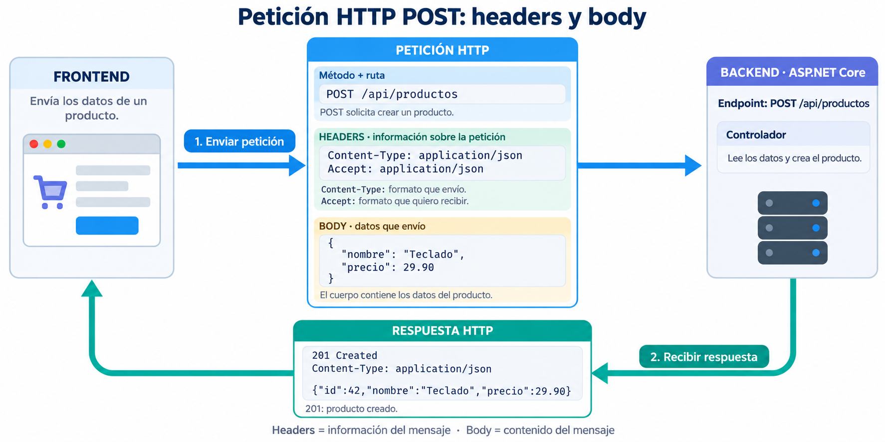

# 📘 Guía de Iniciación a .NET (Backend)

> **Resumen:** Notas técnicas sobre el ecosistema .NET, sintaxis moderna de C\# y patrones para desarrollo backend.
> **Versión:** Referencia para .NET 10 LTS (soporte largo) y C\# 14. Información revisada el 13-10-2026.
> **Ejemplos:** cada bloque es independiente. Las instrucciones de consola se colocan en `Program.cs`; los fragmentos de métodos, dentro de su clase. Los controladores requieren un proyecto ASP.NET Core.

## 1. .NET Framework vs .NET moderno: diferencias e historia

### Vista rápida

- **.NET Framework (2002):** plataforma original para Windows. Sigue existiendo para aplicaciones heredadas; versión 4.8.1.
- **.NET Core (2016-2019):** rediseño abierto y multiplataforma. Versiones 1.0–3.1.
- **.NET (desde 2020):** continuación unificada de .NET Core. Para proyectos nuevos, es la opción habitual.

| Versión | Dónde funciona | Qué la caracteriza | Soporte a octubre de 2026 / uso recomendado |
|---|---|---|---|
| **.NET Framework 4.8.1** | Windows | Plataforma original; usada por aplicaciones Windows, ASP.NET clásico y Web Forms. | Se mantiene según la versión de Windows. Elegirla para mantener sistemas existentes o dependencias que la requieran. |
| **.NET 6** | Windows, Linux, macOS | Consolidó la plataforma multiplataforma e introdujo mejoras como Minimal APIs y Hot Reload. | Soporte terminado en noviembre de 2024. Migrar a una versión con soporte. |
| **.NET 8** | Windows, Linux, macOS | Mejoras de rendimiento y publicación; incorporó C# 12. | LTS hasta el 10-11-2026. Muy presente en proyectos actuales; planificar la actualización de aplicaciones que lo utilicen. |
| **.NET 10** | Windows, Linux, macOS | Versión moderna más reciente de esta tabla; continúa las mejoras de rendimiento y herramientas; usa C# 14. | LTS hasta el 14-11-2028. Recomendado para proyectos nuevos. |

En la política actual, **LTS** significa soporte largo: 3 años de actualizaciones. **STS** significa soporte estándar: 2 años. Las versiones 6, 8 y 10 son LTS; el estado y las fechas cambian según la versión. Consulta la [política oficial de soporte de .NET](https://dotnet.microsoft.com/es-es/platform/support/policy/dotnet-core), las novedades de [.NET 6](https://learn.microsoft.com/es-es/dotnet/core/whats-new/dotnet-6), [.NET 8](https://learn.microsoft.com/es-es/dotnet/core/whats-new/dotnet-8/) y [.NET 10](https://learn.microsoft.com/es-es/dotnet/core/whats-new/dotnet-10), y el [ciclo de vida de .NET Framework](https://learn.microsoft.com/lifecycle/products/microsoft-net-framework).

> **Respuesta de entrevista:** .NET Framework 4.8.1 es la línea antigua para Windows. .NET 6, 8 y 10 pertenecen a la línea moderna, que funciona en varios sistemas operativos y recibe mejoras por versión. La diferencia principal entre 6, 8 y 10 es su fecha, las funciones incorporadas y el plazo de soporte; hoy elegiría .NET 10 para un proyecto nuevo y actualizaría .NET 6 u 8 porque su soporte ya terminó o está por terminar.

### ASP.NET y ASP.NET Core: la parte web de .NET

**ASP.NET** es el conjunto de herramientas de .NET para crear páginas web y APIs. Una **API web** permite que una aplicación pida o envíe datos a un servidor; por ejemplo, consultar productos desde una app móvil.

- **C#** es el lenguaje con el que escribes el código.
- **.NET** es la plataforma que permite ejecutarlo.
- **ASP.NET** aporta lo necesario para recibir peticiones web y responderlas.

| Familia | Se ejecuta sobre | Sistemas | Uso |
|---|---|---|---|
| **ASP.NET clásico (4.x)** | .NET Framework | Windows | Aplicaciones existentes con Web Forms, MVC o Web API |
| **ASP.NET Core 1–3.1** | .NET Core; algunas versiones iniciales también admitían .NET Framework | Windows, Linux, macOS con .NET Core; Windows con .NET Framework | Primeras versiones de la línea moderna |
| **ASP.NET Core 5, 6, 8, 10…** | .NET moderno de la misma versión | Windows, Linux, macOS | Nuevas aplicaciones web y APIs |

**ASP.NET Core conserva «Core» en su nombre**, aunque .NET dejó de llamarse «.NET Core» desde la versión 5. Ejemplo: .NET 10 + ASP.NET Core 10.

Los nombres siguientes son formas de construir aplicaciones, no versiones consecutivas:

- **Web Forms:** páginas con controles y eventos; pertenece a ASP.NET clásico.
- **MVC (Modelo–Vista–Controlador):** separa los datos, la página que ve el usuario y el código que atiende la petición. Existe en ambas familias.
- **ASP.NET Web API:** herramienta del ASP.NET clásico para devolver datos, normalmente JSON.
- **APIs en ASP.NET Core:** pueden usar controladores o **Minimal APIs**, que definen las rutas directamente con menos código.
- **Razor Pages:** organiza una web por páginas y su código asociado; pertenece a ASP.NET Core.
- **Blazor:** permite crear interfaces web interactivas con C# y componentes.

Referencias: [ASP.NET clásico](https://learn.microsoft.com/aspnet/overview) y [ASP.NET Core](https://learn.microsoft.com/aspnet/core/overview?view=aspnetcore-10.0).

## 2\. 🛠️ Configuración y Entorno

Para empezar a trabajar con el ecosistema moderno de Microsoft.

  * **SDK:** herramientas para crear y compilar proyectos .NET. Descarga una versión LTS (Long Term Support): [.NET Download](https://dotnet.microsoft.com/es-es/download/dotnet).
  * **Editor:** para .NET 10, Visual Studio 2026 (18.0 o posterior) o VS Code con **C\# Dev Kit**. Visual Studio 2022 permite trabajar con versiones anteriores, como .NET 8. [Compatibilidad oficial](https://learn.microsoft.com/dotnet/core/porting/versioning-sdk-msbuild-vs).

### Comandos Esenciales (CLI)

La terminal es tu amiga en .NET Core/.NET 5+.

```bash
dotnet --version            # Verificar instalación
dotnet new list             # Ver plantillas disponibles
dotnet new webapi --use-controllers -n MyApi # Crear una API con controladores
dotnet new console -n App   # Crear aplicación de consola
dotnet run                  # Ejecutar proyecto
dotnet build                # Compilar proyecto
```

## 3\. ⌨️ Sintaxis y Sistema de Tipos

C\# es un lenguaje **tipado**: cada variable tiene un tipo que determina qué valores admite. Es **compilado**: el código se traduce antes de ejecutarse.

**¿Qué ocurre al ejecutar?** El compilador convierte C# a **IL** (*lenguaje intermedio*). El **runtime .NET** —el entorno que ejecuta la aplicación— carga ese código. Normalmente, el **JIT** (*compilador justo a tiempo*) traduce cada parte a instrucciones del procesador (código máquina) cuando hacen falta. Por eso, compilar C# no siempre produce un único ejecutable nativo.

### Fundamentos de Sintaxis y Control

Un programa C# combina instrucciones que realizan tareas y elementos que organizan el código. Para empezar a leerlo, conviene reconocer estos tres:

- **`class` (clase):** define los datos y las operaciones de un tipo de objeto. Por ejemplo, una clase `Producto` puede tener un nombre y un método para actualizar su precio.
- **`namespace` (espacio de nombres):** agrupa clases y otros tipos bajo un nombre común. Por ejemplo, `System` contiene tipos como `Console`.
- **`using`:** permite utilizar esos tipos con su nombre corto. Con `using System;`, puedes escribir `Console` en lugar de `System.Console`.

La aplicación necesita un **punto de entrada**: el lugar donde comienza a ejecutarse. Puede declararse con un método llamado `Main`. En las plantillas modernas de consola y Web API, suele bastar con escribir las instrucciones iniciales en `Program.cs`; el compilador crea ese método por ti. Esta forma se llama **instrucciones de nivel superior**.

Por ejemplo, este programa empieza mostrando un mensaje en la consola:

```csharp
using System;

Console.WriteLine("Programa iniciado");
```

  * **Datos Primitivos:** Cubiertos en el *Cheatsheet* (ej: `int`, `bool`, `char`).
  * **Funciones/Métodos:** Bloques de código reutilizables.
  * **Estructuras de Control:** `if/else`, `switch`, y bucles (`for`, `foreach`, `while`).

#### Cheatsheet de Tipos Básicos

```csharp
/*
   ┌─────────────────────────────────────────────────────────────┐
   │               C# TYPE SYSTEM CHEATSHEET 🧪                  │
   └─────────────────────────────────────────────────────────────┘
*/

// 1. NÚMEROS (NUMBERS)
int     entero      = 42;             // Estándar para contar (-2B a +2B)
long    gigante     = 9_000_000L;     // Entero de 64-bits (Nota el guion bajo y 'L')
double  cientifico  = 3.14159;        // Punto flotante estándar (Impreciso para $)
float   graficos    = 3.14f;          // Menor peso, usado en Unity/Juegos ('f')
decimal dinero      = 100.50m;        // Habitual para importes; representa decimales como 0.1m

// 2. TEXTO (STRINGS)
char    letra       = 'A';            // Una unidad UTF-16; algunos símbolos necesitan dos char
string  texto       = "Hola Mundo";   // Comillas dobles estándar
string  json        = """             
                      {
                        "prop": "val" 
                      }
                      """;            // Raw String Literal (C# 11+): Ideal para JSON/XML multilínea

// 3. LÓGICA (BOOLEAN)
bool    esValido    = true;           // true o false; sizeof(bool) = 1 byte

// 4. FECHAS (DATES - MODERN .NET)
DateTime fechaHora  = DateTime.Now;             // Fecha y hora actual local: 2025-10-05 14:30:00
DateOnly soloFecha  = new DateOnly(2025,10,5);  // Solo fecha, sin hora: 2025-10-05
TimeOnly soloHora   = new TimeOnly(14,30);      // Solo hora, sin fecha: 14:30

// 5. IDENTIFICADORES & BYTES
Guid    idUnico     = Guid.NewGuid(); // Identificador de 128 bits; útil entre varios sistemas. Útil para Primary Keys: a1b2c3d4-e5f6...
byte    unByte      = 255;            // De 0 a 255 (Para manipulación de archivos/imágenes)
```

#### Declaración de Variables: `var` vs `dynamic` vs `const`

Esta es una pregunta clásica de entrevista.

  * **`var`**: Inferencia estática en **tiempo de compilación**. El tipo queda fijado y no cambia; no equivale a `dynamic`.
  * **`const`**: Valor fijo (inmutable) conocido en compilación. Se asigna al declararlo y no puede reasignarse.
  * **`dynamic`**: El tipo se comprueba mientras el programa se ejecuta. El compilador no puede detectar algunos errores antes; úsalo cuando sea necesario.

<!-- end list -->

```csharp
// ✅ Recomendado: El compilador sabe que es int
var edad = 25; 

// 🔒 Constante: Nunca cambiará
const double PI = 3.1416; 

// ⚠️ Peligroso: Si te equivocas, falla cuando el programa corre, no al compilar
dynamic datos = "Hola"; 
datos = 10; // Esto es válido en dynamic, pero daría error en var
```

#### `var` en C# vs JavaScript

| C# `var` | JavaScript `var` |
|---|---|
| El compilador infiere un tipo estático una vez | Puede contener valores de tipos distintos |
| Solo variable local con inicializador | Puede declararse sin inicializar; tiene alcance de función o global |
| `var x = 1; x = "a";` no compila | `var x = 1; x = "a";` es válido |

En JavaScript moderno suele preferirse `let` o `const`, cuyo alcance es de bloque.

#### Strings: Interpolación y Verbatim

  * **Interpolación (`$`)**: Insertar variables directamente.
  * **Verbatim (`@`)**: conserva barras y saltos tal como se escriben; una comilla se duplica (`""`). Útil para rutas de archivos

<!-- end list -->

```csharp
string nombre = "Ana";
// Combinando ambos (muy útil en rutas o JSON a mano)
string ruta = $@"C:\Usuarios\{nombre}\Documentos"; 
string texto = @"Primera línea
Segunda línea; ruta: C:\temp";
string json = @"{""activo"":true}"; // Comillas dobles duplicadas
```

`@"{}"` es una cadena literal de dos llaves; no interpola ni procesa escapes. Para interpolar, usa `$"{nombre}"`. En una cadena interpolada, las llaves literales se escriben `{{` y `}}`.

#### Nulabilidad: `?`, `?.` y `??`

- `string?`: referencia que puede ser `null` (con *nullable reference types* habilitados).
- `int?`: abreviatura de `Nullable<int>`; un tipo de valor que admite `null`.
- `?.`: acceso condicional; devuelve `null` si el receptor es `null`.
- `??`: valor alternativo si la expresión de la izquierda es `null`.

```csharp
string? nombre = null;
int? longitud = nombre?.Length;
int segura = longitud ?? 0;
```

`?` no añade una comprobación automática en ejecución para referencias: el compilador analiza nulabilidad y emite advertencias.

### 💾 Tipos de Valor vs Tipos de Referencia

**Al asignar una variable a otra, se copia el valor o la referencia al objeto.** Esa diferencia determina si las dos variables comparten datos.

#### 1️⃣ Tipos de Valor → *Como una fotocopia en papel* 🧾

Un **tipo de valor guarda directamente el dato**.
Cuando asignas una variable a otra, se hace una **copia independiente**.

##### 🧠 Analogía

Es como hacer una **fotocopia de un documento**:

* Tienes el original
* Haces una copia
* Si escribes en la copia, **el original no cambia**

Son dos hojas completamente separadas.

##### ✅ Ejemplo simple en C#

```csharp
int vidasJugador1 = 3;
int vidasJugador2 = vidasJugador1; // Se copia el VALOR

vidasJugador2 = 1;

Console.WriteLine(vidasJugador1); // 3 ✅ No cambia
Console.WriteLine(vidasJugador2); // 1
```

#### 2️⃣ Tipos de Referencia → *Como un documento compartido en Google Drive* 🔗

Un **tipo de referencia no guarda el objeto en sí**, guarda una **referencia (dirección)** hacia ese objeto.

##### 🧠 Analogía

Es como un **documento compartido online**:

* Dos personas abren el mismo archivo
* Si una escribe algo…
* La otra **ve el cambio al instante**

No hay dos documentos: hay **uno solo compartido**.

##### ✅ Ejemplo simple en C#

```csharp
var cuenta1 = new Cuenta { Saldo = 100 };
var cuenta2 = cuenta1; // Se copia la REFERENCIA

cuenta2.Saldo = 500;

Console.WriteLine(cuenta1.Saldo); // 500 ✅ ¡Cambia también!
Console.WriteLine(cuenta2.Saldo); // 500

public class Cuenta
{
    public int Saldo;
}
```

#### 📊 Comparativa

| Concepto | Tipo de valor | Tipo de referencia |
|---|---|---|
| ¿Qué guarda la variable? | El dato directamente | Una referencia al objeto |
| Al asignar a otra variable | Copia el valor | Copia la referencia; ambas apuntan al mismo objeto |
| Al modificar la copia | Cambiar un valor simple, como `int`, no modifica el original | Modificar el objeto compartido se ve desde ambas variables |
| ¿Dónde viven? | Depende del contexto: dentro de otro objeto o en la pila de llamadas (memoria temporal de los métodos activos) | Normalmente, el objeto está en el heap (zona donde .NET guarda y administra objetos) |
| Analogía de ubicación | Una hoja dentro de una carpeta o sobre el escritorio: depende del contenedor | Un documento en un archivador; la variable conserva cómo encontrarlo |
| Ejemplos | `int`, `bool`, `decimal`, `struct` | `class`, arrays, `List<T>` |

Copiar un `struct` copia sus campos: si alguno contiene una referencia, el objeto apuntado puede seguir compartido. Reasignar una variable de referencia para que apunte a otro objeto tampoco cambia la otra variable.

Referencia: [Tipos de valor y copia de referencias](https://learn.microsoft.com/dotnet/csharp/language-reference/builtin-types/value-types).

## 4\. 🧬 Programación Orientada a Objetos (POO)

### ✍️ Convenciones de Nomenclatura (Estándar C\#)

Seguir estas convenciones de estilo es importante para mantener *Clean Code* y la consistencia en proyectos .NET:

| Elemento | Convención | Ejemplo de nombre |
|---|---|---|
| Clases, métodos, propiedades y namespaces | PascalCase: cada palabra empieza con mayúscula | `EntradaService`, `CalcularPrecio` |
| Parámetros y variables locales | camelCase: primera palabra con minúscula | `edad`, `precioFinal` |
| Campos privados, incluidos los `readonly` | Guion bajo + camelCase | `_entradaService` |
| Interfaces | Prefijo `I` + PascalCase | `IEntradaService` |

El nombre no determina el acceso: `public`, `private` y `protected` se declaran aparte.

### Anatomía de una Clase Típica

Una **clase** es la plantilla para crear objetos.

  * **Creación de objeto:** puedes crearlo con `var object = new Class();` o recibir uno creado por otro componente. Con DI, el contenedor crea o reutiliza las dependencias y te las entrega.

<!-- end list -->

```csharp
// Uso:
var lapiz = new Producto("Lápiz HB");
lapiz.AñadirStock(10);

public class Producto
{
    // 1. Campo (Field) Variable interna de la clase, típicamente privada con convención _camelCase
    private int _stockMinimo = 5;

    // 2. Propiedad (Property): Encapsula el acceso al campo, controlando su lectura/escritura (pública con PascalCase)
    //    Usando 'auto-implemented property' (lo más común):
    public string Nombre { get; set; }

    // 3. Constructor: Método especial que se ejecuta al crear el objeto (con 'new').
    public Producto(string nombreInicial)
    {
        Nombre = nombreInicial;
    }

    // 4. Método (Method): Define la acción o comportamiento del objeto.
    public void AñadirStock(int cantidad)
    {
        // Lógica de negocio
        if (cantidad < 0) return;

        Console.WriteLine($"Añadiendo {cantidad} unidades a {Nombre}.");
    }
}
```

### `static`: un dato común o una función que llamas desde la clase

**Para acceder a un miembro `static`, no necesitas crear una instancia de la clase con `new`.** Una instancia es un objeto creado a partir de una clase. Por ejemplo, puedes leer `Empleado.Empresa` directamente, sin crear antes un empleado.

`static` puede aplicarse a campos, propiedades y métodos. Los campos y propiedades pertenecen a la clase y se comparten; los métodos se llaman usando el nombre de la clase.

- **Datos compartidos:** información común a todos los objetos, como el nombre de la empresa.
- **Funciones de utilidad:** operaciones que reciben datos y devuelven un resultado sin necesitar un objeto concreto, como convertir minutos en segundos.

**Ejemplo: los empleados de un cine.** Cada empleado tiene su nombre, pero todos trabajan para la misma empresa.

```csharp
var lucia = new Empleado { Nombre = "Lucía" };
var marcos = new Empleado { Nombre = "Marcos" };

System.Console.WriteLine(lucia.Nombre);    // Lucía
System.Console.WriteLine(marcos.Nombre);   // Marcos
System.Console.WriteLine(Empleado.Empresa); // Cine Centro

// Cambiamos el dato común una sola vez.
Empleado.Empresa = "Cine Norte";
System.Console.WriteLine($"{lucia.Nombre}: {Empleado.Empresa}");  // Lucía: Cine Norte
System.Console.WriteLine($"{marcos.Nombre}: {Empleado.Empresa}"); // Marcos: Cine Norte

public class Empleado
{
    public string Nombre { get; set; } = "";      // Uno por empleado
    public static string Empresa = "Cine Centro"; // Común a la clase
}
```

| Dato | Cómo se lee | Qué significa |
|---|---|---|
| `Nombre`, sin `static` | `lucia.Nombre` | El nombre de ese empleado |
| `Empresa`, con `static` | `Empleado.Empresa` | El nombre común de la empresa |

**Analogía:** el nombre de cada empleado está en su tarjeta. El nombre de la empresa está en el cartel común del cine.

Una lista con `static` funciona igual: hay una lista compartida, no una lista nueva por cada objeto. Una lista sin `static`, creada dentro de cada objeto, es independiente.

#### Métodos estáticos

Un método `static` se llama usando el nombre de la clase. Es útil para operaciones que no necesitan datos de un objeto concreto:

```csharp
System.Console.WriteLine(Tiempo.ConvertirASegundos(2)); // 120

public static class Tiempo
{
    public static int ConvertirASegundos(int minutos)
    {
        return minutos * 60;
    }
}
```

No necesitamos crear `new Tiempo()`: entregamos los minutos y obtenemos los segundos. Una clase declarada `static` no se instancia y contiene miembros estáticos.

- `static` no significa «no se puede cambiar»: el ejemplo cambia la empresa.
- En una API, los datos estáticos se comparten entre las peticiones de esa aplicación. Evita usarlos para guardar el carrito o los datos personales de cada usuario.
- Una lista estática no es una base de datos: se pierde al reiniciar la aplicación y modificarla desde varias peticiones a la vez requiere coordinación.

### Modificadores de Acceso y Sobrecarga

| Modificador | Acceso | Descripción |
| :--- | :--- | :--- |
| **`public`** | Público | Accesible desde donde pueda utilizarse la clase que contiene el miembro. |
| **`private`** | Limitado | Solo accesible **dentro de la misma clase**. (Recomendado para campos internos). |
| **`protected`** | Limitado | Accesible dentro de la misma clase y por las **clases hijas (heredadas)**. |

#### Ejemplos de Modificadores de Acceso

```csharp
// Uso desde fuera de las clases:
var cuenta = new CuentaBancaria();
cuenta.NumeroCuenta = "12345";       // ✅ OK: Es public
// cuenta._saldo = 500m;             // ❌ Error: Es private
// decimal interes = cuenta.Interes; // ❌ Error: Es protected

public class CuentaBancaria
{
    // 1. private: Solo accesible dentro de esta clase (Encapsulación).
    private decimal _saldo = 1000m;

    // 2. protected: Accesible aquí y en clases que hereden de CuentaBancaria.
    protected decimal Interes = 0.05m;

    // 3. public: Accesible desde cualquier lugar.
    public string NumeroCuenta { get; set; } = "";

    // Método público que interactúa con el campo privado
    public decimal ObtenerSaldo()
    {
        return _saldo;
    }
}

public class CuentaAhorro : CuentaBancaria
{
    public void CalcularInteres()
    {
        // ✅ Acceso permitido a 'protected' (Interes), porque es una clase hija.
        decimal nuevoInteres = this.ObtenerSaldo() * this.Interes;

        // ❌ Error de compilación si intentamos acceder a '_saldo' directamente,
        // porque '_saldo' es 'private' en la clase base.
    }
}
```

### Sobrecarga de Métodos (Overloading)

La sobrecarga permite definir **múltiples métodos con el mismo nombre** dentro de una clase, siempre y cuando tengan **diferentes firmas**. La firma se define por el **número** o el **tipo** de sus parámetros.

> **Importante:** El tipo de retorno del método **no** es suficiente para diferenciar una sobrecarga.

#### Ejemplo de Sobrecarga

```csharp
// Uso: El compilador elige automáticamente qué método usar
var calc = new Calculadora();
var resultadoInt = calc.Sumar(5, 10);        // Llama a Sobrecarga 1
var resultadoDecimal = calc.Sumar(5.5m, 10m);  // Llama a Sobrecarga 3

public class Calculadora
{
    // Sobrecarga 1: Suma de dos enteros
    public int Sumar(int a, int b)
    {
        return a + b;
    }

    // Sobrecarga 2: Suma de tres enteros (diferente número de parámetros)
    public int Sumar(int a, int b, int c)
    {
        return a + b + c;
    }

    // Sobrecarga 3: Suma de dos decimales (diferente tipo de parámetros)
    public decimal Sumar(decimal a, decimal b)
    {
        return a + b;
    }
}
```

### Clases y Herencia: `virtual` vs `override`

La **Herencia** permite que una clase hija adquiera las propiedades y métodos de una clase padre. Los conceptos `virtual` y `override` son la base del **Polimorfismo**.

| Palabra Clave | Uso | Propósito |
| :--- | :--- | :--- |
| **`virtual`** | Se define en el **método de la clase padre**. | Permite que este comportamiento **pueda ser modificado** (sobrescrito) por las clases que hereden de ella. |
| **`override`** | Se define en el **método de la clase hija**. | **Reemplaza** el comportamiento definido en la clase padre. |

**`base`** permite acceder desde la clase hija a la implementación de la clase padre. Se usa para reutilizar o ampliar su comportamiento; también puede llamar al constructor base con `: base(...)`.

#### Ejemplo de Código:

```csharp
// Uso:
Empleado e = new Empleado();
Manager m = new Manager();

Console.WriteLine(e.CalcularSalario()); // Salario base según contrato.
Console.WriteLine(m.CalcularSalario()); // Salario base según contrato. Más bonificación...

public class Empleado
{
    // Este método es virtual, la clase hija PUEDE cambiarlo.
    public virtual string CalcularSalario()
    {
        return "Salario base según contrato.";
    }
}

public class Manager : Empleado
{
    // Usamos override para cambiar el comportamiento del padre.
    public override string CalcularSalario()
    {
        return base.CalcularSalario() + " Más bonificación por objetivos.";
        // 'base' llama a la implementación original del padre.
    }
}
```

### Interfaces

Definen un **contrato**: qué operaciones ofrece un componente. En estos ejemplos, la interfaz declara las operaciones y la clase aporta el código. C# moderno también permite implementaciones predeterminadas en interfaces.

> **Importancia en Backend:** facilitan cambiar implementaciones y probar componentes con objetos que simulan sus dependencias. DI también puede inyectar clases concretas; una interfaz ayuda a depender de su contrato.

```csharp
public interface IGuardable
{
    // Define el contrato: debe haber un método Guardar sin implementación.
    void Guardar(string datos);
}

// La clase concreta implementa el contrato
public class RepositorioSql : IGuardable
{
    public void Guardar(string datos)
    {
        Console.WriteLine($"Guardando '{datos}' en la base de datos SQL.");
    }
}
```
Referencias: [Interfaces](https://learn.microsoft.com/dotnet/csharp/fundamentals/types/interfaces) e [instrucciones de nivel superior](https://learn.microsoft.com/dotnet/csharp/fundamentals/program-structure/top-level-statements).

## 5\. 🔍 Generics y Colecciones

Los **Genéricos (`<T>`)** nos permiten escribir código reutilizable y seguro sin especificar el tipo de dato exacto hasta el momento de usarlo.

> **¿Por qué usarlos?** El compilador comprueba los tipos: `List<string>` no acepta enteros. `List<int>` evita convertir cada entero en `object` (**boxing**, una conversión que puede crear un objeto adicional). Los genéricos no evitan todas las conversiones: `List<object>` sí hace boxing al guardar un `int`.

```csharp
// Lista genérica: Solo acepta enteros
List<int> numeros = new List<int>(); 

// Método genérico
T DevolverElemento<T>(T elemento)
{
    return elemento;
}
```

### Colecciones Básicas

Las colecciones te permiten agrupar datos:

  * **`array`:** Colección de tamaño fijo y del mismo tipo. `int[] numeros = new int[5];`
  * **`List<T>`:** Colección dinámica (genérica) del mismo tipo.
  * **`Dictionary<TKey, TValue>`:** Colección de pares clave-valor (genérica).
  * **`HashSet<T>`:** Colección sin orden garantizado; no admite duplicados según su comparación de igualdad.
  * **Tupla de valor (`ValueTuple`):** Agrupa varios datos: `(int id, string nombre) usuario = (1, "Ana");`. Esta sintaxis crea un tipo de valor; `System.Tuple<...>` es una clase.

Referencias: [Tuplas de valor](https://learn.microsoft.com/dotnet/csharp/language-reference/builtin-types/value-tuples) y [boxing](https://learn.microsoft.com/dotnet/csharp/programming-guide/types/boxing-and-unboxing).

## 6. Delegados y programación funcional

### 🚀 Funciones de Primera Clase y Delegados (Callbacks)

> **Concepto Clave:** En C\#, las funciones pueden tratarse como variables. Esto permite pasar lógica como parámetro (Callbacks).

#### 1\. Action (Void)

Delegado que **NO retorna valor** (void).

  * *Uso:* Ejecutar una operación, como escribir un log, que no devuelve un valor. La llamada normal espera a que termine; `Action` no implica asincronía.

<!-- end list -->

```csharp
// Recibe un string, no devuelve nada
void ProcesarDatos(Action<string> fnCallback, string mensaje)
{
    Console.WriteLine("Inicio del proceso...");
    fnCallback(mensaje); // Ejecutamos la función que nos pasaron
    Console.WriteLine("Fin del proceso.");
}

// Uso:
var miLogger = (string msg) => Console.WriteLine($"LOG: {msg}");
ProcesarDatos(miLogger, "Usuario registrado");
```

#### 2\. Func (Return)

Delegado que **SÍ retorna valor**.

  * `Func<Entrada, Salida>`: El último tipo es siempre lo que devuelve.
  * *Uso:* Transformar datos, cálculos, LINQ.

<!-- end list -->

```csharp
// Recibe string, devuelve string transformado
void Transformar(Func<string, string> fnTransformacion, string texto)
{
    string resultado = fnTransformacion(texto);
    Console.WriteLine($"Resultado: {resultado}");
}

// Uso:
var aMayusculas = (string s) => s.ToUpper();
Transformar(aMayusculas, "hola mundo"); // Imprime: HOLA MUNDO
```

#### 3\. Lambda Functions (`=>`)

Es la sintaxis concisa para crear delegados (`Action` o `Func`) en línea.

```csharp
// Lógica que recibe string y devuelve string (Func)
Func<string, string> aMayusculas = (texto) => texto.ToUpper();

// Lógica que recibe string y no devuelve nada (Action)
Action<string> logger = (msg) => Console.WriteLine($"LOG: {msg}");
```

### Principios de programación funcional

- **Funciones puras:** mismo input → mismo output; sin efectos secundarios.
- **Inmutabilidad:** evita modificar datos compartidos; crea valores nuevos.
- **Funciones de primera clase:** asigna funciones a variables, pásalas como argumentos y devuélvelas.
- **Composición:** combina funciones pequeñas para construir una transformación mayor.
- **Declarativo:** describe el resultado (`Where`, `Select`) en lugar de los pasos manuales.

```csharp
var numeros = new[] { -1, 2, 3 };
var resultado = numeros
    .Where(n => n > 0)
    .Select(n => n * 2)
    .ToArray(); // transforma; no modifica la lista original
```

LINQ suele usar **evaluación diferida**: espera hasta que el programa recorre los resultados para ejecutar la consulta. Por ejemplo, `ToArray()` la ejecuta y guarda los resultados en un array.

## 7\. 📊 LINQ (Language Integrated Query)

LINQ permite consultar y transformar datos de arrays y colecciones. Con un proveedor, como EF Core, algunas consultas pueden traducirse para ejecutarse en una base de datos.

Existen dos sintaxis:

1.  **Query Syntax (Parecido a SQL):** Más legible para consultas complejas.
2.  **Method Syntax (Lambdas):** Más común, conciso y potente.

<!-- end list -->

```csharp
var numeros = new List<int> { 1, 5, 8, 10, 3 };

// 1. Method Syntax (Más usada en el día a día)
var mayoresDeCinco = numeros.Where(n => n > 5).ToList();

// 2. Query Syntax
var query = from n in numeros
            where n > 5
            select n;
```

## 8. Web API: HTTP, controladores y datos

### Controladores, endpoints y métodos HTTP


- **HTTP:** reglas que usan el navegador o una app para comunicarse con un servidor. Envías una petición y recibes una respuesta.
- **Controlador:** clase que agrupa las operaciones de una parte de la API. Por ejemplo, `ProductosController` atiende consultas y altas de productos. Es como una recepción: recibe la petición, pide el trabajo a los servicios necesarios y entrega la respuesta.
- **Acción:** método del controlador que atiende una petición. Por ejemplo, `Obtener`.
- **Endpoint:** punto de entrada a una operación de la API. Se identifica por el método HTTP y la ruta: `GET /api/productos/5`.

```text
La app pide: GET /api/productos/5
    → ASP.NET Core encuentra la ruta y el método HTTP
    → llama a Obtener(5) en ProductosController
    → el controlador devuelve una respuesta a la app
```

El **método HTTP** indica qué operación solicita el cliente. La **ruta** indica sobre qué datos:

| Método HTTP | Atributo en C# | Uso habitual | Ejemplo |
|---|---|---|---|
| `GET` | `[HttpGet]` | Consultar productos | `GET /api/productos` |
| `POST` | `[HttpPost]` | Enviar un producto para crearlo | `POST /api/productos` |
| `PUT` | `[HttpPut]` | Sustituir los datos de un producto | `PUT /api/productos/5` |
| `PATCH` | `[HttpPatch]` | Cambiar solo algunos datos | `PATCH /api/productos/5` |
| `DELETE` | `[HttpDelete]` | Eliminar un producto | `DELETE /api/productos/5` |

`GET /api/productos` y `POST /api/productos` son endpoints diferentes, aunque compartan la ruta. Estos atributos seleccionan el método que se ejecuta; el código de ese método realiza la operación.

**Ejemplo de controlador:** devuelve datos de muestra y recibe un producto, sin guardarlo en una base de datos.

```csharp
using Microsoft.AspNetCore.Mvc;

[ApiController]
[Route("api/productos")]
public class ProductosController : ControllerBase
{
    [HttpGet("{id}")] // GET /api/productos/5
    public IActionResult Obtener(int id)
    {
        return Ok(new { Id = id, Nombre = "Teclado" });
    }

    [HttpPost] // POST /api/productos
    public IActionResult Recibir([FromBody] ProductoEntrada producto)
    {
        return Ok(new { Recibido = producto.Nombre });
    }
}

public class ProductoEntrada
{
    public string Nombre { get; set; } = "";
}
```

- `[Route("api/productos")]`: parte común de las direcciones del controlador.
- `[HttpGet("{id}")]`: añade el identificador a esa ruta; el `5` de la URL llega al parámetro `id`.
- `[FromBody]`: convierte el JSON enviado en el cuerpo de la petición en un objeto C#. Aquí puedes enviar `{"nombre":"Ratón"}`.
- `ControllerBase`: clase de ASP.NET Core que aporta herramientas para responder, como `Ok(...)`.
- `IActionResult`: representa la respuesta HTTP; se detalla en [Respuestas del controlador](#respuestas-del-controlador-iactionresult-y-actionresultt).
- `[ApiController]`: activa ayudas para APIs; por ejemplo, responde **400** (petición incorrecta) si los datos no superan la validación.

Para activar los controladores, añade en `Program.cs`:

```csharp
var builder = WebApplication.CreateBuilder(args);
builder.Services.AddControllers();
var app = builder.Build();
app.MapControllers();
app.Run();
```

Referencia: [APIs con controladores en ASP.NET Core](https://learn.microsoft.com/aspnet/core/web-api?view=aspnetcore-10.0).

#### Cómo se construye la URL: rutas y nombres C#

**El nombre del método C# no se añade automáticamente a la URL.** En el ejemplo anterior, `Obtener` atiende `GET /api/productos/5`: la dirección sale de `[Route("api/productos")]` + `[HttpGet("{id}")]`. Puedes renombrarlo y esa ruta seguirá igual.

Los **tokens** `[controller]` y `[action]` se sustituyen al preparar las rutas y ahorran escribir nombres repetidos. `{id}` es distinto: un parámetro cuyo valor llega en cada petición.

| Marcador | Se sustituye por | Ejemplo |
|---|---|---|
| `[controller]` | Nombre del controlador sin el sufijo `Controller` | `ProductosController` → `Productos` |
| `[action]` | Nombre de la acción; normalmente, el nombre del método | `Obtener(int id)` → `Obtener` |
| `{id}` | Valor que llega en la URL de cada petición | `/5` → `id = 5` |

**Ejemplo con ambos tokens:**

```csharp
using Microsoft.AspNetCore.Mvc;

[ApiController]
[Route("api/[controller]/[action]")]
public class ProductosController : ControllerBase
{
    [HttpGet("{id}")]
    public IActionResult Obtener(int id) => Ok(new { Id = id });
}
```

La ruta queda `GET /api/Productos/Obtener/5`. Aquí `Obtener` aparece porque hemos incluido `[action]`.

| Ruta base del controlador | Atributo de `Obtener(int id)` | Endpoint resultante |
|---|---|---|
| `[Route("api/productos")]` | `[HttpGet("{id}")]` | `GET /api/productos/5` |
| `[Route("api/[controller]")]` | `[HttpGet("{id}")]` | `GET /api/Productos/5` |
| `[Route("api/[controller]/[action]")]` | `[HttpGet("{id}")]` | `GET /api/Productos/Obtener/5` |

- **Ventaja:** menos nombres repetidos y un formato común para varios controladores.
- **Consecuencia:** renombrar el controlador o la acción puede cambiar la URL cuando usas su token. Las rutas escritas explícitamente permiten mantener una URL estable aunque cambien los nombres C#.

Referencia: [Enrutamiento y sustitución de tokens](https://learn.microsoft.com/aspnet/core/mvc/controllers/routing?view=aspnetcore-10.0#token-replacement-in-route-templates-controller-action-area).

### Serialización y Deserialización

Es el proceso de **convertir un objeto C\#** (como una instancia de una clase) **en un formato de transmisión** (como JSON o XML) y viceversa. Esto es fundamental para las API Web.

  * **Serialización:** `Objeto C#` $\rightarrow$ `JSON/XML` (Para enviar datos a un cliente).
  * **Deserialización:** `JSON/XML` $\rightarrow$ `Objeto C#` (Para recibir datos del cliente).

Para JSON, .NET incluye **`System.Text.Json`**. XML utiliza otras bibliotecas, como `System.Xml.Serialization`.

```csharp
// Serialización a JSON
var producto = new { Nombre = "Teclado" };
string json = System.Text.Json.JsonSerializer.Serialize(producto);
// Output: {"Nombre":"Teclado"}
```

### Petición POST: headers y body



- **Headers (cabeceras):** información sobre el mensaje. `Content-Type` indica el formato enviado; `Accept`, el formato de respuesta que el cliente acepta.
- **Body (cuerpo):** datos enviados; aquí, el nombre y el precio del producto en JSON.
- El diagrama muestra una API que crea el producto y responde **201 Created**. El ejemplo C# anterior solo recibe los datos y responde **200 OK**.

#### Usar los headers y el body en un controlador

**Una misma acción puede recibir datos del body y de varios headers.** ASP.NET Core los lee y los entrega como parámetros al método:

| Atributo | Qué lee | Ejemplo |
|---|---|---|
| `[FromBody]` | El cuerpo de la petición; convierte el JSON en un objeto C# | `{"a":10,"b":3}` → objeto `Numeros` |
| `[FromHeader]` | La cabecera cuyo nombre coincide con el parámetro | Parámetro `host` → header `Host` |
| `[FromHeader(Name = "Content-Length")]` | Una cabecera con el nombre indicado | Header `Content-Length` → parámetro `longitud` |

```csharp
using Microsoft.AspNetCore.Mvc;

[ApiController]
[Route("api/calculos")]
public class CalculosController : ControllerBase
{
    [HttpPost("sumar")]
    public IActionResult Sumar(
        [FromBody] Numeros numeros,
        [FromHeader] string? host,
        [FromHeader(Name = "Content-Length")] long? longitud)
    {
        return Ok(new
        {
            Resultado = numeros.A + numeros.B,
            Host = host,
            BytesDelBody = longitud
        });
    }
}

public class Numeros
{
    public decimal A { get; set; }
    public decimal B { get; set; }
}
```

**Petición de ejemplo:**

```http
POST /api/calculos/sumar HTTP/1.1
Host: localhost:5000
Content-Type: application/json
Content-Length: 14

{"a":10,"b":3}
```

- `numeros.A` vale `10`; `numeros.B`, `3`; la suma devuelve `13`.
- `host` contiene `localhost:5000`: dirección y puerto del servidor al que se envía la petición.
- `longitud` vale `14`: tamaño del cuerpo en **bytes**, no número de campos JSON. Normalmente lo calcula el cliente HTTP; esta cabecera puede faltar, por eso usamos `long?`.
- `Name` permite leer cabeceras con guiones o usar un nombre de parámetro distinto. Los nombres de cabecera no distinguen mayúsculas y minúsculas.
- Usa un solo parámetro `[FromBody]`; agrupa los datos del cuerpo en una clase. Puedes añadir varios parámetros `[FromHeader]`.
- Con `[ApiController]`, un objeto como `Numeros` normalmente se obtiene del body aunque omitas `[FromBody]`; escribirlo explícitamente deja claro de dónde vienen los datos.

Referencia: [Origen de los parámetros de una acción](https://learn.microsoft.com/aspnet/core/web-api?view=aspnetcore-10.0#binding-source-parameter-inference).

### GET por identificador: buscar y devolver un objeto

Dentro de un controlador con `[Route("api/personas")]`, esta acción atiende `GET /api/personas/5`:

```csharp
[HttpGet("{id}")]
public People Get(int id) => Repository.People.First(p => p.Id == id);
```

Se presupone que `People` es la clase de persona y `Repository.People` contiene la lista de personas. La composición de esta URL se explica en [Cómo se construye la URL](#cómo-se-construye-la-url-rutas-y-nombres-c).

- El primer `=>` abrevia el cuerpo del método: equivale a `{ return ...; }`.
- `First(...)` es una operación de LINQ: busca y devuelve la primera persona que cumple la condición.
- `p => p.Id == id` significa «para cada persona `p`, comprobar si su identificador coincide con el recibido».
- El objeto devuelto se convierte normalmente en JSON; el cliente no necesita conocer la clase C# `People`.

**Si no encuentra la persona, `First` lanza una excepción.** Para responder **404 Not Found** (no encontrado), usa `FirstOrDefault` y comprueba el resultado:

```csharp
[HttpGet("{id}")]
public ActionResult<People> Get(int id)
{
    var persona = Repository.People.FirstOrDefault(p => p.Id == id);
    if (persona is null)
        return NotFound(); // HTTP 404

    return Ok(persona);    // HTTP 200 + datos de la persona
}
```

### Respuestas del controlador: `IActionResult` y `ActionResult<T>`

**`IActionResult` representa una respuesta HTTP. `ActionResult<T>` permite además indicar el tipo de datos esperado**, como una persona. ASP.NET Core envía el estado y convierte los datos normalmente en JSON.

**Analogía:** es el sobre de la respuesta. Puede llevar un estado («correcto», «petición incorrecta»…) y contenido.

| Tipo de retorno | Qué permite devolver | Uso habitual |
|---|---|---|
| `People` | Un objeto de ese tipo | Devolver datos directamente |
| `IActionResult` | Respuestas HTTP como `Ok(...)` o `NotFound()` | Elegir el estado y contenido de la respuesta |
| `ActionResult<People>` | Un objeto `People` o una respuesta HTTP | Declarar los datos esperados y responder con distintos estados |

En `ActionResult<People>`, `People` es el tipo indicado entre `< >`. El GET anterior utiliza esa opción:

```text
GET /api/personas/5
    → FirstOrDefault busca la persona
    → No existe: return NotFound() → HTTP 404
    → Existe:    return Ok(persona) → HTTP 200 + persona en JSON
```

`return` termina la ejecución del método. Si devuelve `NotFound()`, ya no llega a `Ok(persona)`.

| Respuesta C# | Código HTTP | Significado |
|---|---|---|
| `Ok(datos)` | 200 | Petición correcta; devuelve datos |
| `BadRequest(mensaje)` | 400 | Datos de la petición incorrectos |
| `NotFound()` | 404 | Recurso no encontrado |
| `NoContent()` | 204 | Petición correcta; sin cuerpo de respuesta |

#### Ejemplo con `IActionResult`: disponibilidad de una reserva

Suponemos que quedan cuatro plazas. El método puede responder con un error de entrada o con los datos de disponibilidad:

```csharp
using Microsoft.AspNetCore.Mvc;

[ApiController]
[Route("api/reservas")]
public class ReservasController : ControllerBase
{
    [HttpGet("disponibilidad/{personas:int}")]
    public IActionResult ConsultarDisponibilidad(int personas)
    {
        if (personas < 1)
            return BadRequest("Indica al menos una persona.");

        return Ok(new
        {
            Personas = personas,
            Disponible = personas <= 4
        });
    }
}
```

| Petición | Respuesta |
|---|---|
| `GET /api/reservas/disponibilidad/0` | **400**: cantidad incorrecta |
| `GET /api/reservas/disponibilidad/2` | **200**: `{"personas":2,"disponible":true}` |
| `GET /api/reservas/disponibilidad/6` | **200**: `{"personas":6,"disponible":false}` |

No tener plazas sigue siendo una consulta correcta: devuelve **200** con `disponible: false`.

**Nombres parecidos:** una *acción* es el método del controlador; `ActionResult<T>` representa su resultado; `Action<T>` es un delegado de C# para ejecutar una función que no devuelve valor.

### Swagger y OpenAPI

- **OpenAPI** es un formato estándar para describir una API: rutas, métodos (`GET`, `POST`), parámetros y respuestas. Suele publicarse como un archivo JSON.
- **Swagger** es el nombre de un conjunto de herramientas que usan esa descripción. **Swagger UI** la muestra como una página web y permite probar los endpoints desde el navegador.
- Flujo: API ASP.NET Core → documento OpenAPI → Swagger UI → explorar y enviar peticiones.
- En .NET 9 y posteriores, ASP.NET Core puede generar el documento OpenAPI integrado; para la página interactiva se añade una herramienta como Swagger UI. En .NET 6 y 8 es común encontrar Swashbuckle en las plantillas o proyectos existentes.
- Habilita la interfaz solo en desarrollo, salvo que el acceso esté protegido: puede revelar rutas y detalles de la API.

> **En una frase:** OpenAPI describe la API; Swagger UI convierte esa descripción en documentación interactiva para verla y probarla. [Documentación ASP.NET Core](https://learn.microsoft.com/es-es/aspnet/core/tutorials/web-api-help-pages-using-swagger?view=aspnetcore-10.0).

## 9. Arquitectura, inyección de dependencias y SOLID

### 1. Arquitectura: quién hace cada trabajo

**Ejemplo común: una aplicación para comprar entradas de cine.** Antes de comprar, el usuario consulta el precio. En este ejemplo, los menores de 18 años pagan 7 € y los adultos, 10 €.

Separar la aplicación significa repartir el trabajo entre clases. Podemos empezar con carpetas dentro de un único proyecto.

| Pieza | Qué hace | En nuestro cine |
|---|---|---|
| **Controlador** | Recibe la petición HTTP, comprueba la entrada y devuelve una respuesta | Recibe la edad y devuelve el precio |
| **Servicio / caso de uso** | Realiza una operación de la aplicación | Calcula el precio; en una compra podría coordinar cobro, guardado y envío de la entrada |
| **Dominio** | Contiene las reglas del negocio | Un menor paga 7 €; un adulto, 10 € |
| **Infraestructura** | Se comunica con una base de datos u otros sistemas | Guarda entradas o utiliza un proveedor de correo |
| **Interfaz** | Declara qué operaciones ofrece una pieza | Permite pedir un precio sin conocer el cálculo concreto |

**Una petición paso a paso:**

1. El navegador envía `GET /api/entradas/precio?edad=15`.
2. El controlador recibe `edad = 15` y comprueba que no sea negativa.
3. Pide al servicio que calcule el precio.
4. El servicio aplica la regla del cine y devuelve `7`.
5. El controlador responde **200 OK** con `{"precio":7}`.

**Analogía:** el controlador es quien te atiende en taquilla; el servicio realiza el trabajo; las reglas de dominio son las tarifas del cine.

En este ejemplo pequeño, el servicio contiene la regla de precio. Si las reglas crecen, podemos separarlas en clases de dominio. El controlador sigue atendiendo HTTP y delegando el cálculo.

#### Interfaz y servicio: pedir algo y realizarlo

Una **interfaz** es un contrato: indica qué puedes pedir. El servicio es la clase que lo realiza.

```csharp
public interface IEntradaService
{
    decimal CalcularPrecio(int edad);
}

public class EntradaService : IEntradaService
{
    public decimal CalcularPrecio(int edad)
    {
        if (edad < 0)
            throw new System.ArgumentOutOfRangeException(nameof(edad));

        if (edad < 18)
            return 7m;

        return 10m;
    }
}
```

- `IEntradaService` promete una operación: calcular un precio a partir de una edad.
- `EntradaService` cumple esa promesa con las tarifas del cine.
- La regla no conoce rutas, JSON ni códigos HTTP. Se puede usar también desde una aplicación de consola.
- El servicio rechaza edades negativas incluso si se llama sin pasar por el controlador.

#### Inyección de dependencias: entregar el servicio al controlador

El controlador necesita un servicio para trabajar. Ese servicio es su **dependencia**.

**Inyectar** significa entregárselo desde fuera. En ASP.NET Core, lo recibimos por el constructor: el método que se ejecuta al crear el objeto.

```csharp
using Microsoft.AspNetCore.Mvc;

[ApiController]
[Route("api/entradas")]
public class EntradasController : ControllerBase
{
    private readonly IEntradaService _entradaService;

    public EntradasController(IEntradaService entradaService)
    {
        _entradaService = entradaService;
    }

    [HttpGet("precio")]
    public IActionResult ConsultarPrecio([FromQuery] int edad)
    {
        if (edad < 0)
            return BadRequest("La edad no puede ser negativa.");

        decimal precio = _entradaService.CalcularPrecio(edad);
        return Ok(new { Precio = precio });
    }
}
```

- `entradaService`: el servicio que llega al constructor.
- `_entradaService`: el campo que lo guarda para usarlo al atender la petición.
- `[FromQuery]`: lee `edad` de la parte `?edad=15` de la URL.
- El controlador valida la entrada HTTP; el servicio protege la regla para cualquier forma de uso.

#### ¿Quién crea y entrega ese servicio?

El **contenedor DI** de ASP.NET Core. Es un registro de servicios: le decimos qué clase debe utilizar cuando alguien pida una dependencia.

En el `Program.cs` mostrado en Web API, añade esta línea junto a `AddControllers()`, antes de `builder.Build()`:

```csharp
builder.Services.AddScoped<IEntradaService, EntradaService>();
```

Así asociamos el contrato `IEntradaService` con la clase `EntradaService`. Al crear `EntradasController`, ASP.NET Core ve su constructor, obtiene el servicio y se lo entrega. Cuándo se crea y reutiliza se explica en **Ciclos de vida**.

**¿Para qué sirve?**

- El controlador puede usar otro servicio que cumpla el mismo contrato.
- En una prueba, podemos entregarle un servicio de ejemplo con un precio conocido.
- ASP.NET Core se encarga de crear y reutilizar los objetos según su registro.

### 2. Ciclos de vida: cuándo se comparte el servicio

Los tres registros hacen funcionar la inyección. Cambia **cuándo se crea un objeto nuevo y cuándo se reutiliza el existente**.

**Imagina que dos componentes piden el mismo servicio durante una petición:**

| Registro | Dentro de esa petición | En la petición siguiente | Memoria y uso típico |
|---|---|---|---|
| **Transient** | Cada componente recibe un objeto distinto | Se crean objetos nuevos al solicitarlos | Más objetos creados. Útil para una herramienta pequeña que da formato a un texto |
| **Scoped** | Ambos reciben el mismo objeto | Se crea otro para esa petición | Un objeto por petición, si se solicita. Habitual para servicios que trabajan con datos de esa petición |
| **Singleton** | Ambos reciben el mismo objeto | Se reutiliza el mismo | Un objeto para toda la aplicación. Útil para un servicio de configuración o un catálogo compartido de solo lectura |

**Una instancia** es un objeto creado a partir de una clase. Un **scope** es un grupo que comparte sus servicios; en una API, normalmente corresponde a una petición HTTP.

El ejemplo de entradas ya está registrado como **Scoped**. Para cambiar su ciclo de vida, sustituye ese registro por una de estas alternativas:

```csharp
builder.Services.AddScoped<IEntradaService, EntradaService>();

// Opción Transient:
// builder.Services.AddTransient<IEntradaService, EntradaService>();

// Opción Singleton:
// builder.Services.AddSingleton<IEntradaService, EntradaService>();
```

- **Transient:** «nuevo cada vez que lo pide el contenedor», no en cada llamada a su método.
- **Scoped:** suele encajar con `DbContext`, el objeto de EF Core que consulta y guarda datos en la base de datos.
- **Singleton:** se comparte entre usuarios. No guardar ahí la edad, la compra o el carrito de un usuario.
- No guardar un servicio scoped dentro de un singleton: el singleton puede seguir vivo después de terminar esa petición.
- Si varias peticiones modifican un objeto compartido, puede haber conflictos. El registro DI no evita esos conflictos.
- Al terminar una petición, el contenedor libera los recursos de los servicios scoped y transient desechables que ha creado dentro de ese ámbito. La memoria se recupera cuando los objetos dejan de usarse y actúa el recolector de basura. Los singleton permanecen mientras viva el contenedor de la aplicación.

### 3. SOLID: cinco ideas para cambiar el código con menos problemas

SOLID ayuda a repartir responsabilidades y a sustituir componentes sin romper lo que los utiliza. Cada letra representa una idea; no obliga a crear más capas o interfaces de las que necesitamos.

#### S — SRP: una responsabilidad principal por clase

**Una clase tiene una responsabilidad principal y un motivo principal para cambiar.** Si cambia la tarifa, modificamos el cálculo. Si cambia el formato del ticket, modificamos su impresión.

```csharp
public class CalculadoraEntrada
{
    public decimal Calcular(int edad) => edad < 18 ? 7m : 10m;
}

public class ImpresorTicket
{
    public void Imprimir(decimal precio)
    {
        System.Console.WriteLine($"Entrada: {precio} euros");
    }
}
```

El cálculo y la impresión están separados. `condición ? valor1 : valor2` elige el primer valor si la condición se cumple y el segundo si no.

#### O — OCP: añadir opciones sin reescribir lo que ya funciona

**Para añadir una tarifa, creamos otra clase que cumpla el contrato.** La taquilla puede usarla sin modificar su cálculo.

```csharp
public interface ITarifa
{
    decimal ObtenerPrecio();
}

public class TarifaNormal : ITarifa
{
    public decimal ObtenerPrecio() => 10m;
}

public class TarifaEstudiante : ITarifa
{
    public decimal ObtenerPrecio() => 8m;
}

public class Taquilla
{
    public decimal CalcularTotal(ITarifa tarifa, int cantidad)
    {
        return tarifa.ObtenerPrecio() * cantidad;
    }
}
```

Con dos entradas, la tarifa normal devuelve **20** y la de estudiante, **16**. Podemos añadir `TarifaJubilado` sin cambiar `Taquilla`.

#### L — LSP: cambiar una implementación sin romper la promesa

**Si usamos un tipo base, cualquiera de sus tipos derivados debe cumplir lo que esperamos.** Una entrada de papel y una digital deben proporcionar un código válido.

```csharp
Entrada entrada = new EntradaDigital();
System.Console.WriteLine(entrada.ObtenerCodigo()); // CINE-002
// Cambiar a new EntradaPapel() también devuelve un código válido.

public abstract class Entrada
{
    public abstract string ObtenerCodigo();
}

public class EntradaPapel : Entrada
{
    public override string ObtenerCodigo() => "CINE-001";
}

public class EntradaDigital : Entrada
{
    public override string ObtenerCodigo() => "CINE-002";
}
```

`abstract` declara lo que los tipos derivados deben implementar; `override` aporta su versión. Una entrada que no pueda entregar un código incumpliría este contrato.

#### I — ISP: interfaces pequeñas con lo que cada componente necesita

**Una impresora de tickets no tiene que saber leer entradas.** Separamos ambos contratos.

```csharp
public interface IImpresoraTickets
{
    void Imprimir(string codigo);
}

public interface ILectorEntradas
{
    bool Validar(string codigo);
}

public class ImpresoraTickets : IImpresoraTickets
{
    public void Imprimir(string codigo)
    {
        System.Console.WriteLine($"Ticket: {codigo}");
    }
}
```

La impresora solo implementa la impresión. No necesita un método de validación que no sabe realizar.

#### D — DIP: pedir una capacidad, no una clase concreta

**La venta pide que se entregue una entrada mediante un contrato.** Así podemos cambiar el modo de entrega sin reescribir la venta.

```csharp
public interface IEntregaEntrada
{
    void Entregar(string codigo);
}

public class EntregaConsola : IEntregaEntrada
{
    public void Entregar(string codigo)
    {
        System.Console.WriteLine($"Entrada entregada: {codigo}");
    }
}

public class VentaEntrada
{
    private readonly IEntregaEntrada _entrega;

    public VentaEntrada(IEntregaEntrada entrega)
    {
        _entrega = entrega;
    }

    public void Finalizar(string codigo)
    {
        _entrega.Entregar(codigo);
    }
}
```

La consola simula la entrega. Podemos implementar el mismo contrato para entregar por correo o imprimir un ticket.

**DIP** es decidir que `VentaEntrada` depende del contrato `IEntregaEntrada`. **DI** es entregarle un objeto que cumple ese contrato, como `EntregaConsola`, por el constructor.

Referencias: [Arquitectura por capas](https://learn.microsoft.com/dotnet/architecture/modern-web-apps-azure/common-web-application-architectures), [Inyección de dependencias](https://learn.microsoft.com/dotnet/core/extensions/dependency-injection) y [Ciclos de vida](https://learn.microsoft.com/dotnet/core/extensions/dependency-injection/service-lifetimes).

## 10\. 🌐 Instalación y verificación de IIS (Internet Information Services)

IIS es un servidor web de Microsoft para Windows. Su disponibilidad depende de la edición del sistema. Los pasos siguientes corresponden a Windows de escritorio; en Windows Server se añade el rol **Servidor web (IIS)**.

ASP.NET Core puede ejecutarse localmente con `dotnet run` y su servidor Kestrel, sin IIS. Para alojarlo en IIS, instala también el **.NET Hosting Bundle**, que aporta el módulo de integración y los runtimes necesarios. [Guía oficial de publicación en IIS](https://learn.microsoft.com/aspnet/core/tutorials/publish-to-iis).

### 1. Instalación de IIS

Con permisos de administrador, sigue estos pasos para activar IIS en Windows:

1. Abra el **Panel de control**.
2. Acceda a **Programas > Programas y características**.
3. Haga clic en **Activar o desactivar las características de Windows**.
4. Busque **Internet Information Services (IIS)** y marque la casilla principal.
5. Expanda el nodo de IIS y compruebe que están seleccionados los componentes necesarios, como:
   - **Herramientas de administración web** (*Web Management Tools*).
   - **Servicios de World Wide Web** (*World Wide Web Services*).
6. Haga clic en **Aceptar** y espere a que Windows complete la instalación.


### 2. ✅ Verificación de la instalación

Para comprobar que IIS se ha instalado correctamente y que el servidor web está funcionando:

1. Abra su navegador web.
2. Escriba la siguiente dirección en la barra de direcciones:

   ```text
   http://localhost
   ```

3. Pulse **Enter**.

Si el sitio predeterminado de IIS está iniciado y escucha en el puerto 80, aparecerá su página de bienvenida. Esto comprueba IIS; no significa que ya hayas publicado una API ASP.NET Core.


