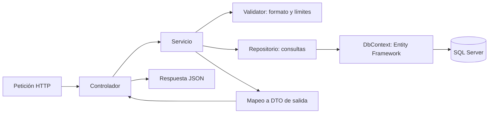

# Librería: Web API de referencia

Aplicación de ejemplo para consultar buenas prácticas de ASP.NET Core. Gestiona libros, editoriales y clientes; calcula cotizaciones y consulta Open Library.

**«Librería» es el dominio del negocio: una tienda de libros.** Este proyecto es una Web API ejecutable; no un paquete NuGet.

Derivada del ejercicio de un profesor. Consulta [origen y atribución](ORIGEN.md). El ejemplo recibido se conserva en `../../project-example/`.

## Empieza aquí

[](../../docs/images/libreria-roadmap-inicio.png)

### Orden de lectura

1. **Arranca el proyecto:** sigue el [arranque rápido](#1-arranque-rápido). Crea primero una editorial.
2. **Entiende la preparación:** [Program.cs](Libreria.Api/Program.cs) conecta los componentes; [appsettings.json](Libreria.Api/appsettings.json) aporta la configuración.
3. **Envía una petición:** abre [Libreria.Api.http](Libreria.Api/Libreria.Api.http). `POST /api/libros` combina método, ruta, headers y body.
4. **Sigue la entrada:** [LibrosController.cs](Libreria.Api/Controllers/LibrosController.cs) recibe el [DTO](Libreria.Api/DTOs/LibroDtos.cs) y llama al servicio.
5. **Lee las reglas:** [LibroService.cs](Libreria.Api/Services/LibroService.cs) utiliza el [validator](Libreria.Api/Validators/LibroValidators.cs), comprueba datos existentes y aplica el [mapeo](Libreria.Api/Mappings/LibroMappings.cs).
6. **Sigue el guardado:** [LibroRepository.cs](Libreria.Api/Repositories/LibroRepository.cs) usa [LibreriaDbContext.cs](Libreria.Api/Data/LibreriaDbContext.cs) para guardar la [entidad Libro](Libreria.Api/Models/Libro.cs) en SQL Server.
7. **Observa la vuelta:** el servicio devuelve un DTO; el controlador responde `201 Created`, JSON y `Location`.

**Distingue los momentos:** `Program.cs` configura la aplicación al arrancar. El recorrido controlador → servicio → repositorio ocurre al atender la petición.

## 1. Arranque rápido

Requisitos:

- SDK de .NET 10 actualizado.
- SQL Server. En Windows puedes usar SQL Server Express LocalDB.
- Visual Studio con soporte para .NET 10, o un editor y la terminal.

Desde la raíz del repositorio:

```powershell
cd project/Libreria
dotnet restore
dotnet tool restore
dotnet ef database update --project Libreria.Api --startup-project Libreria.Api
dotnet run --project Libreria.Api --launch-profile http
```

- Swagger: `http://localhost:5210/swagger`.
- Solicitudes preparadas: [Libreria.Api.http](Libreria.Api/Libreria.Api.http). Ejecuta sus bloques de uno en uno.
- Solución para Visual Studio: [Libreria.sln](Libreria.sln).
- No hay datos iniciales: crea primero una editorial y después un libro.
- `database update` crea **LibreriaCurso** y aplica su migración inicial. No utiliza la base `Store` del ejercicio original.
- Iniciar la API no crea ni modifica el esquema: aplica las migraciones expresamente.

### Conexión y configuración

[appsettings.json](Libreria.Api/appsettings.json) contiene una conexión local de ejemplo, sin contraseñas:

```text
Server=(localdb)\MSSQLLocalDB;Database=LibreriaCurso;Trusted_Connection=True;TrustServerCertificate=True
```

- Usa LocalDB solo en Windows y desarrollo. Para otra instancia, cambia `Server`.
- `Trusted_Connection=True` usa tu identidad de Windows.
- `TrustServerCertificate=True` facilita la conexión local. En producción configura un certificado válido y usa `False`.
- No guardes contraseñas en Git. Para otra conexión puedes sobrescribir la configuración mediante una variable de entorno:

```powershell
$env:ConnectionStrings__Libreria = "Server=localhost;Database=LibreriaCurso;Integrated Security=True;Encrypt=True;TrustServerCertificate=True"
```

Las variables de entorno prevalecen sobre `appsettings.json`. `appsettings.Development.json` ajusta el registro de consultas SQL en desarrollo.

## 2. Dónde buscar cada cosa

| Carpeta o archivo | Responsabilidad | Pregunta que resuelve |
|---|---|---|
| `Program.cs` | Arranque, configuración, DI y rutas | ¿Quién crea y conecta los componentes? |
| `Controllers/` | Entrada HTTP y respuesta HTTP | ¿Qué URL y método debo llamar? |
| `DTOs/` | Datos de entrada y salida | ¿Qué campos acepta o devuelve la API? |
| `Validators/` | Validación del contenido | ¿Faltan campos? ¿El precio es válido? |
| `Services/` | Reglas y coordinación | ¿Existe la editorial? ¿Se repite el ISBN? |
| `Repositories/` | Consultas y escrituras | ¿Cómo se busca o guarda en SQL Server? |
| `Models/` | Entidades persistidas | ¿Qué datos representa cada tabla? |
| `Mappings/` | Copia explícita entre DTO y entidad | ¿Qué campos se permiten modificar? |
| `Data/` | DbContext, índices y relaciones | ¿Cómo se configura la base de datos? |
| `Migrations/` | Historial del esquema | ¿Qué tablas e índices se crean? |
| `Infrastructure/` | Errores comunes de la API | ¿Cómo se convierte un error en HTTP? |
| `Examples/` | Ejemplos aislados de DI, HTTP y asincronía | ¿Cómo funciona cada mecanismo? |

Las capas son carpetas de un mismo proyecto para facilitar la lectura. Las interfaces permiten cambiar implementaciones; no separan ensamblados por sí solas.



### Qué hace cada capa

- **Controlador:** recibe el DTO; delega; devuelve `200`, `201` o `204`.
- **Validator:** comprueba títulos, precios, correos e ISBN. No consulta la BD.
- **Servicio:** valida; comprueba reglas que requieren datos; coordina el guardado.
- **Repositorio:** compone las consultas y llama a EF. No decide códigos HTTP.
- **DbContext:** sigue los cambios; `SaveChangesAsync` ejecuta la escritura.
- **Mapeo:** copia campos permitidos. El cliente no puede cambiar `Id` enviándolo en un DTO.

Los servicios lanzan errores propios; [ApiExceptionHandler](Libreria.Api/Infrastructure/ApiExceptionHandler.cs) los convierte en respuestas HTTP uniformes.

## 3. Ejemplo completo: dar de alta un libro

1. Crea una editorial con `POST /api/editoriales`; conserva su `id`.
2. Envía `POST /api/libros` con `Content-Type: application/json` y este cuerpo, sustituyendo `editorialId`:

```json
{ "titulo": "Fantastic Mr. Fox", "isbn": "9780140328721", "precio": 12.50, "editorialId": 1 }
```

3. Recorre estos archivos:

| Paso | Archivo | Qué ocurre |
|---|---|---|
| 1 | [LibrosController](Libreria.Api/Controllers/LibrosController.cs) | `[FromBody]` convierte el JSON en un DTO y llama al servicio. |
| 2 | [LibroCrearDto](Libreria.Api/DTOs/LibroDtos.cs) | Declara solo los campos que se pueden enviar. |
| 3 | [LibroCrearValidator](Libreria.Api/Validators/LibroValidators.cs) | Exige título, ISBN-13 válido, precio positivo y editorial positiva. |
| 4 | [LibroService](Libreria.Api/Services/LibroService.cs) | Comprueba que la editorial existe y que el ISBN no está usado. |
| 5 | [LibroMappings](Libreria.Api/Mappings/LibroMappings.cs) | Copia los campos del DTO a una entidad nueva. |
| 6 | [LibroRepository](Libreria.Api/Repositories/LibroRepository.cs) | `Add` prepara el alta; `SaveChangesAsync` envía el INSERT. |
| 7 | [LibreriaDbContext](Libreria.Api/Data/LibreriaDbContext.cs) | Define tabla, identidad, relación e índice único. |
| 8 | Controlador | Devuelve `201`, el DTO creado y `Location: .../api/Libros/{id}`. |

`CreatedAtAction(nameof(Obtener), new { id = creado.Id }, creado)` construye la URL de consulta. No ejecuta el método `Obtener`.

### Qué cambia al editar

- `PUT /api/libros/1`: el identificador llega por ruta; el cuerpo contiene los campos editables completos.
- El repositorio obtiene la entidad con seguimiento de EF.
- El mapeo modifica ese mismo objeto, incluido `EditorialId`.
- `SaveChangesAsync` detecta los cambios y ejecuta el UPDATE.
- `Id` nunca se copia desde el cuerpo. Se evita la discrepancia entre identificadores de URL y JSON.

## 4. Endpoints

| Método | Ruta | Resultado normal |
|---|---|---|
| GET | `/api/libros?texto=Fantastic&pagina=1&tamano=25` | `200`: elementos, total, página y tamaño |
| GET | `/api/libros/{id}` | `200`: libro |
| POST | `/api/libros` | `201` + `Location` |
| PUT | `/api/libros/{id}` | `200`: libro actualizado |
| DELETE | `/api/libros/{id}` | `204` |
| GET | `/api/editoriales` | `200`: primeras 100 editoriales, ordenadas por Id |
| GET | `/api/editoriales/{id}` | `200`: editorial |
| POST | `/api/editoriales` | `201` + `Location` |
| PUT | `/api/editoriales/{id}` | `200`: editorial actualizada |
| DELETE | `/api/editoriales/{id}` | `204`, si no tiene libros |
| GET | `/api/clientes?nombre=Lucia` | `200`: primeros 100 clientes coincidentes, ordenados por Id |
| GET | `/api/clientes/{id}` | `200`: cliente |
| POST | `/api/clientes` | `201` + `Location` |
| POST | `/api/cotizaciones` | `200`: subtotal, descuento e importe total |
| GET | `/api/catalogo-externo/{isbn}` | `200`: datos de Open Library |

- Los nombres de métodos C# son internos. Las URL proceden de `[Route]` y `[HttpGet]`, etc.
- Libros: página `1..1000000`, tamaño `1..100`; sin coincidencias devuelve una colección vacía.
- Editoriales y clientes limitan resultados a 100; no implementan paginación en este ejemplo.
- Clientes: solo alta y consulta; no hay endpoints de actualización o borrado.
- El ISBN admite 13 dígitos sin guiones, prefijo 978/979 y dígito de control correcto.
- El correo se guarda sin espacios exteriores y en minúsculas para comparar duplicados.
- No se permite borrar una editorial con libros. El servicio lo comprueba y la FK también lo protege.

### Errores

| Código | Cuándo |
|---|---|
| `400` | JSON inválido, validación fallida, paginación inválida o editorial inexistente |
| `404` | Libro, editorial, cliente o ISBN externo no encontrado |
| `409` | ISBN/correo duplicado o conflicto de relación al guardar/borrar |
| `502` | Fallo HTTP o respuesta inválida del catálogo externo |
| `504` | El catálogo externo supera su tiempo de espera |
| `500` | Error inesperado, como conexión SQL no disponible |

Las validaciones devuelven `application/problem+json` con un diccionario `errors`. Los fallos inesperados no exponen detalles internos.

```json
{ "title": "Revisa los datos enviados.", "status": 400, "errors": { "Precio": ["El precio debe ser mayor que cero."] } }
```

Los índices únicos evitan duplicados aunque lleguen dos peticiones simultáneas. La comprobación previa del servicio mejora el mensaje, pero la BD sigue siendo la garantía final.

## 5. Inyección de dependencias

Los constructores solicitan interfaces. [Program.cs](Libreria.Api/Program.cs) registra las implementaciones:

```csharp
builder.Services.AddScoped<ILibroService, LibroService>();
builder.Services.AddScoped<ILibroRepository, LibroRepository>();
builder.Services.AddDbContext<LibreriaDbContext>(options => options.UseSqlServer(conexion));
```

- `Scoped`: una instancia por petición. Los repositorios comparten el contexto de esa petición.
- `Transient`: instancia nueva en cada resolución. El cliente HTTP tipado usa este registro.
- `Singleton`: una instancia durante la aplicación. La caché en memoria se comparte.
- `DbContext` no admite uso concurrente. Las consultas del servicio se esperan consecutivamente.
- Los datos de negocio se guardan en SQL Server. No hay listas estáticas compartidas.

## 6. Consumo de Open Library

[CatalogoExternoService](Libreria.Api/Services/CatalogoExternoService.cs) usa un `HttpClient` tipado registrado mediante `AddHttpClient`.

- Dirección y timeout en `OpenLibrary` dentro de `appsettings.json`.
- La URL relativa `api/books?...` se combina con `https://openlibrary.org/`.
- El ISBN llega por ruta; los datos remotos se convierten a DTOs.
- Cada respuesta correcta se guarda cinco minutos en la caché de este proceso.
- Timeout, JSON inválido y fallos de red tienen respuestas controladas.
- La cancelación del cliente se transmite a la petición saliente.
- Consultar no inserta libros en nuestra base de datos.
- Este endpoint requiere Internet y depende de la disponibilidad y datos del proveedor.

Referencia: [API Books de Open Library](https://openlibrary.org/dev/docs/api/books).

## 7. Ejemplos para estudiar

Las rutas `api/ejemplos/*` y Swagger solo se habilitan en **Development**. En otro entorno las rutas de ejemplo no existen.

| Ruta GET | Qué observar |
|---|---|
| `/api/ejemplos/di` | Dos objetos transient diferentes; scoped iguales en una petición; singleton iguales entre peticiones. |
| `/api/ejemplos/di/nombre?nombre=Ana` | Dos implementaciones del mismo contrato, elegidas con claves. |
| `/api/ejemplos/esperas/sincrona` | `Thread.Sleep`: bloquea el hilo durante 500 ms. |
| `/api/ejemplos/esperas/asincrona` | `await Task.Delay`: espera 500 ms sin mantener ocupado el hilo. |
| `/api/ejemplos/esperas/concurrente` | Dos esperas simultáneas mediante `Task.WhenAll`. |

El POST `/api/ejemplos/http` muestra cómo combinar un header y un body. Los temporizadores representan esperas; no son consultas reales ni una medición de rendimiento.

En [CotizacionService](Libreria.Api/Services/CotizacionService.cs), el cálculo es una función pura: no consulta BD ni modifica estado externo. Recibe datos y devuelve un resultado.

## 8. Entity Framework y migraciones

La migración inicial crea `Editoriales`, `Libros`, `Clientes`, índices únicos y la relación libro-editorial. Se conserva el snapshot del modelo para calcular futuras diferencias.

Para cambiar el esquema:

```powershell
# 1. Modifica la entidad y/o su configuración en LibreriaDbContext.
dotnet ef migrations add DescribirElCambio --project Libreria.Api --startup-project Libreria.Api
# 2. Revisa Up y Down antes de aplicar.
dotnet ef database update --project Libreria.Api --startup-project Libreria.Api
```

- Equivalentes en la consola de paquetes de Visual Studio: `Add-Migration DescribirElCambio` y `Update-Database`; selecciona `Libreria.Api` como proyecto predeterminado y de inicio.
- Las migraciones se versionan. `bin/`, `obj/`, `.vs/` y archivos `*.user` se ignoran.
- [esquema-inicial.sql](esquema-inicial.sql) permite consultar el SQL generado; usa `database update` para el arranque habitual.
- Para regenerar el script después de modificar migraciones:

```powershell
dotnet ef migrations script --project Libreria.Api --startup-project Libreria.Api --output esquema-inicial.sql
```

`AsNoTracking` evita guardar información de seguimiento en lecturas. Las búsquedas usan `IQueryable`: EF traduce filtros, orden y límites a SQL antes de materializar con `ToListAsync`.

## 9. Decisiones y límites

- Mapeo manual para seguir cada asignación. No se instala AutoMapper en esta adaptación.
- Repositorios específicos para practicar capas. EF ya ofrece abstracciones de acceso y seguimiento; añadir repositorios no es obligatorio en todos los proyectos.
- Solo se implementan las operaciones indicadas en la tabla; no hay pedidos, stock ni cobros.
- La cotización calcula el importe a partir del precio enviado: no sustituye un proceso de venta.
- Sin autenticación ni autorización. Es una referencia de aprendizaje local.
- Actualizaciones sin control de versión: si dos usuarios editan el mismo libro, puede prevalecer la última escritura.
- El original mantiene sus propios paquetes y configuración; esta adaptación no lo actualiza.
- El paquete `System.Security.Cryptography.Pkcs` se fija en 10.0.13 para corregir la versión transitiva de SqlClient. [Aviso oficial](https://github.com/advisories/GHSA-846f-f764-76mx).

### Comprobaciones manuales

Resultados de la ejecución: [VERIFICACION.md](VERIFICACION.md).

Con SQL Server preparado, utiliza el archivo `.http` para:

1. Crear dos editoriales y un libro; consultar la URL devuelta en `Location`.
2. Editar el libro y cambiar su editorial; verificar el nuevo valor mediante GET.
3. Enviar precio cero o ISBN incorrecto → `400` con `errors`.
4. Repetir un ISBN o correo → `409`.
5. Consultar un Id inexistente → `404`.
6. Borrar una editorial que tenga libros → `409`.
7. Borrar el libro y después la editorial → `204`.
8. Consultar Open Library y comparar los identificadores del ejemplo DI en dos peticiones.
